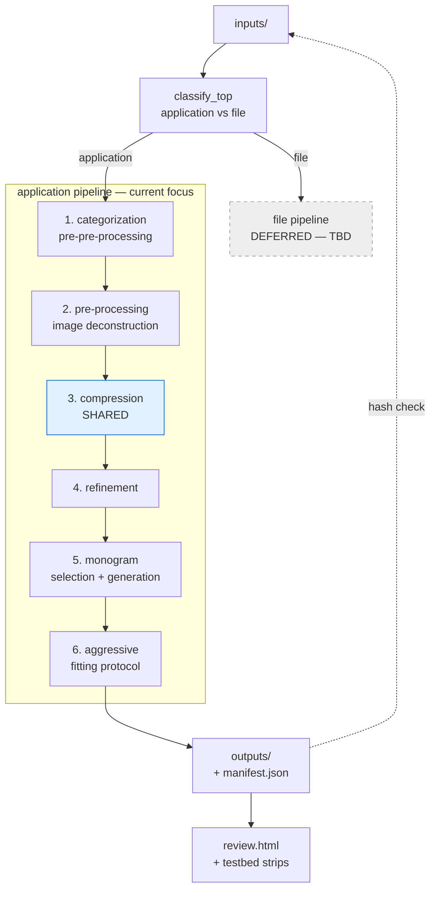

# iconograph-algorithm

## Project overview

iconograph-algorithm produces Fedora hicolor icon sets — abstract pixelated logo + monogram per source. Built on Python + OpenCV + scikit-image. Invoked as a CLI that batches over `inputs/logo-markings/` and is idempotent across reruns. Architecture splits at the top by icon class (application vs file): the application pipeline — current focus — is a six-stage sequence with sub-case branching inside applicable stages, converging at shared compression. The file pipeline is deferred until the application pipeline is shipping clean outputs.

## Pipeline at a glance



The first split is **icon class** — application vs file. The two pipelines diverge enough to be developed independently and sequentially: application first, file deferred. Inside the application pipeline, stages 1 → 6 run in order; sub-case branching (standard, inverted, burst, …) lives *within* applicable stages, most heavily 2, 4, and 5. Stage 3 (compression) is the lone branch-agnostic shared stage. Growth proceeds **breadth-first by stage** per H3.

## Coding heuristics

- **H1 — Ground truth before tuning.** Before any algorithm parameter is changed, the affected fixtures must already have a "current output" rendered alongside the source in `review.html` (or a `testbed/` comparison strip for in-development stages). No knob turns without a visible before/after. If a stage has no reference output to compare against, the work is "render the current output," not "tune the stage."

- **H2 — Library-first, hand-rolled never.** Color quantization → `sklearn.cluster.KMeans` or `skimage.color`. Edges / contours / connected components / morphology → `cv2`. Resize and dithering → `Pillow` or `cv2.resize` with explicit interpolation. Glyph rendering → `Pillow.ImageDraw` + freetype. If a Python `for` loop is iterating over pixels, stop and search the library first. Comment the library function only when the choice is non-obvious.

- **H3 — Tree-structured pipeline, grown by phase.** The pipeline is a decision tree. Sub-cases (standard, inverted, burst-pattern, ...) become branches; branches converge at shared stages (classify, compress, compose). Within a phase, grow a branch linearly down to the phase threshold. Then move to the next phase across all current branches before opening new branches. Concretely: don't start compression work for class A until pre-processing exists for the classes already in fixtures; don't add a new pre-processing branch for a new class until the current phase across known classes is broadly stable. Backtracking is allowed and expected — but it's a deliberate step, not drift.

- **H4 — One file, one responsibility.** Each stage-step is a small `.py` file exporting a small set of functions focused on one thing. Branches are directories: `src/iconograph/application/preprocess/<class>.py`, `src/iconograph/application/monogram/<class>.py`. Shared helpers live in `<stage>/common.py`. Cross-module wiring is plain function calls and imports — **no plugin registries, no stage base classes, no DI containers.** The branching is in the directory layout, not in a runtime framework.

- **H5 — Reuse across branches; do not re-solve.** Before writing a new function in any branch, grep the sibling branches and the stage's `common.py` for a function that already handles the same primitive. If a near-duplicate exists, lift it to `common.py` and import from both branches. The cost of one refactor beats N divergent copies. A new branch's first commit should mostly be imports and a thin class-specific glue layer.

- **H6 — Cache the previous stage; develop the next stage against the cache.** Each fixture's intermediate output is written to `.cache/stages/<fixture>/<stage>/` after a stage produces it. When developing the next stage, load from cache instead of re-running upstream. The testbed CLI drives this: pick a stage, load the cached previous-stage outputs for the fixture set, run the new stage, emit a comparison strip.

- **H7 — Comparison strips during development, single best image after acceptance.** A stage under development emits a `testbed/<stage>/<fixture>.png` showing `previous-stage | new-stage | ideal` side-by-side. When multiple methodologies are being weighed, render them in the same strip: `previous | methodA | methodB | methodC | ideal`. For crucial steps where the methodology has internal stages worth showing, depict the intermediate steps too. Once a methodology is accepted, delete the losing variants' artifacts and the strip collapses to the single best result. `testbed/` is never allowed to accumulate dead variants — clutter there is a code-review smell.

- **H8 — Determinism + skip-don't-rebuild.** Seed every randomized step (`KMeans(random_state=...)`, etc.) so reruns on unchanged inputs are byte-identical. The batch CLI hashes each input against `manifest.json` and only reprocesses new or changed entries. `--force` exists but is never the default of any subcommand.

- **H9 — A diverse fixture dataset is part of the project, not setup.** Maintain ≥20 application logos in `fixtures/`, deliberately chosen to cover the sub-case space (standard, inverted, burst-pattern, monogram-only, wordmark-with-icon, gradient-heavy, single-color flat, etc.). Five seed logos are **non-negotiable** and must be present from Phase 0 onward: **Discord, Gmail, YouTube Music, Claude, Microsoft Edge**. New logo encounters that don't fit an existing branch are added to the dataset *first*, then drive the work in H3's "recurrence" path. Every accepted heuristic / methodology change must hold across the full dataset, not just the logo that motivated it — single-fixture wins are over-fits. `fixtures/README.md` records each logo's sub-case label and the rationale for its inclusion so the dataset's coverage is auditable at a glance.

- **H10 — Learning-mode presentation; user writes the code.** This project is also a vehicle for the user to gain hands-on image-processing experience. Default behavior for any prompt asking the assistant to *implement* a pipeline primitive (stage function, helper, refactor inside `src/iconograph/`): the assistant produces a **Recipe + Library Reference** brief — *not* full Python. The user writes the actual code from the brief. The brief is concept-first, library-aware, and treats the API surface as something the user is actively learning.

  **Format (mandatory shape).** Use the labeled sections below, in order; omit a section only if it is genuinely irrelevant to the primitive.

  ```
  TASK: <name + one-line description>

  WHAT IT'S DOING (concept):
  <2-4 sentences — geometric / mathematical intuition; what the
  algorithm optimizes; how to mentally model the operation>

  WHY <relevant choice>:
  <2-3 sentences — algorithmic or color-space justification the
  implementer needs in order to understand a non-obvious step>

  LIBRARIES (preferred → fallback):
    <lib.fn>   — <one-line note on why preferred>
    <lib.fn>   — <alternative; when better/worse>

  API (relevant subset only):
    <signature with key parameters>
      <relevant attribute>   <shape/type> — <role>

  COLOR SPACE / RELATED CONVERSIONS (optional):
    <skimage.color or similar utility with dtype / range notes>

  STEPS (procedural):
    1. <action>
       <library call with key params>
    2. <action>
       <library call with key params>

  GOTCHAS:
    - <determinism / dtype / range / edge-case note>
    - <project-specific pitfall referencing other heuristics where relevant>
  ```

  **Output destination — file docstring, not chat.** The brief is written **into the target python file's module-level docstring** (top of file), replacing the existing one-line bootstrap docstring. It is **not** returned as a chat response. The user opens the file, reads the brief, and writes the function body below it. Each stage function's brief lives in its own file — co-located with the code it teaches. The assistant's chat reply only confirms what landed (file path + section headers); the brief content itself is in the file. This makes the roadmap version-controllable and readable without re-asking.

  **Override.** A message whose first non-whitespace token is `!fc` (full-code) disables H10 for that prompt only. The assistant produces complete, working Python under H1-H9 directly in the target file. Any pre-existing learning-mode brief docstring is either replaced by a normal docstring or absorbed as inline comments where the conceptual lines aid readability. The next prompt re-enters learning mode unless it also begins with `!fc`. The override is **per-message**, not per-session — a deliberate switch each time.

  **Out of scope for H10.** Explaining existing code, debugging, code review, testbed-strip interpretation, drafting CLAUDE.md / sub-agent prompts / bootstrap scaffolding the user explicitly requests, anything routed through `ruthless-grader` — these are always full responses. H10 governs *implementation prompts only*.

  *Worked example (lives in `src/iconograph/application/compress/quantize.py` as the module docstring):*

  ```
  TASK: Reduce an RGB image to K dominant colors (palette quantization).

  WHAT IT'S DOING (concept):
  Every pixel is a 3D point in color space. Summarize H*W points by K
  "representatives" such that each pixel's nearest rep is close. KMeans
  is the standard answer: iteratively (assign → update) finds K centroids
  minimizing total squared distance from points to their nearest centroid.
  Converges to a *local* minimum (not global) — hence random_state matters
  even on the same input.

  WHY LAB (not RGB):
  RGB Euclidean distance ≠ perceived color difference. Lab is designed so
  equal distance ≈ equal perceived change. Cluster in Lab → perceptually
  better palettes; in RGB the centroids drift toward bright primaries
  because primaries are far apart in RGB but not perceptually farther
  than mid-tones.

  LIBRARIES (preferred → fallback):
    sklearn.cluster.KMeans    — full control; deterministic via
                                random_state; ~ms for 1024×1024
    PIL.Image.quantize        — built-in median-cut (recursively splits
                                color box at median); faster, less control
    scipy.cluster.vq.kmeans2  — alternative; rarely needed here

  API (relevant subset):
    KMeans(n_clusters, random_state, n_init=10)
      .fit(X)              X shape (N, D)
      .cluster_centers_    shape (n_clusters, D) — the palette
      .labels_             shape (N,) — cluster index per point

  COLOR SPACE:
    skimage.color.rgb2lab(rgb)   # uint8 [0,255] or float [0,1] → Lab
    skimage.color.lab2rgb(lab)   # Lab → float [0,1]

  STEPS:
    1. RGB → Lab
       skimage.color.rgb2lab(img)
    2. Flatten (H, W, 3) → (H*W, 3) — KMeans wants 2D point arrays
       numpy: img.reshape(-1, 3)
    3. Cluster (seed mandatory per H8)
       sklearn.cluster.KMeans(n_clusters=K, random_state=SEED).fit(pixels)
    4. Map each pixel to its centroid via fancy indexing
       km.cluster_centers_[km.labels_]
    5. Reshape → Lab → RGB → cast to input dtype

  GOTCHAS:
    - random_state mandatory (H8)
    - lab2rgb returns float [0,1]; multiply by 255 + cast for uint8 output
    - K too small (≤3) → blotchy; K too large (≥32) → defeats the purpose
    - KMeans converges to local minima; n_init=10 (default) mitigates
  ```

- **H11 — Delegate to the sub-agents; don't shortcut them.** Four sub-agents live under `.claude/agents/` (`library-scout`, `branch-primitive-auditor`, `ruthless-grader`, `fixture-collector`). They exist *because* certain checks slow the main session or get skipped under pressure — H11 makes their invocation mandatory at the points where they apply, even when the assistant is "confident" it could do the work itself.

  **When to invoke (deterministic triggers).**

  - **`library-scout`** — before naming any library function in an H10 brief *or* an `!fc` implementation. Trigger: a primitive that requires an OpenCV / scikit-image / scikit-learn / Pillow / numpy call. Output flows into the brief's `LIBRARIES` and `API` sections (or, under `!fc`, into the chosen imports + inline comments).
  - **`branch-primitive-auditor`** — before drafting a new function for a stage sub-case branch. Trigger: a primitive targeting a `*.py` file inside a directory that also contains `common.py` + sibling branches (`preprocess/`, `monogram/`, `refine/`). Output decides reuse / lift-to-common / write-new *before* the brief or implementation commits to a specific shape.
  - **`ruthless-grader`** — before declaring a stage methodology "accepted." Trigger: prompts like *"I think this stage is done"*, *"ship this"*, *"ready for stage N+1"*. Output is PASS/FAIL; FAIL blocks acceptance until violations are addressed.
  - **`fixture-collector`** — for any prompt asking to gather / fetch / download / populate `fixtures/`. Triggered by intent words like *fetch*, *gather*, *fill the dataset*, *get the seeds*. Off-loaded immediately so the main session continues unblocked.

  **Hard rules.**

  - **No substitution.** The assistant never replaces an applicable agent with its own judgment, even when confident. The agent's repo grep and accumulated taxonomy supply context the assistant lacks.
  - **Parallelize when independent.** Multiple agents that apply to the same prompt (e.g. `library-scout` + `branch-primitive-auditor` for a new sub-case primitive) are invoked in parallel — a single message with multiple `Agent` tool calls.
  - **Surface what was delegated.** The chat reply names which agents fired and gives a one-sentence summary of each verdict, so the user can audit the trace without opening agent transcripts.

  **Override.** `!fc` (the H10 escape) disables only brief-only output; H11's agent delegation continues to fire under `!fc`. To skip delegation entirely (rare — e.g. a trivial one-line tweak), prefix the prompt with **both** escapes: `!fc !raw`. The pairing is intentional friction — by the time you've typed both, you've confirmed you don't want the guardrails.

  **Out of scope for H11.** Exposition, debugging, reading existing code, testbed-strip interpretation, drafting CLAUDE.md / sub-agent prompts / bootstrap scaffolding, anything not in `src/iconograph/**`. H11 governs *implementation work*, like H10.

## Top-level architecture and pipeline stages

**Top-level split — icon class.** The first decision is **application icon vs file icon**. These paths diverge enough to be separate pipelines, developed sequentially. The application pipeline is built end-to-end across the H9 fixture dataset first; the file pipeline is **deferred — TBD** until the application path is shipping clean outputs.

Phase-0 commitments for the file branch (everything else waits):
- `src/iconograph/file/` exists with `__init__.py` and a `README.md` reading "deferred until the application pipeline ships — see CLAUDE.md §3."
- `classify_top.py` returns `"application"` for every current fixture; anything classified `"file"` routes to an explicit `NotImplementedError` so the boundary is visible in stack traces, not silently absorbed.

**Application pipeline — six stages, run in order.**

Sub-case branching (standard, inverted, burst, monogram-only, …) lives *inside* the stages that need it — most heavily 2, 4, and 5. Each stage owns one directory under `src/iconograph/application/`. Each stage's cached output is the next stage's input (per H6). **Per-stage advance threshold (per H3):** every H9 fixture's output at this stage has been rendered in `review.html` and accepted before the next stage's work begins.

1. **Categorization / pre-pre-processing.** Detects the logo's sub-case (standard, inverted, burst, monogram-only, …) and performs the normalization that has to happen *before* deconstruction — alpha-channel fixup, background detection/removal, canvas trimming, orientation correction. Produces a normalized RGBA image + a sub-case label that downstream stages route on. Branching: shared logic with class-specific *detectors* registered here; this stage is what *creates* the sub-case label.
2. **Pre-processing / image deconstruction.** Decomposes the normalized image into its parts: foreground vs background, primary shape vs accent, text vs glyph, flat-color region vs gradient. What counts as "the abstract" is class-specific — a burst-pattern logo's abstract *is* the burst; an inverted logo's abstract is the white-on-color silhouette. Branching: heavy — one `<class>.py` per sub-case in `application/preprocess/`.
3. **Compression.** The single shared stage. Palette reduction — KMeans over Lab to a small palette — at a **canonical working resolution**. Per-target rasterization (pixelation onto each Fedora hicolor grid) is **deferred to stage 6**, because the scale that drives pixelation is chosen there. One implementation, no class-specific variation — if a branch needs something different here, the heuristic violation is upstream and stage 2 should be revisited to produce an input compression can handle uniformly.
4. **Refinement.** Post-compression cleanup: stray-pixel snapping, isolated-pixel artifact removal, minimum-feature-size enforcement per hicolor target, edge-aware corrections where the pixel grid permits. Branching: light — most logic in `refine/common.py`, with class-specific passes (e.g. radial-symmetry preservation for burst-patterns) only where shared logic visibly fails on a sub-case.
5. **Monogram selection and generation.** Pick the monogram glyph (extracted letter, embedded mark, or filename-derived fallback) and render it at the **canonical working resolution**. Per-target scaling and rasterization are deferred to stage 6. Branching: per-class — inverted logos use a different luminance threshold for letter extraction; monogram-only logos forward their own glyph unchanged; standard logos go through connected-component / OCR letter extraction.
6. **Aggressive fitting protocol.** Inspired by MIT Media Lab's algorithmic identity system. For each Fedora hicolor size (16, 22, 24, 32, 48, 64, 128, 256), search over **(scale, x-offset, y-offset)** to maximize the proportion of the NxN canvas occupied by ink — i.e. fill as much of the final square as possible — subject to: (a) the abstract's tight bounding box is preserved (no foreground clipping), (b) the monogram, when present, meets a minimum legible glyph height for the target, (c) a per-size padding floor so the icon doesn't visually touch the canvas edge. "Aggressive" because the logo is rescaled and repositioned *per output size* rather than rendered at one canonical scale — small sizes can drop the monogram entirely and let the abstract fill the full square; large sizes include both with the abstract sized to dominate. Per-target rasterization happens here, after the scale is chosen (the pixel grid depends on the final scale). Writes the Fedora hicolor tree and updates `manifest.json`.

**Recurrence — new sub-case encountered.** Add `application/preprocess/<newclass>.py` (stage 2), then propagate through stages 4 and 5 as needed. Stages 1, 3, 6 are largely class-agnostic and rarely require changes for a new sub-case. The H9 fixture set must be extended to include the new sub-case before its branch is considered complete.

**Bootstrap (pre-stage-1).** Repo skeleton, `pyproject.toml` (`opencv-python`, `scikit-image`, `numpy`, `Pillow`, `scikit-learn`), package layout from §4, **≥20 fixture logos in `fixtures/` per H9** (Discord, Gmail, YouTube Music, Claude, Microsoft Edge + 15 sub-case-diverse logos) with `fixtures/README.md` labeling each. `inputs/` and `outputs/` committed with `.gitkeep`. The `file/` stub directory and `classify_top.py` are present. Threshold: `python -m iconograph --help` runs **and** the fixture dataset is at n ≥ 20 with each entry labeled.

## Repository layout (target)

```
src/iconograph/
    __init__.py
    __main__.py            # CLI entrypoint
    pipeline.py            # top-level dispatch: application vs file
    classify_top.py        # icon-class detector (application | file)
    manifest.py            # hash + skip (shared across pipelines)
    review.py              # review.html generator
    testbed.py             # cached-stage runner + comparison strip emitter
    application/           # application-icon pipeline (current focus)
        __init__.py
        pipeline.py        # stage 1 → 6 orchestrator
        categorize.py      # stage 1: sub-case detection + pre-pre-processing
        preprocess/        # stage 2: image deconstruction (per-class)
            common.py
            standard.py
            inverted.py
            burst.py
        compress/          # stage 3: SHARED — palette reduction
            quantize.py
        refine/            # stage 4: post-compression cleanup
            common.py
            burst.py       # only where class-specific refinement is needed
        monogram/          # stage 5: selection + generation (per-class)
            common.py
            standard.py
            inverted.py
        fit/               # stage 6: aggressive fitting protocol
            common.py
            search.py      # (scale, x-offset, y-offset) fill-maximization
            compose.py     # abstract + monogram → hicolor tree
    file/                  # DEFERRED — TBD per CLAUDE.md §3
        __init__.py
        README.md          # "deferred until application pipeline ships"
fixtures/                  # ≥20 reference logos spanning sub-cases (per H9)
    README.md              #   per-logo sub-case label + inclusion rationale
inputs/logo-markings/      # user-provided, gitignored
outputs/                   # generated, gitignored
.cache/stages/             # per-fixture intermediate outputs (per H6)
testbed/                   # comparison strips for in-development stages (per H7)
review.html                # generated, gitignored
```

## Commands (the contract the stages build toward)

- `python -m iconograph build` — batch over `inputs/logo-markings/`, skip unchanged
- `python -m iconograph build --force` — reprocess everything
- `python -m iconograph build --only "<glob>"` — reprocess matching inputs
- `python -m iconograph review` — regenerate `review.html`
- `python -m iconograph testbed <stage> <branch>` — run an in-development stage against cached previous-stage outputs; write a comparison strip to `testbed/<stage>-<branch>/`
- `python -m iconograph testbed <stage> <branch> --compare <variantA> <variantB> [...]` — render multiple proposed methodologies side-by-side in the same strip (per H7)
