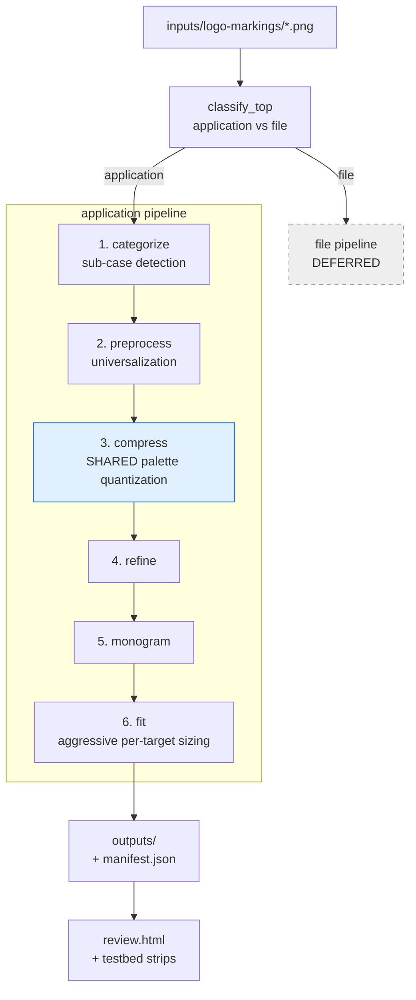
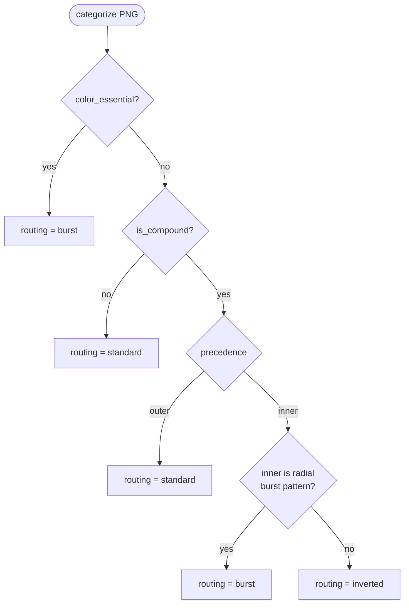

# iconograph-algorithm

A pipeline that decomposes application logos into a pixelated "abstract" +
monogram and ships them as a Fedora hicolor icon set. The architectural
inspiration is MIT Media Lab's algorithmic identity system: per-target
rescaling and recomposition instead of one canonical bitmap squeezed onto
every grid. Built on Python + OpenCV + scikit-image + scikit-learn + Pillow.

## Pipeline at a glance



## Pipeline stages

This README documents each stage's **interface** — input contract, output
contract, decision logic, invocation. Algorithm internals live in
`src/iconograph/**`; downstream stages should plan against this README, not
against upstream source (per CLAUDE.md H6 — "applies to LLM context too").

### Stage 1 — categorize (sub-case detection)

**Status:** complete. 25/25 fixtures match ground truth on
`python -m iconograph testbed categorize`.

**Input contract**

- `path: pathlib.Path` pointing at a PNG (any mode — `_load_rgba` handles
  RGB, RGBA, indexed-with-tRNS uniformly via `Pillow.Image.convert("RGBA")`).

**Output contract**

Returns a frozen `Categorization` dataclass with these fields:

| Field             | Type                              | Meaning                                                                                                |
|-------------------|-----------------------------------|--------------------------------------------------------------------------------------------------------|
| `routing`         | `"standard" \| "inverted" \| "burst"` | Which Stage 2 branch the dispatcher will call.                                                          |
| `color_essential` | `bool`                            | Chrome/Firefox signature — small central element inside multi-hue surround. When `True`, routing is always `"burst"`. |
| `is_compound`     | `bool`                            | Envelope + inner-glyph composition (Telegram disc+plane, Claude square+sunburst).                       |
| `precedence`      | `"outer" \| "inner" \| None`        | For compound logos: which sub-element wins. `None` for non-compound.                                    |
| `envelope_mask`   | `(H, W) bool \| None`              | Outer boundary mask when compound; `None` otherwise.                                                    |
| `inner_mask`      | `(H, W) bool \| None`              | Inner glyph/hole mask when compound; `None` otherwise.                                                  |

**Decision tree (routing)**



The post-strip-recategorize check (`psr` node) re-runs after Stage 2 would
strip the envelope: if the revealed inner is a sunburst (Claude), the final
routing is `burst`, not `inverted`. The check uses polygon-vertex count
≥ 20 *and* radial-profile coefficient-of-variation ≥ 0.20 together — either
signal alone misfires.

**Routing distribution across the 25 fixtures**

```
standard  = 15   discord, gmail, whatsapp, slack, figma, android-head_flat,
                 vscode, mastodon, obsidian, apple-rainbow, docker-mark-black,
                 homebrew, react, microsoft-edge, youtube
inverted  =  7   adobe-illustrator, instagram, linkedin, signal, spotify,
                 telegram, youtube-music
burst     =  3   claude, chrome, firefox
```

**Invocation (Python)**

```python
from pathlib import Path
from iconograph.application.categorize import categorize, load_rgba

cat = categorize(Path("fixtures/claude.png"))
# cat.routing == "burst"
# cat.is_compound == True
# cat.precedence == "inner"

rgba = load_rgba(Path("fixtures/claude.png"))   # canonical RGBA loader
# returns (H, W, 4) uint8 cropped to non-transparent bbox
```

**Invocation (testbed)**

```
python -m iconograph testbed categorize
```

Emits `testbed/categorize/grid.png` (3×3 routing confusion matrix +
per-fixture chips + check/cross). Exit code 0 iff every fixture matches
the ground truth in `fixtures/README.md`.

### Stage 2 — preprocess (universalization)

**Status:** complete. 25/25 fixtures pass the contract check on
`python -m iconograph testbed preprocess`.

Stage 2 takes `(Categorization, RGBA)` and dispatches to one of three
branches: `standard.universalize`, `inverted.universalize`, or the
three-phase `color_essential` pipeline (shade-collapse → frame →
feature-separate → compose). All branches converge at `frame_with_margin`,
producing a `(S, S, 3) uint8` square RGB image on white with a 10% margin
around the content's tight bounding box. Burst logos (Claude) fold into the
standard branch at Stage 2 because the mask-selection primitive is
identical to any inner-precedence compound; the burst identity flows
downstream via `cat.routing` for stages 4 and 5 to re-diverge on.

### Stage 3 — compress (palette quantization)

**Status:** not yet implemented.

Single shared stage. KMeans clustering in Lab color space over the Stage 2
output at canonical working resolution, with `k` chosen based on
`cat.color_essential` (higher k for Chrome/Firefox, k=2 for the rest).
Per-target rasterization onto Fedora hicolor grids is **deferred to
Stage 6**, where the per-size scale is chosen.

### Stage 4 — refine

**Status:** not yet implemented.

Post-quantization cleanup: stray-pixel snapping, isolated-pixel artifact
removal, minimum-feature-size enforcement per hicolor target, edge-aware
corrections. Mostly shared logic in `refine/common.py`; class-specific
passes (e.g. radial-symmetry preservation for burst) only where shared
logic visibly fails on a sub-case.

### Stage 5 — monogram (selection + generation)

**Status:** not yet implemented.

Pick the monogram glyph (extracted letter, embedded mark, or
filename-derived fallback) and render it at canonical working resolution.
Per-class: `inverted` uses a different luminance threshold for letter
extraction; `monogram-only` logos forward their own glyph unchanged;
`standard` logos go through connected-component / OCR letter extraction.

### Stage 6 — fit (aggressive per-target sizing)

**Status:** not yet implemented.

For each Fedora hicolor size (16, 22, 24, 32, 48, 64, 128, 256), search
over `(scale, x-offset, y-offset)` to maximize the proportion of the N×N
canvas occupied by ink, subject to: tight bounding-box preservation,
minimum legible monogram glyph height per target, and a per-size padding
floor. Per-target rasterization happens here. Writes the Fedora hicolor
tree + updates `manifest.json`.

## File-icon pipeline

**Deferred** until the application pipeline ships. `src/iconograph/file/`
is a stub directory; `src/iconograph/classify_top.py` routes every
current fixture to `"application"` and raises `NotImplementedError` for
`"file"` so the unimplemented boundary surfaces in stack traces rather
than being silently absorbed.

## CLI

```
python -m iconograph build                  # batch over inputs/logo-markings/, skip unchanged
python -m iconograph build --force          # reprocess everything
python -m iconograph build --only "<glob>"  # reprocess matching inputs
python -m iconograph review                 # regenerate review.html
python -m iconograph testbed <stage>        # in-development stage runner
```

Currently wired testbed stages: `categorize`, `preprocess`. Others return
`not implemented` until their stage lands.

## Repository layout

```
src/iconograph/
    __main__.py            CLI entrypoint
    pipeline.py            top-level dispatch (application vs file)
    classify_top.py        icon-class detector
    manifest.py            hash + skip-don't-rebuild (per H8)
    review.py              review.html generator
    testbed.py             cached-stage runner + comparison-strip emitter
    application/
        pipeline.py        stage 1 → 6 orchestrator
        categorize.py      Stage 1
        preprocess/        Stage 2 — standard.py, inverted.py, color_essential.py, common.py
        compress/          Stage 3 — quantize.py (shared)
        refine/            Stage 4 — common.py, burst.py
        monogram/          Stage 5 — standard.py, inverted.py, common.py
        fit/               Stage 6 — search.py, compose.py, common.py
    file/                  DEFERRED
fixtures/                  ≥20 reference logos spanning sub-cases (per H9)
inputs/logo-markings/      user-provided, gitignored
outputs/                   generated, gitignored
.cache/stages/             per-fixture intermediate outputs (per H6), gitignored
testbed/                   in-development comparison strips (per H7), gitignored
```
