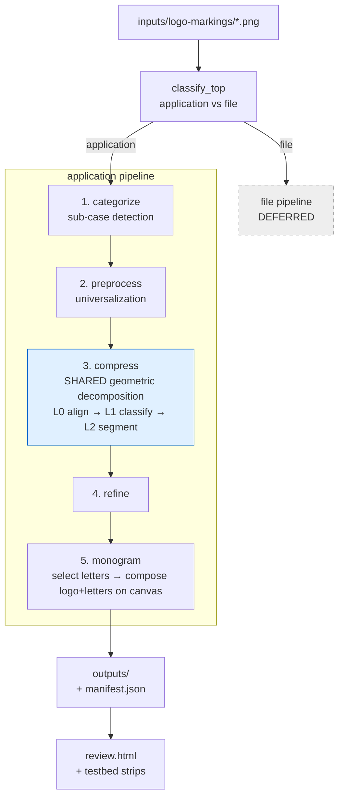

# iconograph-algorithm

A pipeline that decomposes application logos into a pixelated "abstract" +
monogram and ships them as a Fedora hicolor icon set. The architectural
inspiration is MIT Media Lab's algorithmic identity system: per-target
rescaling and recomposition instead of one canonical bitmap squeezed onto
every grid. Built on Python + OpenCV + scikit-image + scikit-learn + Pillow.

## Pipeline at a glance



## Current status & pressing issues

_Last full-set verification: 30/30 fixtures, 15-core run (`ICONOGRAPH_JOBS` caps workers;
default leaves one core free)._

**Built / verified**
- **Stages 1–2 complete** (categorize, preprocess) and **stage-3 upstream** (L0 align, L1
  classify, L2 segment) — all pass their contract checks across the fixture set.
- **Stage 5 — monogram is the CURRENT active work** (in per-fixture tuning): select → full A–Z
  **RECTILINEAR** frame-letters → compose (3-layout) → phase-5 snake connect; all **30 fixtures**
  processed (`--all`, every gate passes). See §"Stage 5 — monogram" for the open tuning items.
- **Stage 3 — compress** is the deepest stage: the D1–D3 contour decomposer
  + the R1 render tier. **Full n=30 set verified:** decompose **30/30** scored, mean area
  **0.963** / boundary **0.804**, 59/60 features adequate (baseline, no regression); R1
  **renders 30/30 without crash** (microsoft-edge / react / youtube fully clean; the rest carry
  honest per-cell feasibility flags — see issue 1).
- **Stage 3 — R1 feed-resolution render (the CUBIFY rework, CURRENT for T ≤ 24; branch
  `render-cubify`):** at the shipping sizes (`HICOLOR_SIZES = (16, 24)`) the geometry-path
  arbitration is replaced by a **label-cleaner + pixel-cubify** path that REPRESENTS labels
  (circle → square, annulus → square ring) rather than IoU-fitting the round raster. The four
  feed-res critique defects are fixed — adobe coarse triangle, discord axis-blocky (`W_AXIS = 1.5`),
  slack cross-construction divots, figma neck divots. **Seed gate (5 × {16,24}) 10/10 green**;
  extended 10-fixture critique set **18/20** (adobe@16 + slack@16 honest partials); all
  byte-deterministic. Assembly tier: stamp harmonization → divot separation → nested-annuli
  coordination (instagram = two 1px-wall square annuli + the separated dot, user-ratified 3×3
  outline @24) → source-gap bridge (android@24's antennae re-connected; keyed on source-at-S
  connectivity). Full design: R1 §"render rework".
- **Stage 4 — refine:** the **perimeter-outline refine chain is BUILT and validated across the
  full n=30 set** (harness `refine_debug`, not yet pipeline-wired — issue 3). Public entry
  `refine_perimeter`: composite → `unblot_features` → `despeck_artifacts` (isolated-speck
  removal, pre-widen) → `widen_underrepresented` (@16 continuity,
  self-gated; ACTIVE since the tight-wireframe rework) → `deburr_nibs` (aggressive de-jag) →
  `normalize_stroke_width` (2px → 1px / hollow 3px, blot-arbitrated) → `symmetrize_render` (label
  mirror fold, chirality- + `_no_reblot`-guarded) → `perimeter_ring` (internally
  `silhouette_outline`, then `connect_disjoint` plain/pocket-averse → `reopen_channels` →
  `relieve_tight_pockets`, arbitrated on `count_tight_pockets`), emitting a face-connected 1-px
  boundary outline. A deliberately-placed
  assembly accent (`protected=`, instagram's camera dot) is carved out before the chain and restored
  onto the final ring — refine's ref-keyed oracles are blind to it. Gates: **blot 0 on all
  60 cells, tight 35 → 20**. **Deterministic** (full-30 `--twice` = zero MISMATCH, all 4-connected);
  ruthless-grader PASS. The scene-level / rotation passes are built + harness-validated but DORMANT
  in the shipped chain pending per-fixture scope. Per-part size-equalization / de-cave was
  investigated and found infeasible as a post-pass → stage-5 geometry-refinement target (see issue 2).

**Pressing issues** (roughly by priority)
1. **R1 ships the SEEDS green at feed res; the geometry path (T > 24) and the non-seed feed-res
   set don't yet.** The feed-resolution **cubify** path (T ≤ 24 = the shipping sizes) renders the
   5 seeds **10/10** (× {16,24}) and the 10-fixture critique set **18/20** (adobe@16 + slack@16
   honest partials). The legacy **geometry path** (T > 24, synthetic regression only) is **~9/15**,
   and the full n=30 feed-res set was **46/60** at the start of the rework — both still flag
   drops/violations on complex woven/rotated/multi-part marks. These are the renderer honestly
   reporting cells it can't fully satisfy at small T, NOT crashes; per the META-FINDING the
   jag/ref-topo metric also lags the desired separation/blockiness (the strips are the truth), so a
   **gate recalibration** + per-cell polish is the path, not a fix to "failures." See R1 §"render
   rework".
2. **figma per-size polish is feasibility-blocked → DEFERRED to stage 5.** The user-provided
   16×16 ideal and 32px size-consistency cannot be reached in R1: the equal-circles variant is
   rejected by a cascade of feasibility gates (fidelity floor → `[pocket]` anti-globbing →
   `[distinct]` → @16 `global_ok`), and forcing it both fails the target AND regresses the
   reg-group analogue (row_stack@32 win→LOSS). figma is **shippable as-is**; the polish is a
   stage-5 geometry-refinement matter (see R1 round 11). _Distinct from figma's feed-res neck
   fusion at 16/24, which is now **RESOLVED** at render via the cubify neck divots (R1 §"render
   rework", critique fix 4) — this issue 2 is the geometry-path T=32 size-consistency only._
3. **The pipeline is not end-to-end.** `application/pipeline.py` is a stub; the stage-4 refine chain
   (`refine_perimeter`) runs only under the `refine_debug` harness. **Stages 5–6 are unimplemented.**
   `build` does not run end-to-end yet — only the per-stage testbeds work.
4. **R2 / R3 render tiers deferred** (junction overrepresentation, residual layering) — the
   thin-stroke / tiny-grid identity losses (claude@16 spikes, vscode@16 X, mastodon residual)
   live there.
5. **Two fixtures route incompletely** — electron + vue yield no multi-part L2 Features (open
   stage-1/2 routing item; see Stage 1 status). They still render, but aren't fully decomposed.

Per-stage detail + the full round-by-round R1 history are below.

## Pipeline stages

This README documents each stage's **interface** — input contract, output
contract, decision logic, invocation. Algorithm internals live in
`src/iconograph/**`; downstream stages should plan against this README, not
against upstream source (per CLAUDE.md H6 — "applies to LLM context too").

### Stage 1 — categorize (sub-case detection)

**Status:** complete — 25/25 original fixtures match ground truth on
`python -m iconograph testbed categorize`. The 5 later additions (mathematica, electron,
medium-m, vue, reddit-snoo) route with documented caveats (see `fixtures/README.md`):
electron + vue currently yield 0 L2 Features downstream (an open stage-1/2 routing item,
parked), and the new rows' flag columns are estimates.

**Input contract**

- `path: pathlib.Path` pointing at a PNG (any mode — `_load_rgba` handles
  RGB, RGBA, indexed-with-tRNS uniformly via `Pillow.Image.convert("RGBA")`).

**Output contract**

Returns a frozen `Categorization` dataclass with these fields:

| Field             | Type                              | Meaning                                                                                                |
|-------------------|-----------------------------------|--------------------------------------------------------------------------------------------------------|
| `routing`         | `"standard" \| "inverted" \| "burst"` | Which Stage 2 branch the dispatcher will call.                                                          |
| `color_essential` | `bool`                            | Chrome/Firefox signature — small central element inside multi-hue surround. When `True`, routing is always `"burst"`. |
| `is_compound`     | `bool`                            | Envelope + inner-glyph composition (Telegram disc+plane, Claude square+sunburst).                       |
| `precedence`      | `"outer" \| "inner" \| None`        | For compound logos: which sub-element wins. `None` for non-compound.                                    |
| `envelope_mask`   | `(H, W) bool \| None`              | Outer boundary mask when compound; `None` otherwise.                                                    |
| `inner_mask`      | `(H, W) bool \| None`              | Inner glyph/hole mask when compound; `None` otherwise.                                                  |

**Decision tree (routing)**


The post-strip-recategorize check (`psr` node) re-runs after Stage 2 would
strip the envelope: if the revealed inner is a sunburst (Claude), the final
routing is `burst`, not `inverted`. The check uses polygon-vertex count
≥ 20 *and* radial-profile coefficient-of-variation ≥ 0.20 together — either
signal alone misfires.

**Routing distribution across the original 25 fixtures** (the 5 later additions are
documented per-row in `fixtures/README.md`; current totals there: standard 19 / inverted 8 / burst 3)

```
standard  = 15   discord, gmail, whatsapp, slack, figma, android-head_flat,
                 vscode, mastodon, obsidian, apple-rainbow, docker-mark-black,
                 homebrew, react, microsoft-edge, youtube
inverted  =  7   adobe-illustrator, instagram, linkedin, signal, spotify,
                 telegram, youtube-music
burst     =  3   claude, chrome, firefox
```

**Invocation (Python)**

```python
from pathlib import Path
from iconograph.application.categorize import categorize, load_rgba

cat = categorize(Path("fixtures/claude.png"))
# cat.routing == "burst"
# cat.is_compound == True
# cat.precedence == "inner"

rgba = load_rgba(Path("fixtures/claude.png"))   # canonical RGBA loader
# returns (H, W, 4) uint8 cropped to non-transparent bbox
```

**Invocation (testbed)**

```
python -m iconograph testbed categorize
```

Emits `testbed/categorize/grid.png` (3×3 routing confusion matrix +
per-fixture chips + check/cross). Exit code 0 iff every fixture matches
the ground truth in `fixtures/README.md`.

### Stage 2 — preprocess (universalization)

**Status:** complete — 25/25 original fixtures pass the contract check on
`python -m iconograph testbed preprocess` (same later-additions caveat as Stage 1:
electron/vue universalize but their thin strokes defer at L2).

Stage 2 takes `(Categorization, RGBA)` and dispatches to one of three
branches: `standard.universalize`, `inverted.universalize`, or the
three-phase `color_essential` pipeline (shade-collapse → frame →
feature-separate → compose). All branches converge at `frame_with_margin`,
producing a `(S, S, 3) uint8` square RGB image on white with a 10% margin
around the content's tight bounding box. Burst logos (Claude) fold into the
standard branch at Stage 2 because the mask-selection primitive is
identical to any inner-precedence compound; the burst identity flows
downstream via `cat.routing` for stages 4 and 5 to re-diverge on.

### Stage 3 — compress (geometric decomposition)

**Status:** L0 align + L1 primitive-classify + L2 feature-segment complete. The **contour-driven
decomposer** — D1 `contour_parse` (DONE) + D2/D3 `decompose` — is the **mature primary path**: most
fixtures decompose to **≥0.85 IoU as clean, contiguous constructions** (**circle-first** arc-trace +
spill-carve + notch-subtract + **recursive hole decomposition** (multi-primitive counter carves, incl.
**negative CSG groups** for arch-bearing counters) + annular ring/sector + **rrect annulus** + holed
fill-fit + **primitive-union / skeleton / block-carve / local-feature discovery** + iterative
contour-refinement + a **structure-first `_post_prune`**, all chosen through one **boundary-aware**
`min(area, boundary)` arbitration with a structured-annulus + **parsimony** preference). Sub-adequate
features additionally fire the **`diff_fit` refiner** — test-time differentiable CSG optimization
(torch CPU, NO training; lazy optional import) that jointly polishes the top deterministic candidates
and competes through the same arbitration. **Woven multi-ring** shapes (react) use **per-group CSG**
(`Part.group`); a **Wedge** (pie-sector) primitive is in the vocabulary. The **L3 beam**
(`L3_fit`) is kept *only* as the `testbed decompose --panels` panel-4
baseline — whole-shape IoU **blob-fitting**, **never reused by D2** (it breaks contiguity). See
*"D1–D3 — contour-driven decomposer"* below for the full design, per-fixture results, and the
**Next (future sessions)** roadmap.

Stage 3 "compresses" the universalized image into a minimal **geometric**
description — fitted primitives where one suffices, split sub-features where
none does — that the deferred fitting layer turns into the final pixel
abstract. It is a sub-pipeline of three implemented sub-stages, each cached
(H6) with its own testbed grid, plus a deferred fourth:

```
align (L0) → segment_prim_classify (L1) → L2_feature_segment (L2) → ┬ L3_fit (beam — baseline ONLY, `--panels`)
                                                                    └ contour_parse (D1) → decompose (D2+D3)  ◀ ACTIVE
                                                                        └ diff_fit (gated test-time refiner)
```

#### D1–D3 — contour-driven decomposer (the active decomposition paradigm)

The decomposer identifies **the clean primitives whose boundaries trace a shape's contour** —
triangles for straight/angular runs, ellipses for curved runs, combined by union (add) + negation
(subtract) — leaving **curve-junction labels** between primitives and a small **complex residual**.
*Why:* clean primitive identity enables idealized geometric pixel-art (a later render stage can
de-rotate / "linearize" e.g. Android's angled pills to straight rects, and overrepresent the
labelled curves), recovering structure that nearest-neighbour pixelation destroys. It is **not**
area-IoU blob-fitting (L3's muddy whole-shape fits — Docker's 7-part 0.92 whale — are the
anti-pattern). Built layer-by-layer; each layer is its own module + `*_debug.py` testbed.

- **D1 — `contour_parse.py` (`parse_shape`).** A feature mask → `ParsedShape{outer, holes}`. Each
  closed contour (via `approxPolyDP`) is split into maximal **straight** and **arc** runs (by the
  **sagitta ratio**, `STRAIGHT_DEV_FRAC=0.12` — semicircle≈0.50, 45°-arc≈0.10), each run + corner
  tagged **convex/concave** (curvature cross-product on a CW-normalized contour), and **interior
  holes** parsed (`RETR_CCOMP`). Types: `ContourSegment{kind, points, start, end, convex}`,
  `Corner{point, kind, convex}`, `ParsedShape` (in `common.py`). Run: `python -m iconograph.d1_debug`
  → strip: aligned | typed contour (straight=blue, convex arc=red, concave arc=purple, hole=amber,
  peak=green, valley=cyan). **DONE, validated, deterministic.**

- **D2+D3 — `decompose.py` (`decompose_shape(mask, min_feat, hint, ring, bbox_xy) → Decomposition`).** Edge-traces
  the boundary: a **convex arc → a primitive that ADDs**; a **concave arc → a primitive that
  SUBTRACTs** (so Apple's bite / a ring's inner edge / a letterform counter carve generically — *no
  hint needed*, the convexity sign is the linchpin). The arc model is **circle-FIRST** (`_fit_arc_prim`):
  a **Kasa least-squares circle** (`_fit_arc_circle`, `np.linalg.lstsq` — cv2 has no LSQ circle fit)
  when the run is genuinely circular (`rmse ≤ max(ARC_CIRCLE_RMSE_PX, ARC_CIRCLE_RMSE_FRAC·r)`), else
  the bbox-constrained ellipse — because `cv2.fitEllipse` is **ill-conditioned on partial arcs** (a
  half-circle arch run balloons into an eccentric runaway that the spill gate then rejects, collapsing
  the trace; the 3-dof circle is well-conditioned on the same points, and a contour-anchored circle is
  what the render tier idealizes best). Arc admission is a **relative AND absolute floor**
  (`MIN_ARC_FRAC=0.02` of perimeter, run length ≥ `ARC_MIN_RUN_MULT·min_feat`) — the old 0.05 cliff
  silently deleted counter arcs and crown scallops. An added arc primitive that **spills** outside the
  shape is **carved by a half-plane** from a straight run (the whale hull's flat top → `ellipse − rect`
  = half-disc) and remaining **interior** spill (an arch circle's lower half dipping into a concave leg
  gap no half-plane can reach) by **eats-guarded primitive subtracts** — both BEFORE the group spill
  verdict, so a carvable construction isn't thrown away; the
  straight-edged remainder is covered by per-component best-fit primitives; a **concave straight
  notch** (an over-covered spill component) is carved by an `approxPolyDP` **triangle SUBTRACT** —
  inscribed, eats-guarded (the Gmail M's V); **holes subtract** a fitted primitive, or — when one
  primitive can't match (`_fit_hole_parts`) — a **depth-1 recursive `decompose_shape` on the hole
  crop**: an all-add counter construction flips flat by De Morgan (each add → a parent-group subtract);
  one that needs its own subtracts (a letterform arch = ring − inner) lands VERBATIM in a **negative
  CSG group** that `_compound_mask` carves from the positive groups' union (mastodon's m = rect block +
  arch circles − counter circles − gap rect, exactly the hand-annotated construction); a
  **parallel-run stroke candidate** (`_fit_stroke_rects`) pairs near-parallel straight D1 runs (outer
  AND hole contours) at consistent width into **bars whose long edges coincide with the runs** — a
  `RotatedRectangle`, or a `RoundedRectangle` capsule when rounded end-caps fit better — then finishes
  with the shared fill/hole-carve/spill machinery (vscode's X strokes + bracket bar → refined to
  0.98/0.90, winning over the 0.85 triangle-carve with the semantically right identity); a
  **single-primitive `shape_hint`** is fit directly (`rotated_rect` probes rounded, sharp, AND a
  forced full capsule — `corner_radius = min(w, h)/2` on the sharp fit's geometry, since the rounded
  fitter's own corner estimate under-rounds true capsules: android's antennae 0.34 vs 0.65 boundary) —
  and an adequate single (min ≥ `DIFF_FIRE_THRESH`) returns early, while a SUB-adequate single falls
  through into the full candidate flow (trace + discovery + refiner) with the single kept in the pool
  — the old unconditional early-exit bypassed the fire gate on exactly the features that needed it
  (android's round-capped antennae at 0.47 → 0.78); a **`holed` / annular `shape_hint`** builds a
  **fill-fit ring** (`_fit_holed`: best primitive over the hole-FILLED body ADD − each detected hole
  SUBTRACT) and, when `RingGeom` is threaded, an **annular** construction (`Circle(outer) ADD −
  Circle(inner) SUBTRACT [− two radial half-plane SUBTRACTs]`, `_fit_annular`) — **both compete** with
  the edge-trace (so a ragged ring geometry can't beat a clean fill-fit; youtube-music's ring → 0.95). A
  **rounded-rect annulus** (`RoundedRect(outer) − RoundedRect(inner)`, `_fit_rr_annular`, near-square
  admitted via `min_aspect=1.0`) competes for annular hints too — instagram's squircle ring → **0.95
  (red→green)**, while a true circular ring keeps its `Circle` annulus (corner-radius / no-hole /
  solidity gates make it a no-op). For **hint=`None`** shapes a set of **discovery** candidates competes
  by the same `min`-key: a **primitive-union** (DT-peak circles + enclosing rect/tri/ellipse, area-greedy
  ⊕ boundary-aware better-of-both — slack's corner → circle+rect 0.60→0.95), a **skeleton-stroke** union
  (figma's pill), a **block-carve** (`block − exact D1 notch triangles` — gmail's M), and a
  **local-feature** union (filled body − fitted holes — react/slack/signal dots); a **parsimony**
  preference (fewest parts ≥2 within `PARSIMONY_TOL=0.03` of the best `min`) then favours the cleaner
  construction. **Woven multi-ring** shapes carve each other under one global subtract, so each ring is
  scoped to its own **CSG group** (`Part.group`): `_compound_mask` evaluates `(∪add − ∪sub)` per group
  then unions the groups (default group 0 = the flat `(∪add)−(∪sub)`, **byte-identical**), and a
  **symmetry-replicated rotated-ellipse orbit** detector (`_fit_rot_orbits`: `minEnclosingCircle` centre
  → `warpPolar` outer-radius profile → `numpy.fft.rfft` order-pick → envelope ellipse fit, one annulus
  per orbit in its own group) reaches **0.94** on react under grouped eval vs 0.49 flat, and a sibling
  **radial-spur** detector (`_fit_rot_spurs`: same `warpPolar` profile → `scipy.signal.find_peaks`
  peak-count order → one `RoundedRectangle` capsule blade per spike + a hub circle, gated on spike-spacing
  uniformity) turns claude's 12-spike **sunburst** into a clean 13-part burst (0.50→**0.78**). A
  **structured-construction preference** then selects the clean few-part annulus over a higher-fidelity
  many-part trace when it covers ≥ `STRUCT_MIN_AREA` and is within `STRUCT_TOL` of the best score
  (chrome's global ring `outer − inner − cuts` beats its 19-part local-ellipse trace). Each arc-ellipse fit is
  **bbox-constrained** (axis ≤ `AXIS_BBOX_FRAC` × the feature box, + a centre-escape reject) so a
  partial, ill-conditioned arc can't balloon. Acceptance is **global containment**: the convex-arc
  ellipses are carved (deterministic order), then kept as a group iff the carved construction's spill
  (`|outside S| / |construction|`) ≤ `ACCEPT_SPILL`; an un-traceable / un-carvable run → a **junction
  label**; coverage < `ADEQUATE_COV=0.90` leaves a **residual** mask. **The construction is then
  REFINED** while sub-adequate: the trace loops its own contour-fit passes over the shrinking residual
  (under-coverage → a best-fit ADD; over-coverage → a generalized eats-guarded SUBTRACT,
  `_best_overcover_prim`; both net-positive-guarded, bounded by `REFINE_MAX_ITERS`/`MIN_REFINE_GAIN`) —
  filling under-carved counters and missing negates while staying **one contiguous, contour-aligned
  piece** (deliberately *not* the L3 IoU-beam, which scatters non-contiguous blobs). A trace that piles
  past `TRACE_PRUNE_PARTS` gets the **structure-first `_post_prune`** (common.py, H5-shared): a free
  pass drops parts costing < `PRUNE_TOL` of the min-IoU, then a budget pass removes the cheapest parts
  toward the cap while each step costs ≤ `STRUCT_PRUNE_STEP` — clean few-part structure is worth
  bounded fidelity (the chrome-annulus doctrine). The full **arbitration pool** per feature: the traced
  construction; the sub-adequate single-hint candidates (kept in the pool — no early exit below the fire
  gate); a straight-only trace and a whole-shape single primitive when sub-adequate; the discovery
  candidates (primitive-union / skeleton / block-carve / local-feature / **parallel-run strokes** /
  rot-orbits / rot-spurs / the annular family); and — below
  `DIFF_FIRE_THRESH=0.88` — the **`diff_fit` refined candidates**: test-time differentiable CSG
  optimization (`diff_fit.py`, torch CPU, NO training, lazily imported only when firing) that encodes
  the top-3 deterministic candidates as gated soft-SDF constructions (smooth per-group CSG matching
  `_compound_mask` incl. negative groups), descends a boundary-band-weighted soft-IoU with Adam on a
  bbox-cropped ≤160px grid, alternates deterministic residual **spawning** (no RNG — components +
  distance-transform argmax), optionally ties parameters across a detected **mirror axis**, decodes
  back to exact Parts (angle-snap to axis-aligned types; circle-snap), and re-scores HARD — refined
  candidates only append to the pool and win or lose through the same arbitration (H8: bitwise-identical
  reruns, verified). **Arbitration is
  contour-aware**: candidates rank by **`min(area IoU, boundary IoU)`** — Boundary IoU (Cheng 2021) is
  IoU restricted to a `d`-px boundary rim (`d = 0.02 × bbox diagonal`), so a high-area but boundary-wrong
  construction (a curved ellipse shaving a flat edge — Adobe's 'A' top; a local ellipse over a global
  ring) loses to the boundary-aligned one. The same `min` keys the spill-subtractor pick
  (`_best_overcover_prim`), flipping Adobe's flat top from a negated ellipse to a straight subtract.
  `coverage` (area IoU) still drives the residual/adequacy gates; `boundary_cov` rides along for display.
  Runs on a padded canvas (spill room). `Decomposition{parts: list[Part], junctions, residual,
  coverage (area IoU), boundary_cov, …}`. Run: **`python -m iconograph testbed decompose`** (cache-only;
  per-fixture `target | D2 overlay` + **split chips** top=area / bottom=boundary IoU, so a high-area /
  low-boundary false positive reads green-over-red) or **`python -m iconograph testbed decompose --panels`**
  (4-panel: target | D1 contour | D2 | old L3 beam). **Mature, deterministic.**

**Output contract:** `{ primitives (signed `Part`s with a CSG `group` — within each group adds OR'd then
subtracts carved; POSITIVE groups then unioned and NEGATIVE groups carved from that union (a counter
whose own construction needs subtracts); default group 0 = flat `(∪add)−(∪sub)`), junction labels (curves
the renderer overrepresents), residual mask (low-res render tier) }`. Vocabulary includes **Wedge**
(filled pie sector, `cv2.ellipse` partial-angle raster; `a1 > a0`, may exceed 360°).

**Render tiers:** R1 idealize/linearize primitives → crisp pixel-art — **BUILT, lives in stage 3**
(`compress/straighten.py` + `compress/render.py`, see §"R1 — render" below; the renders then feed
stage 4 refinement); R2 overrepresent junctions; R3 low-res nearest-neighbour the residual, layered
last (R2/R3 deferred).

**Pre-pivot results (historical record — the 25-fixture / 55-feature era):** Apple → `body ellipse − bite + leaf` (0.93; leaf 0.95); Docker
whale → `hull half-disc (ellipse − waterline carve) + remainder`, the old balloon eliminated (0.79;
tail is honest residual); android dome → half-disc via flat carve (0.95). The **iterative contour-refinement** then carves the
remaining negates/constructions — Adobe's "A" → `triangle − counter − leg-gap` (0.80→**0.97**, zero
residual) — and lifts nearly the whole sub-adequate set with **zero regressions**: telegram 0.78→0.95,
linkedin 0.69→0.91, obsidian 0.86→0.92, discord 0.80→0.92, chrome sectors 0.76→0.90, docker 0.79→0.89,
spotify ~0.66→0.88, vscode 0.75→0.87, gmail 0.74→0.86, figma 0.72→0.84, whatsapp-sector 0.56→0.82 — all
staying one contiguous piece. The
**balloon overshoot is fixed** (bbox-constrained fit + global-spill acceptance),
`ALIGN_TAU`/`ALIGN_FRAC`/`SPILL_FRAC` are retired into one spill gate. Of that era's tuning roadmap,
only **polygon recognition** (one dominant primitive, else **ear-triangles**) was never built as such —
and is now largely obviated by the block-carve, parallel-run stroke, and circle-first trace candidates
(gmail's M-valley, vscode, signal, obsidian all resolve through them); the **ring/annular fitter**
(`Circle(outer) − Circle(inner) [− radial cuts]` from L2's threaded `RingGeom`) plus the **`_fit_holed`
fill-fit**, both competing under the boundary-aware arbitration with a structured-annulus preference,
now render **chrome as a clean 3-sector global annulus** (selected over its 19-part trace, area 0.91→0.76
— a deliberate parsimony tradeoff), fix **youtube-music** (0.00→0.95) and the **whatsapp** band
(0.00→0.86), turn **instagram**'s squircle ring into a clean `RoundedRect − RoundedRect` annulus
(0.67→**0.95**, red→green), and hold microsoft-edge (0.87). **react**'s 3 woven orbit rings are now
**solved**: **per-group CSG** (`Part.group`, byte-identical) + the symmetry-replicated `_fit_rot_orbits`
detector turn the 16-part `holed` blob into 3 clean orbit annuli (0.56→**0.94**, 16→6 parts, red→green).
**claude**'s 12-spike **sunburst** is likewise decomposed by the sibling `_fit_rot_spurs` (peak-count
order → capsule-blade-per-spike + hub) — a 13-part radial burst (0.50→**0.78**, red→amber, boundary
0.14→0.57); **firefox**'s non-uniform burst is held byte-identical by the spacing-uniformity gate (it
stays the open sunburst case). The boundary-aware **primitive-union** also lifted a broad set (slack
corner 0.60→0.95, obsidian/docker/telegram/signal +0.1–0.2). That era closed at dataset mean area-IoU
**0.862→0.93** (46/55 green, n=25), clean fixtures zero-regression — superseded by the pivot numbers below.

**Generic-first hybrid + contour anchoring (the four-round 2026-06 pivot — CURRENT STATE):** the **`diff_fit` refiner**
(test-time differentiable CSG, torch CPU, no training — gated `< DIFF_FIRE_THRESH=0.88`, competing
through the unchanged arbitration) plus **recursive hole decomposition** (negative CSG groups) and the
**circle-first contour-anchored trace** (Kasa LSQ arc circles, the `MIN_ARC_FRAC` 0.05→0.02 cliff fix,
pre-gate interior-spill carving, the structure-first `_post_prune` budget pass) lifted the dataset from
mean area **0.923 → 0.963** (n=30 fixtures / 60 features, mean `min(area, boundary)` 0.804), with 41
features up in round 1, bounded trades in round 2, 5 up / 0 down in round 3 (the stroke candidate
also lifted adobe-illustrator 0.81→0.88, firefox, linkedin, medium-m — not a single-fixture win),
and 8 up / 0 down in round 4 (the capsule-single + no-early-exit fix: android antennae 0.47/0.45 →
0.78/0.75, slack's four pills, apple's leaf, reddit-snoo). The headline structural wins, all in
the user's hand-annotated construction class: **mastodon** 0.667/0.34 → **0.92/0.65** (the white m
finally resolved: rect block + 2 arch circles − counter circles − gap rect, carved as a recursive hole
construction); **homebrew** 0.855/0.48 → **0.97/0.77** (circle-per-crown-scallop + ear circles + handle,
13 parts); **vscode** 0.948/0.70 → **0.98/0.90** (the X strokes + bracket bar as parallel-run capsule bars, the
hand-annotated identity, beating the 0.85 triangle-carve honestly);
**medium-m** (new letterform-counter fixture) 0.94/0.78 → 0.96/0.83; plus broad boundary lifts
(apple 0.47→0.80, obsidian 0.64→0.80, reddit-snoo 0.48→0.83, firefox 0.48→0.77, claude 0.57→0.82,
mathematica 0.44/0.57→0.84/0.78). Known accepted variance: refined-candidate scores drift within a
small band when deterministic seeds shift (obsidian 0.896→0.802, mathematica#1 0.902→0.781 between
rounds — both still far above their 0.64/0.57 baselines); the arbitration floor is the deterministic
pool, which only improved.

**Next (future sessions):**
- **Upstream routing gaps (stage 1/2, NOT decompose):** electron (dark disc not stripped → thin orbit
  strokes deferred, no Feature reaches the orbit detector), vue (V-strokes deferred → 0 L2 Features —
  the stroke-glyph H9 exercise is pending), mathematica (inverted routing → annular_band features, no
  sunburst hint). These gate the H9 second positives for `_fit_rot_orbits` / stroke coordination.
- **Perf:** the README's compute-`recon`-once TODO got more load-bearing — `_post_prune`'s budget pass
  is O(n²) compound evals and the depth-1 hole recursion fires the diff refiner (mastodon ≈ 2–3 min
  cold; memoized per process). An incremental compound mask + a downsampled prune scorer are the two
  obvious wins before scaling render onto the larger hicolor sizes.
- **`diff_fit` C5 (evidence-gated):** encode subtract-Circles as non-elongatable `kind="circle"` if the
  refiner is ever observed mangling shave-off circles (not seen so far — contour-anchored traces mostly
  clear the fire gate).
- **Wedge producer:** the Wedge primitive (+ SDF/encode/decode/reflect plumbing) is in the vocabulary
  but no deterministic candidate constructs one yet — the natural producer is the annular-sector path
  (`Circle − two half-planes ≡ Wedge`, a 1-part idealization the render tier prefers). Wire it when a
  sector fixture motivates it; until then the plumbing is dormant by design.
- **Sunburst follow-ups** (the spur detector itself is SHIPPED — see the historical record above):
  **firefox** (a non-uniform burst — the spacing-CV gate holds it byte-identical, so it needs its own
  variable-length / mixed-spike handling) and ≥1 more *uniform*-burst fixture (H9) so the spur
  methodology isn't a single-fixture win; likewise ≥1 more orbit/atom fixture for `_fit_rot_orbits`
  (both gated on the upstream routing fixes above — electron was meant to be the orbit second positive).
- **Decompose polish, still open:** compute `recon` once per call (incremental compound mask — matters
  for scaling onto the larger hicolor sizes); the optional annular → `compress/annular.py` split. **Reverted once,
  re-land separately if wanted:** deriving `AXIS_BBOX_FRAC` from the arc sagitta (measured mean-neutral;
  a deliberate area↔boundary/parsimony tradeoff, not a free cleanup).
- **Next pipeline work**: stages 4 refine and 5 monogram (both phases) are built; **stage 6 is
  removed** (its per-target placement is now stage 5 phases 2–3, emitting the 24/32 grids directly).
  Remaining: scale the compose output to the larger hicolor grids (48/64/128/256), then the
  **file-icon pipeline** (deferred until the application path ships clean outputs).

#### L0 — align

Axis-aligns dominant straight features so downstream primitive fits aren't
fighting a few degrees of rotation. Input and output are both the
`(S, S, 3) uint8` RGB square (contract-identical to Stage 2's output).
Testbed: `python -m iconograph testbed align`.

#### L1 — segment_prim_classify (primitive classification)

Binarizes, labels 8-connected components, and fits each region to the best
single primitive — **Circle / Rectangle / Triangle / Ellipse** — when one
clears the IoU gate; a region no primitive fits becomes an `L1Miss` carrying
its cropped mask forward.

**Output:** `SegmentClassification{image_shape, binarized, labels,
segments: list[Classified | L1Miss]}`, where
`Classified{primitive, bbox, color_rgb, area_px, iou}` and
`L1Miss{bbox, color_rgb, area_px, mask, best_attempt}`. The shared primitive
fitters and `iou_analytical` live in `compress/common.py` (reused by L2).
Testbed: `python -m iconograph testbed segment_prim_classify`.

#### L2 — L2_feature_segment (feature segmentation)

Splits each `L1Miss` — it does **not** fit it (fitting is L3's job). Per miss:

- **global structure kept whole** — `holed` (interior counterform),
  `sunburst` (radial spikes), or `ring` (a thin band around an empty centre);
- **a detected ring is polar-resolved** — `cv2.warpPolar` unrolls it about
  its centre, connected components in polar space split it into its
  sub-features (Chrome's 3 sectors, Edge's band, Signal's open arc), each
  inverse-warped back to cartesian and tagged `annular_band` /
  `annular_sector`. A seam stitch across θ=0/2π keeps a sector that crosses
  the +x axis as one feature;
- **otherwise body + appendages** — morphological opening peels thin
  protrusions (the body is kept exact as `mask − appendages`); each part is
  identified by its best-fitting primitive, with a `half_circle` fallback,
  else `defer`.

A cross-miss pre-pass groups shared-centre misses that tile one ring
(Chrome's sectors arrive as three separate `L1Miss`es) before resolving.

**Output:** `FeatureSegmentation{image_shape, segments: list[Classified |
Feature]}`, where `Feature{mask, bbox, kind, color_rgb, best_fit_iou,
shape_hint}`, `kind ∈ {local, global, defer}`, and `shape_hint` (e.g.
`circle`, `rotated_rect`, `half_circle`, `annular_sector`, `holed`) routes
the deferred fitter. Testbed: `python -m iconograph testbed L2_feature_segment`
— a 3-panel strip per fixture (aligned | L1 primitives | L2 features) plus
`grid.png`.

#### L3 — L3_fit (geometric shape fitting)

L3 turns every miss-derived `Feature` into a *construction* — signed primitives
(rotated rectangles / ellipses / triangles, circles) combined by union (add) and
negation (subtract), overlap allowed — that reconstructs the shape. Two passes per
feature: a bounded **beam search** (greedy with back-stepping) adds a primitive over the
uncovered residual or subtracts one over the spilled residual, scoring the *whole*
construction's IoU so overshoot is safe (a later subtract carves it); then a **cleanup**
pass drops redundant parts (backward elimination — the "several rectangles on one spot"
case) and gap-fills any remaining hole (the no-disjoint / arc-coverage guarantee). The
fit runs on a padded canvas so an enclosing primitive can overshoot into background and
be carved rather than silently clipped. The L2 `shape_hint` seeds the search
(single-primitive → 1-part fit; `half_circle` → enclosing circle); composite hints
(`holed` / `ring` / `sunburst` / `annular_*`) cold-start in v1 — dedicated templates are
a later pass.

**Deferral is a fit-adequacy decision:** a feature whose cleaned construction stays below
`ADEQUATE_IOU` becomes a `Deferral` (carrying its mask forward) rather than a forced
low-quality shape. This supersedes L2's `kind="defer"` tag, which now only signals "no
hint → cold start."

**Output:** `FittedDecomposition{image_shape, shapes: list[Classified | FittedShape |
Deferral]}`, where `FittedShape{bbox, color_rgb, parts, iou, shape_hint}` and
`Part{primitive, op ∈ {add, subtract}}` (rotated primitives + the construction algebra
live in `compress/common.py`). Determinism (H8): fixed-order candidates + total
`_part_key` tie-breaks, no RNG. Validated by the direct-run harness `python -m
iconograph.l3_debug` (default fixtures: android-head_flat, gmail, obsidian), which writes
a 4-panel strip per fixture (aligned | L2 features | L3 pass-1 | L3 pass-2) to
`testbed/L3_fit/`; full-testbed wiring is deferred.

#### R1 — render (idealize/linearize onto the pixel grid)

**Status: methodology built + verified on the synthetic set; fixture integration landed
(2026-06-11).** Stage-3 placement (the renders feed stage-4 refinement); testbed-CLI wiring is the
next phase. `compress/straighten.py` (degree-ladder geometry) + `compress/render.py` (grid-fit
search); harness `python -m iconograph.render_debug` (synthetic mode) and
`python -m iconograph.render_debug --fixtures [stem …]` (real decompositions).

**Contract.** `render(parts: list[Part], canvas_hw, target) -> (target, target) uint8` and
`render_debug(...) -> RenderResult` (mask + reference + naive baseline + per-part `TweakRecord`s +
violation/drop report). Input is `Decomposition.parts` in the padded canonical canvas (square, ==
`Decomposition.shape`); `target` ∈ `HICOLOR_SIZES` (`application/common.py`). Junctions → R2,
residual → R3, both deferred. Deterministic (H8): fixed candidate order, total tie-breaks, no RNG —
`render_debug --twice` asserts byte-identical reruns.

**Doctrine.** The Parts are ground truth; each part's *degree of straightening*, per-axis size, and
placement are tweakable. Jag = staircase aliasing from curves and off-grid diagonals; the renderer
re-expresses curves as straight edges meeting at single corners (a sole circle at 16 px → a square),
with the permitted curvature set by the part's **structural role**:

- **Degree ladder** (0 = fully straight … 3 = true curve), per primitive kind: circle/ellipse →
  area-matched square (`side r√π`, IoU vs disc ≈ 0.83) / octagon / 16-gon / dense 64-gon; rounded-rect
  → sharp box / chamfer (the chord between arc endpoints — lies inside the arc, composition-safe) /
  dense true outline; rotated kinds snap angles to {0°, 90°} / 45°-grid / original; wedge → 1-chord /
  2-chord / 4-chord / dense fan with **(a0, sweep) snapped as a pair** (never a0/a1 independently);
  triangle → edge-angle 45°-snap within 15° / 8° tolerance, vertices re-derived as line intersections.
  Sub-1.5-px curvature auto-degenerates to D0 (a capsule at 16 px is a sharp rect).
- **Raster convention (load-bearing, pinned by the harness self-test):** `cv2.fillPoly` is
  outline-inclusive with round-half-up vertex placement — an integer-corner box `(a..b)` fills pixels
  `a..b` exactly; cv2's center+radius drawing covers `2r+1` px. All emitted forms are **inset ~0.5 px
  per edge** (boxes −1/dim, N-gons −0.5/apothem, triangle edge-lines shifted 0.5 inward) so fills
  match the pixel-centers-inside coverage rule; `Polygon` rasters at quarter-px fixed point
  (`shift=2` — half-px quantization lands on round-half-up ties and bloats right/bottom edges).
  DEG_TRUE forms are *dense polygons* (64-gons, 6°-step arcs) for the same reason: the int-rounded
  `cv2.circle`/`_rounded_rect_poly` paths cap boundary IoU ≈ 0.69 at T=64.
- **Roles, inferred structurally** (Parts carry no labels; stage 3 stays frozen): per positive group
  the largest add = `dominant`, other adds `lobe` (≥ 0.25× dominant) or `accent`; subtracts split
  `counter` (≥ 0.85 of the bite interior to `erode(add-union, band)`) vs `shave` (bevel/notch — bite
  touches the boundary band); negative groups are counters wholesale.
- **Curvature budget** = base extent ladder (`<8 px → D0 | 8–15 → D1 | 16–31 → D2 | 32–63 → D3 |
  ≥64 → forced true`) + role offset (`dominant/lobe −1, accent 0, shave/counter +1`) — dominant
  curves straighten hardest, bevels keep more curve. The budget is a *maximum*; degrees above it stay
  in the candidate set as **escalation** options because the proportionality floor outranks the
  straightening doctrine (a sole wedge whose D0 45°-snap rotates the sector 20° escalates to D1/D2
  instead of shipping a misfit).
- **Jag metric** `J = Σ contours [approxPolyDP(ε=1) vertex count + 0.25·len(off-grid segments)]`
  (RETR_CCOMP so holes count; CHAIN_APPROX_NONE input). DP absorbs the *perfect* 45° staircase — the
  optimal digital diagonal — into one segment; the length term catches digitally-straight but
  visually-stairy slopes (a 30° edge). Normalized `Ĵ = J / boundary px` compares across sizes.
- **Grid-fit search:** per-part candidates = degree × extent targets ({round±1, floor, ceil} of each
  axis — anisotropic for adds, because the reference's ≥0.5 tie-inclusive coverage can stretch one
  axis by a pixel) × snap mode (none / center-to-half-grid / bbox-corner-to-integer). Two passes of
  dominant-first coordinate descent, lexicographic objective: feasibility → global J ↓ → min(area,
  boundary) IoU vs the supersampled reference ↑ → lower degree → candidate order. Between the
  passes, **parent-follow candidates** (the composition clause): subordinates gain variants
  translated through their group dominant's chosen affine map, so a corner bevel cuts the *snapped*
  corner, not the absolute grid — this is what makes bevel_rect hit the reference's own J exactly.
  After both passes, **twin harmonization**: identical-shape siblings (four corner bevels) must not
  end with mixed degrees because fractional-phase ties broke differently per corner; each uniform
  degree is tried set-wide (floor checked on the final state only) and the best (J, fidelity) wins.
- **Reference + baseline:** `R_T` = parts rastered at 4×T → exact numpy box-mean → ≥ 0.5 threshold
  (NOT `cv2.INTER_AREA`, whose uint8 cast truncates the exactly-half case); the baseline to beat is
  the INTER_NEAREST downsample of the canonical-res compound mask.
- **Composition constraints** (the size-compromise clauses): subordinate inflation cap (cand \ orig
  ≤ 0.35·orig + 2 px); shave **bite-growth** cap (extra parent eaten ≤ 0.30·bite + 2 px past a 1-px
  tolerance — "the rounding must not exceed the rect it rounds"); **sibling retention** (every add
  keeps ≥ 0.6× its reference visibility — no feature starves another); the global **proportionality
  floor** `min(area, boundary) IoU ≥ 0.55 (T≤24) / 0.65 (≤48) / 0.75 (≥64)` — deliberately LOW for
  now. Infeasible parts fall back to their most faithful form and are flagged; the renderer never
  crashes.
- **Min-feature rules** (T=16 regime): dominant/lobe clamp UP, never drop; sub-min shaves/accents
  DROP (a 2-px bevel is noise stealing silhouette pixels); counters force-merge if ≥ 1 px of
  surrounding material survives, else drop (annulus → disc is the legal extreme-T degradation). A
  post-render **island-integrity audit** drops negative-group islands that fused with the body
  (recorded, so the topology audit sees a 1:1-accounted drop).

**Round 2 — symmetrization + label collapse + wedge suppression.** Diagnosis (user, on the round-1
fixture strips): the naive baseline often *looks* better because it preserves the mirror/radial
symmetry the constructions inherently carry, while per-part snapping breaks it — and the jag metric
is blind to symmetry. Three mechanisms, all arbitrated honestly:

- **Symmetrization.** The construction's mirror axis is detected once at canonical res (the
  `_mirror_axis` helper lifted from diff_fit to `common.py` — H5; near-vertical/horizontal only,
  a diagonal mirror cannot be enforced on an integer raster), snapped to the half-px grid at target
  scale, and the whole construction rigidly shifted onto it. Parts pair by reflection-matching at
  canonical res (discord = on-axis body + 5 mirror pairs); each FOLLOWER renders as the **exact
  integer raster flip** of its leader about the snapped axis — pixel-exact symmetry by construction.
  Never rasterize reflected polygons: fillPoly's round-half-up tie bias is not mirror-equivariant,
  so even an analytically exact reflection can land one pixel off its twin. On-axis (self-paired)
  parts keep only flip-invariant candidates (the round±1 parity targets guarantee one exists).
  Drops are pair-coherent. **Local mirror pairs** (vscode's two X bars — no global axis) get the
  same flip machinery about their own snapped pair axis. A fired axis REPLACES the plain search
  (arbitrating symmetric-vs-not on (J, fid) would recreate the blindness); a plain fallback ships
  only when the symmetric render misses the floor. Reported as `sym = IoU(render, flip(render))`.
- **Distinctness (the constraint symmetrization exposed).** Retention measures *coverage*, not
  identity — a feature absorbed into a sibling is still "covered", and pairing lets one choice move
  both twins at once, so the jag-first objective fuses identity-bearing twins (figma's stacked
  circles, vscode's X). Feasibility therefore also requires every add to keep ≥ `RETAIN_FRAC` of
  its EXCLUSIVE territory (pixels only it covers among the true forms).
- **Label collapse** (the user's "convolution"): at T ≤ `COLLAPSE_MAX_T = 32`, each positive group's
  add-set offers a collapsed variant — ONE label fitted to the group silhouette `M_g = (∪ adds)
  AND-NOT (∪ shave solos)` at canonical res (shaves ABSORBED into the silhouette, counters RETAINED
  to re-carve the label: discord's eyes are non-negotiable). Fitter pool = the L1/decompose single-
  primitive fitters + `_fit_rounded_rect(min_aspect=1.0)` for squircle faces; gate: canonical
  `min(area, boundary)` ≥ `COLLAPSE_MIN_IOU = 0.80` (the figma guard — a five-lobe column never
  clears it). **Radial families** (hub + ≥6 equidistant uniform-spaced blades, re-detected
  geometrically from the Part list) also offer a `star_polygon` label (straighten.py; 2n vertices,
  phase snapped MODULO the pitch 360/n, never the absolute 45° grid) gated on AREA IoU only — the
  star is an idealization whose boundary is deliberately simplified; its honest boundary test is the
  target-scale arbitration. Variants run the SAME pair-aware search and compete with the multi-part
  incumbent on `(feasible, J, −fid, n_parts)` — fewer parts breaks J ties (parsimony); a collapsed
  face whose counters force-merge away is INFEASIBLE by the topology clause. Absorbed parts get
  1:1-accounted records; ref/naive always come from the ORIGINAL parts.
- **Wedge doctrine (user):** strict pixel-detail; a wedge's rotation is a SUPPRESSIBLE degree of
  freedom — orientation-normalized candidate bases (a0 snapped to the 45° grid, sweep preserved)
  are offered at EVERY chord-detail level and listed first, decoupling the ladder's (angle-grid ×
  chord-count) coupling; the floor arbitrates when the rotation is identity-bearing.

**Round 3 — the digital-line doctrine, anti-globbing, pronouncedness, build symmetry (BUILT).**
User critique of the round-2 strips identified four deeper failures; one inverts a core metric
assumption:

- **The digital-line doctrine (J₂).** The decomposable unit downstream is the **pixel run**, not the
  geometric chord: stage-4 refinement's tools (stray-pixel snap, isolated-pixel removal, min-feature)
  all threshold at ≥ 2 px, so a 1-px 45° staircase — which the DP-based J treats as FREE — is the
  *worst* boundary structure: every 1×1 tooth decomposes as a stray pixel or a 1-px line. This is why
  straight edges matter fundamentally, and why gmail's naive beat the round-2 render. J₂ keeps the DP
  vertex count and adds a staircase term from the raw chain code: per maximal staircase region,
  penalize **n_dd = the count of consecutive diagonal-diagonal move pairs** beyond a K₄₅ = 3 chamfer
  allowance (a pure 45° run of L moves costs L−1; a clean 2:1 line costs 0; "straight edges that form
  from single corners" = short chamfers stay free). The on-grid angle set widens to the digital slope
  grid Θ = {0, ±26.57°, ±45°, ±63.43°, 90°} (runs ≥ 2). Calibration gates before anything else:
  J₂(gmail naive) < J₂(gmail round-2 render); a hand-built 2:1-V M beats naive; small-octagon cells
  keep their ordering. All recorded J numbers are metric-relative — gates restate as ratios under the
  SAME metric, old→new recorded side-by-side in the transition only. Vocabulary follows: slope-grid
  snaps everywhere a 45°-grid snap exists today (45° stays — the rule is reachability + honest
  pricing of the 2:1/1:2 siblings); the D1 circle form becomes a chamfered square (45° edges capped
  at K₄₅); a staircase-escalation clause keeps the budget from deadlocking against the new penalty.
- **Anti-globbing.** Distinctness protects each part's ink; nothing protects shared BACKGROUND — a
  glob assembles from individually-legal allowances meeting in the middle (claude's mass, vscode's
  swallowed tails, figma@16). Two constraints, both newly-violated semantics: **separation** (adds
  whose true target solos are non-8-adjacent must stay non-adjacent) and **pocket retention**
  (negative-space pockets = components of close(R_T, 3×3) AND-NOT R_T with area ≥ 3 px — vscode's
  open wedges — keep ≥ 0.5 of their pixels background; also enforced in the final arbitration, which
  is how a collapse variant honestly beats a globbed incumbent), plus anti-globbing's DUAL — a
  **connectivity clause** (never newly fragment beyond the reference's component count: separation
  carving must not split a connected mark, measured the hard way on vscode@16). Sub-pixel gaps
  (claude@16's inter-blade < 1 px) are unrepresentable — constraints correctly don't fire; the
  degradation is **blade decimation** (keep every 2nd blade, drops recorded 1:1, gap
  representability judged OUTSIDE the hub neighborhood) competing as a family variant.
- **Pronounced significant feature geometry.** A subordinate's tiny-T identity is its **protrusion
  profile**, not its area: discord's wings should render *narrower and less tilted* — less accurate,
  more true to the style. Mechanics: narrow+straighten candidates for elongated subordinates (width
  down to min-feature, length preserved, harder angle snaps — nothing offers narrowing today); a
  pronouncedness floor (protrusion depth via distance transform ≥ 0.6× its reference depth, for
  features with d_ref ≥ 1.5 px); inflation extended to LOBES (the forced-extension bug-class); and
  narrowed candidates trade retention down to 0.4 *iff* pronouncedness holds.
- **Build symmetry (both flavors).** Repeat-regularity: twin harmonization extends from
  uniform-degree to uniform-(degree, fx, fy) — twins must render identical up to placement; radial
  families gain comb-snapped spacing harmonization (offered, arbitrated). A final-mask audit removes
  AND records unclaimed sub-min-feature components (the stray-pixel class) — sym must be exactly 1.0
  when an axis fired. An EXPECTED_SYM table in the harness audits detected-vs-expected axis fires
  per case; gate constants loosen only against a named miss.
- **render_fit (test-time differentiable tweak refiner, diff_fit sibling).** Optimizes per-LEADER
  deltas only (Δpos ± 2 px, per-axis log-scale [0.95, 1.05]; NO angle — angles are doctrine; NO
  existence gates — drops stay 1:1-accounted) over polygon SDFs at a ~64-px grid against the
  pre-threshold float coverage map; loss = band-weighted soft IoU + W_SEP·(soft occupancy over
  pocket masks) + a prior pulling toward the deterministic incumbent. Soft-optimize → decode (snap
  to the crisp grids) → re-score HARD through the full feasibility battery and the same arbitration
  as one more candidate run; soft scores never escape. Fires only when the deterministic result is
  flagged (violations, globbing infeasibility, J₂ ratio > 0.95, or fid within 0.05 of the floor);
  torch absent → silent skip.

**Round-3 measured results (per-cell truth; ALL J numbers below are J₂ — never compare to the
round-1/2 J₁ numbers above).** Synthetic grid (13 cases × {16, 32}): **24/26 jag wins, median Ĵ
ratio 0.597, floor-or-drop 25/26, topo 26/26, sym-audit 26/26, violations 4.** Determinism:
`--twice` byte-identical (26/26 synthetic full grid pre-connectivity; 12/12 subset on the final
build incl. the new cases; discord fixture ×2). The new cases vs
their before-strips: `long_diag` 0.974/0.893 → **0.550/0.472** (the V renders as clean 2:1 runs —
the doctrine's core win), `tab_body` tab-DROPPED → **kept + pronounced** (0.499/0.431, sym 1.0),
`asterisk6` @16 star6 collapse 0.559 / @32 star6 wins as a recorded 1.186 LOSS (a clean symmetric
star honestly out-keys six jaggier rotated blades — the "six distinct blades" expectation was
mis-calibrated against the J-first arbitration), `thin_x` @16 1.054 LOSS with fid 0.515 < floor
(0.75-px-wide bars — the representability edge; local pair fires, accent preserved). The sym-audit
caught and fixed a real bug: 4-fold-symmetric shapes made `_mirror_axis`'s strict argmax land on
the PCA DIAGONAL (nested_counter) — `_sym_prep` now re-tests axis-aligned mirrors before rejecting,
and nested_counter@16 keeps its island with sym 1.000, zero drops.
Fixtures (5 × {16, 32}): **discord** 0.667/0.574, sym 1.000, fid 0.790/0.701 (@32 strongly improved
— the wings render from narrowed/snapped candidates); **vscode** 0.615/0.636, fid 0.689/0.688, violations 0 (an earlier
round-3 build FRAGMENTED the mark at 16 — a floating left chunk where separation carved
connectivity, a regression the silhouette metrics rewarded; fixed by the CONNECTIVITY clause:
`global_ok` forbids newly fragmenting beyond the reference's component count — anti-globbing's
dual, and the absolute battery enforces it at arbitration too); **gmail** @32 **0.631** with the V as clean 2:1 runs (the doctrine case) but @16 **1.169
LOSS** (fid up 0.639→0.742; the naive's short 45° V sits INSIDE the K45 chamfer allowance — free —
while the chunky 2-px-step V pays DP vertices: a real metric edge at tiny sizes, documented);
**claude** decimates 12→6 blades at both sizes (@16 0.640/fid 0.550 — a defensible 6-spoke
simplification; @32 0.869/fid **0.490 below floor, viol 7** — the organic narrowest gaps trip the
decimation test, open item); **figma** guard holds (gates did not fire), 0.612/0.287.

**Round-3 open items:** (a) gmail@16's chamfer-allowance interplay (naive's sub-K45 45° V is
metric-free; consider a tiny-T notch vocabulary or K45 sensitivity under H1); (b) claude's
decimation aggressiveness (fused-pair majority over-fires on organic spacing — @32 fid 0.490 and
viol 7 is too much identity to spend, and the decimated strips read sparse; evidence-gate a
fused-fraction or per-gap test); (c) thin_x@16 stays sub-floor (0.75-px bars are below honest
representability — R2-tier overrepresentation territory); (d) the gmail@32 V-notch leaves a small
symmetric uncarved wart (claimed by the dominant, so the final-mask audit correctly keeps it — a
refiner/vocabulary nit); (e) vscode's sym reads 0.936/0.989 with the axis fired — UNPAIRED
asymmetric parts legitimately float, so "sym must be exactly 1.0" holds only when every live part
is paired or self-paired (doctrine note).

**Round 4 — extrapolated symmetry + removal on globbing (BUILT, `!fc`).** Two user directives:
*"Features can be 'removed' if they produce globbing, such as with Claude's spurs"* and *"take the
geometry and 'extrapolate' symmetries due to the heavy globbing"* (claude), with *"Figma's lower
resolution also suffers — it loses recognizability"*. Locked decisions: the **FEASIBILITY rule**
(a render that breaks a DETECTED family's regularity is infeasible — offering symmetric variants
is not enough, because claude's lopsided cross has LOWER raw jag than a clean star, so regular
forms can only win through the feasibility term); figma = regularity + **round/rounded identity**
(a non-dominant Circle keeps ≥ the octagon, an RRect keeps its chamfer — the pill's cut corner IS
the upper half of figma's armpit dent); claude = uniform **12 spokes @32 / 6 @16**, the depth
following the same evidence as decimation. Mechanics: `_subrep_pairs` per-gap evidence (ring-
quantized fused-span fraction ≥ GAP_FUSE_FRAC, np.bincount over a radius map — library-scout
rejected warpPolar at T ≤ 32) replaces the fused-majority decimation gate, **closing round-3 open
item (b)** (claude@16 fires, @32 does not, asterisk6 never did); **family-harmonized comb
variants** (uniform median-dim blades on the comb, inward hub overlap so attachment isn't raster
phase, D1 slope-grid angle floor — D0 axis-aligns a comb into a '#'); the **translational
`regularize` variant** from `_regularity_groups` (≥3-member same-kind size groups + STRUCTURAL
alignment — concentric members and pitch-only accidents like vscode's X are excluded; radial
blades skipped: a family owns its blades); all extrapolated/decimated/removal variants are
**searched against their OWN reference** (`_run` ref-substitution; `fid_ref` floor waiver, area-
only for comb runs; full-reference fidelity stays in the arbitration key and the report; variant
topology gets the canonical escape); the **idealized-candidate lock** (extrapolated runs keep only
degree + raster phase: isotropic ±1px parity sizes, half-px snaps, no parent-follow drift) plus a
**background-SPILL cap** (the ideal is known — don't paint meaningfully outside it; open-corner
negative space like figma's step has no pocket to guard it); comb-scale battery relaxations
(aggregate pockets at POCKET_RETAIN_REF, 2×POCKET_MIN floor, sub-min-feature identity skips,
newly-violated floor semantics) **scoped to family runs only** — leaking them to figma was exactly
what let its silhouette step fill; and **phase-B removal**: `_global_fail` class tags + offender
attribution feed accent-only, twin-closed, REMOVE_MAX_FRAC-capped removal variants, constructed
only when nothing is feasible, absorbed-accounted (claude's blades are LOBES — family-ladder
territory, never per-part removal). Harness: `asterisk12` (organic ±6° jittered 12-comb) and
`row_stack` (figma-analogue grid) synthetics, EXPECTED_REG audit (radial: claude/asterisk6/
asterisk12; group: figma/row_stack; none elsewhere), `live`/`extr` fid_ref columns.

**Round-4 measured results (per-cell truth, J₂ ratios).** The named cases land on extrapolated
winners with zero violations: **claude@16 Ĵ 0.617**, harmonize 12→6 blades (fid_ref **0.783** vs
the 6-comb's own reference, full-ref fid 0.524, 6 removed blades recorded, 55 px) — a clean
uniform 6-spoke star instead of the round-3 lopsided cross; **claude@32 Ĵ 0.790**, harmonize 12
blades (fid_ref **0.702**, full-ref 0.483) — 12 distinguishable uniform spokes on slope-grid
angles (vs round-3's fid 0.490/viol 7 sparse glob; the ratio is higher than round 3's 0.869
because the comb keeps 12 thin blades where the glob flattened them — doctrine over metric);
**figma@16 Ĵ 0.706**, regularize (fid 0.629, was 0.584-as-blob) — chamfered pill, distinct right
bump with the armpit dent, open step, bottom foot (the user's "unrecognizable" complaint;
recognizability was rebuilt from identity floors + the spill cap, and the Ĵ ratio worsened from
the blob's 0.427 — the blob was jag-optimal); **figma@32 Ĵ 0.531** (incumbent, viol 2 recorded —
armpit + round circle present, round-identity floor active; round-3's 0.287 was the squared-
circle render the user rejected). Synthetics: asterisk12 = 6-spoke @16 (live 0.713) / 12-spoke
@32 (extr 0.695); row_stack@16 incumbent passes the reg audit, @32 carries viol 2 (open item).
Guards held throughout: **asterisk6/thin_x/long_diag/tab_body cells identical to round 3**;
discord 0.667/0.574, gmail 1.169 LOSS/0.631, vscode 0.615/0.636 viol 0 — byte-level round-3
parity; figma mirror-axis guard holds. Full synthetic grid (15 × {16,24,32,64} = 60 cells):
jag wins 53/60, median Ĵ 0.640, floor-or-drop 59/60, topo-or-drop 58/60, sym-audit 60/60,
reg-audit 60/60; the round-identity floor deliberately costs lobe_union@24/@32 their jag wins
(1.118/1.070 LOSS — the circle lobe stays octagonal instead of squaring, the figma trade
accepted per-cell). Determinism: `--twice` byte-identical, grid + all five fixtures.

**Round-4 open items:** (a) row_stack@32 ships the incumbent with viol 2 (its regularize variant
trips the per-pocket veto under the locked candidates — the synthetic's pill/circle notches sit
at the representability edge); (b) asterisk12@16 carries one recorded violation on the winning
6-comb (a blade fallback — [other]-class, sub-min-feature search noise); (c) the gmail@16 K45
interplay carries over from round 3 unchanged (thin_x@16's sub-floor, the other carry-over,
is CLOSED by round 5's L-corner doctrine, with its visual form recorded open as round-5 item (e)); (d) figma@32 ships the
incumbent as least-bad (viol 2 recorded; visually sound — armpit and round circle present): its
regularize variant is also infeasible under the locked candidates (battery [pocket] on its own
reference, fid_ref 0.626 < 0.65) — the per-pocket veto at the 0.5 bar is tight for snapped
geometry at 32; revisit under H1 if more grid-class fixtures join the set; (e) **thin_x@16's
visual form** (round-5 grader finding): the user-locked double-corner reduction renders
faithfully and feasibly but reads closer to an H-frame than the drawn X at near-square
proportions — the diagonal lean is traded for run purity; the user adjudicates the form on the
strip (a possible refinement: per-stroke reductions that keep opposite diagonal lean through the
shared center rather than the single shared-band collapse).

**Round 5 — the L-corner doctrine (BUILT, `!fc`).** The user hand-drew the 16×16 ideal for a thin
X — *"symmetrical, diagonals reduced into L corners for minimal jank and heavy 1px stepping"* —
and generalized it: *"use this as a rendering basis for the current rendering curves on diagonals
like VSCode and so on."* The missing vocabulary rung: D0 axis-aligns a thin diagonal away
entirely, D1's Θ-slope still staircases at ~1px width; round 5 renders the stroke as the COARSEST
digital line — axis runs joined by single corners. `straighten.stroke_axis_runs` builds the forms
("l"/"lr" single-corner; "z" = the drawn flat-X form, dominant run through the center + tip stubs;
"z2" = the user-locked double-corner form for near-square strokes — tip treads + center band +
risers at the span quartiles, keeping a crossing pair's four corners distinct where the flat form
would degenerate into a serifed 'I'). Crossing strokes (center cluster ≤ 0.3×span) share ONE band
on the crossing center, quartile breaks symmetric about it (stroke-relative breaks produce
pinwheel chirality, not the drawn mirror X). The reduction competes both as d=0 candidates and as
the **`axisreduce` extrapolated variant** (ref-substituted — candidate forms alone can never beat
the most-faithful fallback in sub-floor territory, and "less accurate but more true to the style"
is the point), with three hard-won integration rules: ROLES INHERITED (re-inference on 1px forms
made the accent square the dominant), SYM CONSTRUCTIVE (detection off — the grid-snapped mirror
polygons raster tie-free; the pair machinery's half-px axis detection was itself the last
asymmetry source), and EXACT-AS-BUILT rendering for Polygon parts in ref-runs (f=1, no snaps —
per-part snap fallbacks broke the mirror). The width duality: 1px runs build at width 1.6
(half-thickness 0.3 → quarter-px 0.25), so the raster keeps 1px while the ≥0.5-coverage reference
sees 0.6 — at width 1.0 the reference is EMPTY (zero-thickness polyline), at 0.49 the quarter-px
0.5 tie fattens every run to 2px. Radial-family blades are always excluded (comb territory).

**Round-5 measured results (per-cell truth, J₂ ratios).** **thin_x@16 Ĵ 0.474** (was the 1.054
LOSS — round-3 open item (c)'s sub-floor staircase CLOSED): the axisreduce variant wins FEASIBLY
(viol 0, extr **0.778**, full-ref fid 0.282 reported beside it), zero staircase, exact
constructive symmetry, the four corner stubs distinct — but VISUAL TRUTH (grader finding, open
item (e) below): at thin_x's near-square proportions the assembled axis-run form reads closer to
an **H-frame than the drawn X** — the user-locked double-corner construction is rendered
faithfully, yet the diagonal lean is traded for run purity, and the naive staircase arguably
reads more X-like; whether this form is the intended ideal at these proportions is the user's
strip call, recorded OPEN rather than asserted; **thin_x@24 Ĵ 0.425** (extr 0.810) also takes
the reduction; @32 the feasible Θ-staircase incumbent wins
honestly (0.978) and @64 keeps its pre-existing 1.052 LOSS. vscode and gmail are byte-identical to
round 4 — their feasible incumbents beat the L-variant on the honest key (the basis is OFFERED
everywhere; fidelity arbitrates), and gmail's V is negative space (no qualifying add strokes).
Full grid (15 × {16,24,32,64}): jag wins **54/60** (up from 53), median Ĵ 0.622, floor-or-drop
**60/60**, topo-or-drop 59/60, violations 16 (down from 18), sym-audit 60/60, reg-audit 60/60;
remaining losses: lobe_union@24/@32 (the round-identity trade), notch_rect@24, capsule@64,
asterisk6@32 (star wins honestly), thin_x@64 — all pre-existing or doctrine-deliberate, none new.
Fixtures (5 × {16,32}): every cell at round-4 parity (discord 0.667/0.574, gmail 1.169 LOSS/0.631,
vscode 0.615/0.636, claude 0.617/0.790, figma 0.706/0.531), reg-audit 10/10, mirror-axis guard
holds. Determinism: `--twice` byte-identical, 0 mismatches across the grid and all five fixtures.

**Round 6 — proportion honesty, run-≥2 geometric extensions, the 5-fixture gate (BUILT, `!fc`).**
Three directives: *"the globbing and overproportions on the VSCode are not particularly good"*;
*"at higher resolutions there is a style loss as the Logos go to focus on using the 1px diagonal
formations (many bumps) instead of using geometric extensions"*; *"make sure it runs perfectly on
the 5 fixtures here before it is shipped onto the full fixture set."* User rulings locked this
round: uniform 1-px 45° staircases at high res are **avoided unless completely necessary**
(hierarchy: axis runs / run-≥2 slopes ±26.57°/±63.43° first, uniform 45° only when run-≥2 fails
the floors, irregular true-angle only as recorded fallback); the gate covers the five seeds ×
**T ∈ {16, 24, 32} exclusively**. Measured root causes: a thin ~50° bar's solo J at 32 is **2.0**
as a 63.43° run-2 line vs 28.0 at uniform 45° vs 31.6 at true angle — the metric already ranks
the ruling, but the run-2 form was NEVER OFFERED (`snap_slope` goes to the nearest Θ member = 45°,
and the escalation clause then hands the part to true angle); `TRI_SNAP_TOL` D1 = 8° left Θ DEAD
ZONES (max grid distance 13.285°) where gmail's V (~72-82°) and vscode's chevron hypotenuses kept
true angles while recording deg=1; vscode@16 spilled 30/121 px (25%) outside its reference
(dominant chose f=1.23 — the jag-first key buys −J with +1-px columns; nothing policed it);
gmail's V counters SHRANK to f=0.68 for jag (under-carving was unpoliced); gmail@24/32 carried a
3×2 detached sliver the round-3 stray audit skipped (claimed by the dominant AND min-dim ==
min-feature, not below).

Built: **(a)** the run-≥2 rung — `SLOPE_GRID_RUN2` = Θ∖{45°}, `snap_slope_run2` /
`snap_triangle_run2` (grid param threaded through `_snap_triangle`; shared float members make the
D1 re-snap idempotent), extra `_candidates` bases for elongated 45°-zone diagonal adds + the
**`slopereg`** ref-substituted variant (T ≥ 32 — round 5's L-corner doctrine owns thin diagonals
at 16/24, where the slopereg form measured fid_ref 0.289/0.544 and would have displaced the
locked doctrine on raw J; `enable_sym=False` — the pair-flip phase cost 0.682→0.564 of fid_ref;
fid_ref AREA-ONLY when every substituted part is a thin stroke, the round-4 comb doctrine;
radial blades excluded — comb pitch outranks the slope grid). **(b)** `TRI_SNAP_TOL` D1 → 13.5
(full-Θ coverage; `competition`'s edges verified inside the old tolerance — unaffected).
**(c)** the **baseline-relative proportion guard** (incumbent runs): per-(part, degree) f=1 twin
floors — extra spill-outside-ref (adds) / extra uncarved-in-ref-empty (subtracts; `_bite_ok`
polices over-carving, nothing policed UNDER-carving) beyond the twin ≤ max(2, 0.10·ink).
Followers get FLIPPED f=1 twins vs their own true form (the pair-flip phase error is constant
across candidates and must cancel — gmail's mirrored V counters failed every candidate against
the leader's baseline). Straightening quantization is free by construction (circle@16's square
spills its corners at f=1 too). Rotated sub-min-feature-width strokes exempt via `_local_dims`
(extents[] and solo-bboxes are blind to stroke width on rotated geometry — long_diag's 1.5-px
bars). Ref-runs are EXCLUDED: they already carry the round-4 idealized-candidate lock +
`SPILL_FRAC_REF`, and stacking the guard there broke figma's regularize equilibrium. **(d)** the
**claimed-stray clause**: final-mask components ≤ min-feature² lying ≥ `STRAY_OUT_FRAC`=0.6
outside the reference are removed + 1:1-recorded + tagged `[stray]` (a new feasibility class)
even when a live part claims them — unless a claimer is itself a sub-min-feature-width stroke
(claude@16's 1-px comb blades legitimately raster in min-feature-sized fragments); the unclaimed
branch keeps round-3 semantics byte-identical. **(e)** **absolute-extent snap-harmonization**:
size-group members match (d, round(fx·ex_i), round(fy·ey_i)) with free ≤0.5 snaps — the round-4
ratio-tuple matcher was structurally a NO-OP for perturbed groups (equal ratios → unequal pixels,
equal pixels → unequal ratios; figma's r=26.3/26.0/25.7 circles could never harmonize).
**(f)** the **gate surface**: `render_debug` fixture defaults = all five seeds; per-cell gate
table (Jratio/viol/strays/topo/floor/reg → PASS/FAIL) — the silhouette-TOPOLOGY column exists
because a persisting detached blob is invisible to every other column. Probed and **REVERTED**:
a newly-violated-or-worsened soften of `distinct_ok`'s own-hard check (it never freed figma's
spine — the regularize fid_ref floor blocks that cell regardless — and it drifted claude@16's
comb blades and thin_x@16's accent into battery failures; own-hard is doctrine).

**Round-6 measured results.** Synthetic grid (15 × {16,24,32,64}): jag wins **55/60** (up from
54 — thin_x@64's 1.052 LOSS, the grid's last, closed at **0.134**), median Ĵ **0.587** (from
0.622), floor-or-drop 60/60, **topo-or-drop 59/60 (= baseline parity; it stood at 58/60
mid-round — the proportion guard rejected asterisk6@64's blade-inflating candidates and the
star fragmented (1,0)→(3,0), a grader-caught regression fixed by exempting radial-family
blades from the guard: family machinery polices them, and only at 64 do blades clear the
min-feature width where no harmonization re-fuses)**, violations 18 (16 + the three new
single-viol blemishes − row_stack@32's −1), sym/reg audits 60/60, `--twice` 0 mismatches.
Cells moved (9): thin_x@32 **0.978 → 0.306** (slopereg: STAIR 30 → 0, extr 0.682; one accent
floor viol recorded) and @64 **1.052 LOSS → 0.134** (extr 0.751, STAIR 86 → 3);
competition@16/24 fid **0.558→0.674 / 0.563→0.764** (the proportion guard holding shapes
honest, small ratio cost at 16) and @32 0.983→0.971; row_stack@32 viol 2→1 + fid 0.652→0.669
(harmonized equal circles; ratio 0.387→0.537 — the regularity trade); annulus@24 0.433→0.450
(raster-phase); new single-viol blemishes long_diag@24 and row_stack@16 (per-part fallbacks
under the guard, renders unchanged or improved); asterisk6@64 is byte-identical to baseline
after the exemption. **Fixture gate (5 × {16,24,32}): 10/15 green**, determinism 15/15, reg-audit 15/15:
discord 0.790/0.805/0.574 all green (the @16 ratio paid 0.667→0.790 for proportion honesty —
fid 0.790→0.819); claude 0.617/0.833/0.790 all green (byte-parity at 16/32); figma@16 0.706
green, **figma@24 0.756 newly green** (was viol 1 — the harmonization fix), figma@32 RED
(viol 1: the spine's distinct deadlock in the incumbent + the regularize variant still floored
at fid_ref 0.632 < 0.65 with battery [pocket] — round-4 open item (d) continued; circles now
EQUAL, viol 2→1); **vscode@24 0.365 / @32 0.507 green — the named complaint resolved on strips**
(chevron hypotenuses render as uniform Θ digital lines, body proportioned, bump trains gone);
vscode@16 RED (0.524 with viol 5 + a render hole: the axisreduce X arms + retention-squeezed
lobes leave a checkered crossing — needs the round-5 crossing-band coupling extended to
mixed-body constructions, not knobs); gmail@32 0.614 (fid 0.664→0.674, **the sliver REMOVED**,
topology restored 1:1, [stray] honesty record ships as viol 1) and gmail@16 1.353 / @24 1.213
RED (the V and bars are now proportion-honest and visually clean on strips — square corners,
restored V, no blob — but the M's naive raster is exceptionally clean (J 16/20) and R1's
construction pays corner/junction vertices the naive doesn't; closing these needs construction
simplification at tiny T — e.g. dropping the sub-representable corner-rounding shaves — not
constraint tuning). **The 5-fixture gate is NOT met (10/15): per the directive, R1 does NOT ship
to the full fixture set this round.**

**Round-6 open items:** (a) gmail@16/24 J-vs-naive LOSS — construction-level (corner-shave
simplification; possibly slopereg-for-subtract-triangle V arms, currently add-only);
(b) vscode@16 crossing integrity under axisreduce + proportion (5 internal fallbacks);
(c) figma@32 regularize floor (fid_ref 0.632 vs 0.65 + battery [pocket] at 32 — the per-cell
relief that round 4 deferred); (d) the gmail [stray] violation is an honesty record — the
underlying counter-tip meet is unfixed (the sliver is removed from the mask, recorded 1:1);
(e) thin_x@32's slopereg ships one accent floor viol (the accent's own exclusivity in the
substituted frame); (f) round-5 item (e) — thin_x@16's H-frame-vs-X — now has a competing data
point: the slopereg X (two 63.43° run-2 strokes) measured J 8.8 at 16 but fid_ref 0.289 with
sym off; if the user prefers a leaning X at 16 over the locked L-corner form, slopereg-at-16
with constructive symmetry is the candidate path.

**Round 7 — the represented-geometry heuristic (BUILT, `!fc`).** Two user directives, one
principle: *"The render policy seems inconsistent for the top pill at 16×16 — it should render a
pill the same way as at higher resolutions… it is round at this level with that curvature included
because it renders the separation of the components well (represented-geometry heuristic)"* and
*"it should be clear from the labels that the circles are relatively of the same size — consistency
is lost with the geometry being clean and symmetrical."* **The ruling: identity-bearing geometry —
a pill's round end, a circle's roundness, a size group's equal extent — is a property of the PART,
not of whichever run wins arbitration; it renders at every scale at its representable degree because
the geometry is what visually separates components.** Built four changes. **(a) Rounded-identity
floor lifted to ALL runs** (`render.py:2391`, was `ref_run`-only): an RRect add with representable
corner radius keeps ≥ D1 chamfer in every run — the figma pill chamfered at 16/24 (regularize won)
but boxed at 32 (incumbent won); now consistent. **(b) Circle round-identity chamfer arm**
(`render.py:2373`): a non-dominant Circle in a rectilinear-dominant group keeps ≥ D1 chamfer in the
6 px–octagon band (≥ octagon at extent ≥ 7); below 6 px renders as its equal square (chamfering
4-px circles measured as mush — 1.132 LOSS at a 4.0 bound, the representability floor). **(c) Circle
aniso suppression** (`_candidates`, `render.py:1383`): a Circle is round by identity — anisotropic
per-axis candidate pairs (which turned figma's size-grouped circles into f≈1.07×0.92 ovals) are
suppressed for circles. This is the linchpin: it also makes the size-group harmonization's
absolute-extent tuples matchable (members now agree on one isotropic radius), so the existing
incumbent harmonization equalizes them. **(d) Median-lead harmonization** (`render.py:3247`):
the size-group equality pass now harmonizes to the MEDIAN member's extent, not `mem[0]`'s — a lone
outlier (figma@24's one circle at f=1.07 vs two at 0.92) snaps DOWN to the majority instead of
dragging it up; this flipped figma@24's regularize variant from infeasible (`[reg]` size-group
unequal) to feasible. **(e) Pill chamfer-leg cap** (`straighten.py:611`, 7-R2): when an RRect's
corner radius approaches half its short side (a capsule/pill — figma's pill at 16, cr ≈ h/2), the
unclamped chamfer leg ate the whole vertical side and the D1 form degenerated to a hexagon/triangle
(figma@16 pill rastered 5→7→9→6, lopsided); capping the leg at (short−1)/2 leaves a ≥1-px straight
run so it reads as a rounded bar (8→9→9→8, symmetric). Bites only for short dims < ~7 px; larger
RRects keep `min(cr, K45)`.

**Round-7 measured results.** Synthetic grid (15 × {16,24,32,64}): jag wins **55/60** (held),
median Ĵ 0.587 → **0.642** (the deliberate represented-geometry trade — rounder forms carry more
boundary), floor-or-drop 60/60, **topo-or-drop 59/60** (held), violations 18 → **17**, sym-audit
60/60, reg-audit 60/60, `--twice` **0 mismatches**. Deliberate movers, all adjudicated on strips:
**capsule@16 0.339 → 0.920** — the headline represented-geometry win: the capsule rendered a sharp
rect at 16 (round-1 "auto-degenerate" doctrine) and now renders a clean rounded bar (still a win,
8.5 vs 10.1 naive, viol 0; the case docstring is updated); **circle@24 1.000 → 0.923** (the
isotropy lock turned a tie into a win); competition fid up (24: 0.563 → 0.764); lobe_union@24 LOSS
deepened 1.118 → 1.183 (the documented round-identity trade, circle lobe now isotropic);
lobe_union@64 fid 0.812 → 0.905. No new LOSS cells, no new violations (count fell). **Fixture gate
(5 × {16,24,32}): 10/15 green**, determinism 15/15, reg-audit 15/15 — round 7 introduced **no new
red cells** and improved figma + vscode@32: **figma@16 0.706 → 0.481** (the pill is now a clean
rounded bar at all three sizes, strips verified); **figma@24 now PASS** (viol 1 → 0 — circles equal
6×6 by label/reg-audit + pill chamfered; VISUAL TRUTH per the strip: the upper circle fuses into
the body at 24, the counter aperture collapsing to ~1 px — equal and round geometrically but not
yet two visibly distinct circles; distinct separation emerges only at ≥32); **figma@32** circles
equal 8×8 round (a vertical channel separates them on the strip) + pill chamfered but
still red on the pre-existing **spine** viol (round-6 open item (d), unchanged); **vscode@32
0.507 → 0.739 but fid 0.688 → 0.754** — the all-run rounding floor keeps its rounded lobes, trading
jag-ratio for real fidelity (cleaner chevron+bracket on the strip, still a clear win). The five red
cells are exactly round-6's open items (gmail×3, vscode@16, figma@32); the gate is NOT met (10/15)
so R1 still does not ship to the full fixture set — round 7 was a consistency/identity round, not a
gate-closing one.

**Round-7 open items:** carries round-6 (a)–(f) unchanged (gmail J-vs-naive, vscode@16 crossing,
figma@32 spine + regularize floor, gmail [stray], thin_x@32 accent, thin_x@16 form); **(g)** figma's
counter/circles FUSE into the body at small T — the counter aperture collapses at 16, and the
upper circle fuses (aperture ~1 px) at 24; distinct circles emerge only at ≥32. The pill+circle
*identity* (round, equal extent) this round fixed is run-independent and reg-audit-clean; the
remaining matter is small-T component SEPARATION (the represented-geometry rationale — curvature
separates components — argues for forcing the aperture open at 24, a future round, not knob-tuning).

**Round 8 — vscode symmetry, figma outline-separation, NN-output conformance (BUILT, `!fc`).**
Three directives. **(1) vscode** *"preserve the diagonal when it should snap to an L corner + it
should be symmetrical on the render, instead of a weird asymmetric mess."* Diagnosis: the
axisreduce variant already L-corner-reduces vscode's two diagonal bars, but it ran
`enable_sym=False` unconditionally (round-5 doctrine, correct for thin_x where the crossing pair
IS the whole shape) — so vscode's 5 OTHER parts (spine/triangles/ellipse) rendered with no global
symmetry and fell back, asymmetric. Fix (`render.py` axisreduce call site): a predicate enables
symmetry for the axisreduce variant iff there are non-reduced live adds AND a real global axis
exists on the reduced part list (`_sym_prep(red_parts) is not None`) — this turns vscode ON
(horizontal axis, a2=16, even → exact pixel mirror) and keeps thin_x OFF (its off-axis accent
makes `_sym_prep`→None; gating on global-axis presence never falls through to `_local_pairs`,
which would re-pair thin_x's bars and break its byte-lock). **(2) figma** *"lack of good
separation with the half-circle domes on the sides at the lowest resolution — features on render
are given separation if they're separate on the outline of the item."* Diagnosis: separation
keys on TRUE-geometry adjacency (the domes touch in true geometry at 16) and on pockets ≥3px (the
silhouette necks shrink below that), and both the `sep` and `pocket` clauses are newly-violated
(toothless once the baseline fuses the gap). New `_outline_gaps` detector (`render.py`, beside
`_pocket_masks`): a silhouette convexity defect ≥ `OUTLINE_DEPTH_FRAC`×T deep, flanked by two
ROUND adds (Circle/Ellipse — the user's "domes"), radial-skipped — verified to fire ONLY on figma
across all five seeds. Its notch pixels get ABSOLUTE pocket protection in `_global_fail`,
attributed to the flanking domes (so only their search is constrained, never the trunk). Scoped
to the LOWEST resolution (T ≤ 16, the user's words): at 24+ the domes are representable and
forcing a 1-px notch only breaks feasibility (figma@24 domes fell [glob]). **(3) NN refiner**
(user ruling: *make the output conform, don't relax policy*): the soft-optimized deltas moved
self-paired parts a fraction of a pixel off the mirror axis, failing the exact-symmetry IoU and
dropping the stronger candidate. Fix (`render.py` refiner block): axis-clamp the across-axis
delta of self-paired leaders, min-feature-clamp every decoded part, and accept a self-paired
candidate only if its raster is exactly flip-invariant — so the trial is symmetric by
construction and the unchanged `sym_kept` policy check passes. Policy untouched.

**Round-8 measured results.** Synthetic grid (15 × {16,24,32,64}): jag wins **56/60** (up from 55),
median Ĵ 0.642, floor-or-drop 60/60, topo-or-drop 59/60, violations 16 (down from 17), sym/reg
audits 60/60, `--twice` **0 mismatches**. The one moved synthetic is **row_stack@16** (the figma
analogue — 3 circles + spine + pill) gaining a violation as its domes get the same outline-
separation: consistent behaviour that VALIDATES the rule generalizes (still a jag win, 0.588). No
new LOSS cells. **Fixture gate (5 × {16,24,32}): 9/15 green** (from 10/15), determinism 15/15,
reg-audit 15/15. **vscode@16 0.524→0.423**, fid 0.731, now VERTICALLY SYMMETRIC (sym 1.0, axis
recorded — the audit passes) with L-corner-stepped bars (strip-verified — the "asymmetric mess" is
gone); still red only on viol 3 (the spine/triangle fallbacks, now symmetric, not breakage).
**figma@16 0.481→0.595**, fid **0.589→0.712** (up), the right dome now separates from the body
with a visible notch (strip-verified — round-7 was a solid blob); the cell flips green→red on the
PRE-EXISTING spine `[prop/distinct]` fallback (open item d) that round-7's regularize win had
masked — per strips-before-metrics that green was a FALSE PASS on fused domes. **figma@24**
restored to green (0.792 — the ≤16 scope leaves it untouched). The net −1 cell is figma@16's
honest red. **NN conformance** is correct and verified (discord@32 and gmail@16 self-paired parts
now reach symIoU 1.000) but flips no winner on these five fixtures — their NN candidates lose on
jag (kk ≫ cur_key) regardless — so it ships as a latent, regression-free improvement (all five
byte-identical-or-better). The gate is NOT met (9/15); R1 still does not ship to the full set.

**Round-8 open items:** carries forward gmail×3 (J-vs-naive, construction-level), figma@32 spine
(open item d); **(h)** figma@16 is red on the same spine `[prop/distinct]` fallback — the
separation directive is met but the spine, unmasked by losing the regularize win, blocks the
cell; closing it is open-item-d work (the round-6 proportion guard + distinct over-constrain the
thin tall trunk). **(i)** vscode@16 ships symmetric + L-corner with 3 fallback violations (the
non-reduced triangles/ellipse find no feasible candidate at 16 but render symmetrically); the
directive (symmetry + L-corner) is met, the residual is feasibility of the small detail parts.

**Round 9 — figma lower-dome separation, subtract-side L-corner reduction, the hole guard (BUILT,
`!fc`).** Three round-8 defect reports, all at 16×16. NOTE: my round-8 "vscode clean/symmetric"
claim was a strips-before-metrics failure (twice now) — the actual mask had interior holes. Round 9
read the real masks, not the upscaled strips. **(1) figma@16 lower dome** didn't separate (the
bottom dome stayed a fused column). Root cause: `_outline_gaps`' depth gate `0.15×T = 2.4 px` (16)
missed the lower-dome silhouette pinch (only 1.29 px deep). Fix: an absolute `OUTLINE_MIN_DEPTH =
1.0` px floor (the TWO-ROUND-FLANK gate, not depth, is the over-carve discriminator — every other
fixture stays `[]` at 1 px). figma@16 now fires BOTH gaps (lower {2,3} + upper {1,2,3}); both domes
separate (the lower-dome pinch matches the reference) and the round-8 spine fallback *cleared* (the
dome separation freed the spine's exclusivity) → **figma@16 viol 1 → 0**. **(2) gmail@16 inner-V**
didn't render as L-corners. Root cause: the V is **subtract Triangles** (negative space), invisible
to the add-only axisreduce/slopereg. New **`subreduce` variant** (built on `snap_triangle_run2`, the
op-agnostic edge→Θ reducer — NOT `stroke_axis_runs`, which is a 2-endpoint stroke reducer wrong for
a filled wedge): reduces qualifying subtract Triangles to Θ-snapped carves, same gate as the add
path (edge > K45·√2, `|edge%90−45| ≤ TRI_SNAP_TOL[1]`), radial-skipped, **scoped T ≤ 16** (the
complaints are 16×16; at 32 the reduction dropped gmail's fidelity to 0.57 < floor, the M's peak
melting). gmail@16 **1.353 LOSS → 0.655 win** (the V reads as clean angled carves — far past the
forecast that the LOSS would persist); gmail@24/32 revert to round-8 (no sub-floor render). **(3)
vscode@16 hole artifact**: axisreduce reduced the add-bars to 1-px Z-forms, and the raw subtract
carve cut through them → 2 interior holes; the holed variant WON because the jag metric + the
arbitration key were blind to interior topology (the `_feasible` `bool(r.drops)` escape bypassed
the topo check). Fix: an **excess-vs-reference hole term in the arbitration key** (`_excess_holes`,
right after feasibility, before jag) — a render opening interior voids beyond the reference's hole
count can never win on jag alone. vscode@16's holed axisreduce (2 holes, excess 1) now loses to the
hole-free subreduce (1 hole = ref, excess 0) → topo (1,2) → **(1,1) matching the reference, the hole
fixed**, Jratio 0.601. The bar is the MAIN reference's hole count only (NOT the canonical full-res
compound — vscode's canonical has 2 holes but the 16-px ref resolves 1; NOT a variant's own ref);
under-holed renders score 0, so nested_counter/annulus/competition legitimate counters are untouched.

**Round-9 measured results.** Synthetic grid (15 × {16,24,32,64}): **IDENTICAL to round 8** — jag
wins 56/60, median Ĵ 0.642, floor-or-drop 60/60, topo-or-drop 59/60, violations 16, sym/reg 60/60,
`--twice` 0 mismatches; same 4 pre-existing LOSS cells (lobe_union@32, notch_rect@24, capsule@64,
asterisk6@32), no new LOSS, no new violation (row_stack@16's outline-sep viol is the round-8-
disclosed figma analogue). The hole-guard key term changed no synthetic winner (none over-holes the
reference). **Fixture gate (5 × {16,24,32}): 9/15 green**, determinism 15/15 — same COUNT as round
8 but the red cells improved in KIND: gmail@16's jag LOSS became a win (V reduced), vscode@16's
2-hole artifact became 1 clean ref-matching hole, figma@16's domes separated (viol 1 → 0). The 6
reds are now red for construction/topology reasons, not the user's named defects (all addressed).
thin_x byte-locked (no subtracts → subreduce is a no-op there; the combined-axisreduce probe was
reverted in favor of the cleaner key term). The gate is NOT met (9/15); R1 still does not ship.

**Round-9 open items + honest partials:** **(j)** vscode@16 the HOLE is fixed but the chevron arms
render RAW, not as clean L-shapes — the L-bar (Z-form) variant adds jag and loses to the raw-bar
subreduce; clean L-arms at vscode's thick-chevron scale would need add-bar-form work (out of scope).
**(k)** figma@16 stays gate-red on a pre-existing UNDER-holed topo gap (the render misses a *ref*
hole — the opposite of what the hole guard addresses) — separate from the separation directive,
which is met. **(l)** gmail stays 0/3: @16 now a jag win but viol 1 (body fallback under the reduced
carve); @24/32 carry their round-8 LOSS/viol (the V-reduction is 16-only). gmail's cells are
construction-parsimony-bound (the naive M is exceptionally clean) — a decomposition-simplification
matter, not R1 tuning. Carries round-8 (a)–(i).

**Synthetic verification (9 non-fixture cases × {16, 24, 32, 64}):** circle (sole-curve hard
straighten), annulus (counter), bevel_rect (4 corner shaves — the spec's example), lobe_union,
wedge (sector snap), notch_rect, capsule (auto-degenerate), nested_counter (negative-group De
Morgan + force-merge cascade), competition (dominant + lobe + accent + notch contention). Strips
`testbed/render/<case>_<T>.png`: reference | naive | R1 | diff. **Results (per-cell truth):** at the
primary sizes {16, 32}, **17/18 cells pass criterion (1)** — the exception is **wedge@16, normalized
Ĵ ratio 1.005** (a raw-J WIN, 6.93 < 7.26, that reads as a loss only under boundary-length
normalization: the render's perimeter is shorter; accepted documented loss — the D-ladder sector
snap at extreme T). Fidelity ≥ floor 18/18, violations 0, topology matches reference or canonical
modulo the one recorded drop (nested_counter@16's island). Median Ĵ ratio: **primary {16, 32} =
0.56 ≤ 0.60** (the criterion's scope as written); full 36-cell grid = 0.64 with spots included —
both reported, scope adjudication noted. Spot cells > 1.0: circle@24 (1.09) and notch_rect@24
(1.02), both raw-J TIES vs naive (8.0/8.0 and 7.0/7.0) penalized by the same normalization;
floor 36/36, topo 36/36, violations 0 across the full grid.

**Round-2 measured results (5 fixtures × {16, 32}, per-cell truth).** Summary: silhouette jag wins
10/10, median Ĵ ratio 0.557, floor 10/10, violations 5 (per-part most-faithful fallbacks, all
recorded); synthetic grid unchanged (17/18, median 0.635, floor/topo full, 0 violations);
determinism `--twice` byte-identical. Per fixture (ratio/fid, vs round-1):
**discord** 16: 0.568/0.770 **sym 1.000** (was 0.521/0.772 asymmetric) — the user-designated ideal
case lands: symmetric face, both eyes, pair-coherent drops; 32: 0.936/0.654 sym 1.000 (was
0.636/0.665) — symmetry + distinctness traded jag for an exactly-mirrored render that scrapes the
floor; **vscode** 16: 0.519/0.684 sym 1.000 (was 0.626/0.623); 32: 0.545/0.776 (was 0.555/0.786);
**claude** 16: 0.884/0.609 (was 0.651/0.551); 32: 0.898/0.651 (was 0.761/0.650) — distinctness
un-fused the blades (fidelity up), jag ratio worse; **figma** restored byte-equal metrics to round 1
(0.417/0.633, 0.286/0.720) after excluding mirror-trivial kinds from local pairs; **gmail** 16:
0.825/0.639 sym 1.000 (was 0.741/0.578); 32: 0.546/0.663 sym 1.000.

**Open items (named verbatim, not swept):** (a) **vscode@16 loses the X** — the 1.9-px bars are
sub-min-feature thin strokes; clean metrics, lost identity. (b) **claude@16 stays blobby** — the
non-uniform quad-spike asterisk clears its canonical gate (area 0.803) but its ~0.85-px-wide spikes
cannot pass the floor at T=16, so it loses the arbitration honestly; the incumbent renders faithful-
but-jaggy blades (ratio 0.884). (c) **discord@32's jag ratio 0.936** is the symmetry+distinctness
trade operating at the floor's edge. All three are THIN-STROKE failures at tiny grids — exactly the
territory the deferred **R2 tier** ("junction labels: curves the renderer overrepresents") exists
for; revisit there rather than bending R1's constraint system further.

**Fixture integration (`--fixtures` mode).** The real pipeline path: cached L2 segmentation →
`decompose_shape` per Feature in-process (computed ONCE, reused across all target sizes; diff_debug's
raw-pickle pattern) → parts offset to full-canvas coords (`_offset_part`, bbox − pad) → every
construction rendered INDEPENDENTLY on the shared global grid — per-feature rendering is what avoids
cross-feature CSG group collisions (two features both using group 0 must not carve each other) while
keeping inter-feature alignment exact (same global scale, same grid). L1 `Classified` segments render
as 1-part add constructions (their primitives are already full-canvas). Features that decompose to
zero parts are deferred (R3 residual territory, reported, not silently absorbed). Output:
`testbed/render/fx_<stem>.png` — a row per size: aligned source | reference composite | naive
composite | R1 composite (segment colors over light grey so white-on-white features stay visible),
plus per-construction and combined-silhouette metrics (jag ratio with explicit LOSS tags, fidelity
vs floor, drops/violations) on stdout.

**Round 10 — stage-4 mirror-symmetry cleanup (BUILT, `!fc`).** User: the render-time
symmetrization/regularization variants over-fit per-feature and break GLOBAL consistency (gmail@16
gained a left-right asymmetry; the naive render was more consistent). Ruling: a post-render
"cleanup phase" that LAYERS ON TOP of the produced masks (don't touch the variant arbitration).
Built `refine/common.py:cleanup_scene` (driven by `render_debug --cleanup`): the one shipped
capability is whole-silhouette mirror-symmetry reconciliation — gate on the CANONICAL silhouette's
`_mirror_axis` (the "this logo IS symmetric" signal, so a large render drift is still corrected),
then HALF-MIRROR the produced mask about the best integer flip axis (the half whose reflection is
closest — least change; AND erodes, OR over-fills). Skip if already ≥ 0.95 self-symmetric (vscode
untouched) or no global axis (figma). **gmail@16 0.824 → symmetric**, topology preserved;
discord/vscode/claude/figma byte-identical (the no-op contract). Grader PASS, determinism clean,
render.py untouched. Per-part consistency (size-equalize, de-cave) was BUILT and REMOVED — the
seeds are single FUSED constructions, so a solo render ≠ a part's joint footprint and re-stamping
fragments (figma@16/24) or squares the circles (figma@32, violating represented-geometry); a
post-pass cannot isolate fused parts. Only whole-silhouette symmetry is cleanly reachable
post-render. _(Superseded: `cleanup_scene`'s whole-silhouette half-mirror was later replaced by the
pixel-level, chirality-guarded `symmetrize_render` in the shipped stage-4 chain — see "Stage 4 —
refine". `cleanup_scene` remains in the tree but is dormant.)_

**Round 11 — figma size-consistency attempt, FAILED + REVERTED (`!fc`).** User provided a 16×16
figma ideal and asked for @32 size-consistency, sanctioning consistency-over-fidelity for a
detected equal-mark group. Tried `GROUP_FLOOR_SLACK` + multi-lead harmonization + a `_feasible`
floor waiver scoped to the regularize variant. Finding: figma's 3 circles are geometrically equal
(~2%) but the supersampled reference rounds them to 8 vs 9 px, so the equal render deviates from
ground truth — and the equal-circles variant is rejected by a CASCADE of feasibility gates (floor
→ round-3 `[pocket]` anti-globbing battery → `[distinct]`), so it stays infeasible and the unequal
incumbent wins on jag (29.9 < the equal variant's 32.6 — equal circles staircase more). Worse, the
floor-relax regressed the synthetic analogue **row_stack@32** (jag win 0.948 → LOSS 1.034; sweep
56→55/60). All four edits reverted; render.py back to baseline (56/60 wins, viol 16, reg-audit
60/60). **Conclusion: figma's per-size render polish is blocked at every level by the feasibility
framework that correctly rejects globbing/deviating renders — DEFERRED to stage-5 geometry
refinement.** figma ships as-is (the user's own framing).

**Full-set verification (`testbed decompose` + a parallel R1 render, 15-core).** Decompose
**30/30** scored, baseline metrics hold (0.963 / 0.804, 59/60 adequate). R1 **renders 30/30
without crash**; drops/viol are honest per-cell feasibility flags, highest on multi-element logos
(signal 17 constructions, mathematica 18+15 parts), not failures. `testbed`'s worker pool now
leaves one core free by default (`ICONOGRAPH_JOBS` overrides).

**Next (R1):** the full n=30 sweep is DONE (above). Remaining: R2 junction overrepresentation, R3
residual layering (mastodon's feature #1 carries a residual), the per-cell polish on the gate-red
seeds (gmail/figma/vscode) now scoped to **stage-5 geometry refinement**, and revisiting the T=24
spot softness + the FLOOR/INFLATE/BITE/RETAIN starting values under H1.

#### R1 — render rework: the feed-resolution CUBIFY paradigm (CURRENT for T ≤ 24)

`HICOLOR_SIZES` is locked to `(16, 24)` (`application/common.py`) — the only sizes that ship.
At those feed resolutions the geometry-path arbitration of rounds 1–11 (idealize → straighten →
variant competition) is **REPLACED** by a label-cleaner + pixel-cubify path; the round-by-round
geometry path is retained ONLY for T > 24 as a synthetic regression. Dispatched in
`render.render_debug`: `if target <= CUBIFY_MAX_T (=24): return cubify(parts, canvas_hw, target)`.
The reframe that drove it (user ruling): **"it's NOT about fitting the shapes, it's about
representing their LABELS."** At 16/24 px a square barely overlaps a circle as 1-px outlines, so
IoU-vs-the-round-raster is the wrong objective — the render REPRESENTS the decomposition's labels
(circle → square, annulus → square ring, ...) as clean blocky forms, and the gate's `floor_ok` at
cubified sizes is STRUCTURE (topology), not IoU.

- **Label-cleaner (`compress/label_clean.py`, WS2).** `clean_labels(decomp, src, sub_case, min_feat)`
  runs before render (inserted in `render_debug._fixture_constructions` after `decompose_shape`):
  prune/merge/re-fit Parts (reuse `_post_prune` FREE pass + fitters), drop zero-bite subtracts,
  re-select the sub-case variant. Each step gated no-regression on `_compound_score[2]`; hard
  fallback returns the original (H1). A/B on the seeds: 4 cells improved, 0 regressed.

- **Cubify (`compress/cubify.py`, WS3) — HYBRID, two paths.**
  - **(A) Label-driven** (`_label_render`): a construction that is exactly one round ADD (± one
    round concentric SUBTRACT) renders straight from geometry — add-bbox-square minus
    subtract-bbox-square = a square / **square ring**, robust at any size (youtube-music's ring;
    bbox-squares, NOT area-matched straighten-D0 which collapses a thin annulus). `_triangle_label`
    is the second early path (see critique fix 1).
  - **(B) Silhouette pixel-cubify** (everything compound — a head + eyes, an M, an X): a
    deterministic two-phase greedy 1-px-brush search from the naive raster — **Phase A reconnect**
    (area-IoU only, monotonic — climbs out of a fragmented naive: youtube's 12 disconnected ring
    dots), **Phase B cubify** (`jag_score` + `W_ACC·(1−areaIoU)` + soft tie). Move set = straighten
    (tooth-clear ≤ `TOOTH_MAX` nb / notch-fill ≥ `NOTCH_MIN` nb) + ref-guided reconnect. Guards:
    anti-glob pocket retention (`_pocket_masks`/`POCKET_RETAIN`) + `_topo_ok` (component-distance to
    nearer ref/canon must not rise AND holes ≥ min(cur, canon)). **Mirror-pair moves** when
    `_cubify_axis` (= `_sym_prep`) fires a global axis → exact symmetry (discord/gmail/vscode sym IoU
    = 1.000), gated to CONNECTED constructions. `_close_to_canon` bridges a fragmented thin ring
    closed (youtube → closed annulus). Per-primitive cubic forms SHATTER a compound silhouette
    (bbox-squares fragment, diagonals staircase), so compound labels are represented by cubifying
    their composed silhouette. Cube **round-identity at T ≤ 24 OVERRIDES represented-geometry**
    (round → square) — do NOT "restore" roundness at the feed res.

- **The `--final` deliverable seam (`render_debug.assemble_render`).** Renders each construction
  independently on the shared (S, S) grid (no cross-feature CSG group collisions) and composites the
  per-construction R1 masks by segment color (area-sorted → smaller draws on top). The tuple
  `(cons, masks, (S, S), target)` is EXACTLY stage-4 `refine.common.refine_outline`'s input — this
  IS the render→refine handoff. `--final` emits a clean `source | final@16 | final@24` critique strip
  to `testbed/render/final/`.

- **Critique fixes (2026-06, the four feed-res defects the user flagged).** Governing principle:
  **"if a fixture is overrepresented, it must be proportional"** — represent labels cleanly
  (separated, proportional, coarse), don't pixel-fit a globbed/staircased silhouette.
  1. **adobe 'A' → coarse digital triangle** (`cubify._triangle_label`, dispatched before the
     silhouette path): a triangle-dominant silhouette (convex-hull `approxPolyDP` → 3–4 verts,
     `TRI_AGREE = 0.90` IoU agreement vs the holes-filled solid) renders as a flat-top triangle with
     every edge snapped to the run-≥2 slope grid (`straighten.snap_polygon_run2` / `snap_triangle_run2`
     — a new N-gon generalization kept SEPARATE from the byte-locked triangle path), then the counter
     carved (INTER_AREA-downscaled canonical hole, eroded strictly inside, kept only if topology
     (1, 1)). Bypasses the `4-1-4-1` staircase. adobe@24 PASS; **adobe@16 honest partial** (the render
     cleanly separates 'A' from the 'i'; the blurry reference merges them).
  2. **discord@24 'too curved' → axis-blocky term** (`cubify._staircase_teeth`, added to `_cubic`):
     `jag_score` is DP-vertex-based and **FOOLED by smooth curves** (a curve's staircase collapses to
     few vertices = "low jag"), so the 24-px optimum drifts curvier than 16. The term counts ISOLATED
     diagonal boundary steps (a curve's staircase tooth — a diagonal flanked BOTH sides by axis moves;
     a straight diagonal RUN is consecutive, so an intentional angular edge — vscode's bracket,
     telegram's plane, a triangle leg — is spared), weighted `W_AXIS · max(0, (T−16)/8)` so **T=16 is
     byte-unchanged** (already the "perfect" cube) and **T=24 pursues the SAME blocky goal**.
     **`W_AXIS = 1.5`** (user-tuned "hardest cube look").
  3. **slack glob → cross-construction divots** (`render_debug._separate_divots`): re-open 1-px gaps
     between source-SEPARATE constructions (CANONICAL footprints 8-disconnected — slack's gaps are
     sub-px in the *reference*, so a reference-gated test under-separates) whose rendered masks fused.
     Gated `SEP_MIN_CONS = 4` (overrepresented marks only) — KEY DATA: slack's 4 short pills are the
     SAME pixel size as adobe's i-dot, so piece-COUNT, not size/ratio, is the only clean discriminator.
     slack@24 PASS; **slack@16 honest partial** (separated but jag-LOSS vs the smooth glob).
  4. **figma necks → cubify-tier outline separation** (`cubify._stacked_lobes` + `_carve_necks`):
     figma's left column (top pill → mid circle → bottom circle) fuses into a lumpy blob; the necks
     are sub-pixel at feed res (240-px lobes ÷ ~100× downscale) and never appear naturally, so the
     render **IDEALIZES** a deliberate 1-px punch in (cube-round-identity spirit). Detect a run of
     ≥ `DIVOT_MIN_LOBES (=3)` round ADD lobes (`Circle/Ellipse/RotatedEllipse/RoundedRectangle`,
     intrinsic-aspect ≤ `DIVOT_MAX_ASPECT (=3)` so claude's thin radial blades are excluded WITHOUT
     importing radial machinery) stacked along one axis with consecutive boundary-meets (gap window)
     + perpendicular footprint overlap; punch `DIVOT_DEPTH = 1` px per side at each junction WAIST,
     scoped to the necking pair's perpendicular window (so the bowl/spine free edges aren't nicked),
     topology-guarded (component count must not rise → never a SEAM). This is the **cubify-tier
     (T ≤ 24) counterpart of round-8/9 `_outline_gaps`** (the geometry-tier T > 24 doctrine) — but
     **geometry-derived from part-pair boxes** instead of convexity-defects (robust where the union
     outline is convex < 1 px). **`DIVOT_MAX_T = 16`** (user ruling — at T=24 the ~4-px neck column
     pinches to a prominent 2-px bridge, choppier than the "subtle, not a SEAM" intent, and figma's
     @24 glob is mild; the clean baseline wins there). figma@16 separated + jag IMPROVED 0.618 → 0.510;
     figma@24 clean baseline; **both PASS**. Refutes the earlier "blocked at the D2 decomposition"
     verdict — figma is 5 SEPARATE Parts (the stacked circles are NOT merged; only the top bar is a
     `_merge_collinear_circles` pill), so the necks ARE in the part geometry; the prior
     `_punch_top_junction` just used the wrong (silhouette-convexity) detector.

- **Feed-res gate.** **Seed gate (discord/gmail/vscode/claude/figma × {16,24}): 10/10 green**, all
  byte-deterministic (`--twice` IDENTICAL). Extended 10-fixture set (+ firefox/telegram/medium-m/
  adobe/slack): **18/20**, the 2 reds being the adobe@16 / slack@16 **honest partials** — the render
  is visually correct and the metric lags. Full n=30 feed-res set: 46/60 at the start of the rework
  (cubify tuned on seeds; the 14 non-seed reds are complex woven/rotated/multi-part topology), now
  being lifted fixture-by-fixture through the critique loop.

- **META-FINDING (drives the gate recalibration).** The gate's `jag` + ref-based `topo` metrics
  SYSTEMATICALLY penalize the SEPARATION/blockiness the user wants — slack@16 jag-LOSS, adobe@16
  ref-topo, figma's separation costing jag at 24. In every case the render is VISUALLY CORRECT and
  the metric lags; per **strips-before-metrics** the strips are the truth, and the gate needs a
  separation/blockiness-aware recalibration alongside the axis-blocky objective.

- **Next (render rework):** wire stage-4 refine onto the `--final` masks (the handoff seam exists);
  the gate-metric recalibration; lift the non-seed feed-res cells through the critique loop; R2/R3
  tiers remain deferred. Tunable knobs surfaced this round: `W_AXIS`, `SEP_MIN_CONS`, `DIVOT_MAX_T`,
  `DIVOT_DEPTH`, `DIVOT_MIN_LOBES`, `DIVOT_MAX_ASPECT`, `TRI_AGREE`.

#### Detail-retention rework, render tier (2026-07-10 — R1-R4 + R6; probe-calibrated)

The user's detail-destruction audit root-caused five render-tier defects; each fix is
probe-calibrated with an explicit blast-radius scan (only the named fixtures move; all probe
artifacts in the session scratchpad). Result: **gate 42/60 → 44/60** (chrome ×2 FAIL→PASS), zero
non-target movement, full `--fixtures --all --twice` deterministic.

- **R1 — cross-construction stamp harmonization** (`render_debug._harmonize_singles` +
  `_separate_divots(protected=...)`): single-add-part translated-copy constructions detected by
  `render._regularity_groups` on the flat part list (H5 reuse; translated-copy gate
  `HARM_COPY_IOU=0.95` centered solo-raster IoU) re-render as ONE shared stamp on per-axis integer
  pitch combs — docker's nine containers were 2×1…3×2 from independent per-construction rounding,
  now nine IDENTICAL squares (`szspread=0`, reported per cell). Stamp members are PROTECTED from
  the divot contact-clear (the whale spills into the container rows and otherwise eats 1px stamps);
  a protected-vs-unprotected contact clears from the unprotected side. Only docker groups across
  the fixture set (scan-verified).
- **R2 — negative-seam curtains** (`cubify._seam_curtains`): chrome's three swoosh seams are
  canonical subtracts 0.16-0.26px wide that `reference_mask` pre-fuses and path-B reconnects
  toward. Each seam is derived per-subtract (compound WITH vs WITHOUT — the `_widen_gaps` isolation
  idiom), qualified as SEPARATING (fill-back merges canonical comps) and THIN (median `2·dist·f` at
  the medial-axis RIDGE ≤ `SEAM_MAX_W_T=1.5` — ridge-sampled; a plain per-px median biases low),
  rasterized by the exact floor-coordinate map (`_map_coords` floor mode — resize SAMPLING drops
  sub-pixel seams), and committed JOINTLY only when the start-mask component count strictly rises
  toward canon (docker's whale reverts byte-identical; youtube-music's reconnect protected by the
  canon-comps==1 fast exit; adobe excluded by `SEAM_MAX_COMPS=4`). The carved reference makes
  `_topo_ok`'s ref term LOCK the separation. chrome → exact canonical (3,0) at BOTH sizes, jag
  IMPROVED, FAIL→PASS ×2.
- **R4 — spatial hole-witness guard** (`cubify._hole_ok` in `_greedy` / `_close_to_canon` /
  `_reconcile_structure`): a move may only CREATE a new enclosed hole containing ≥1 witness px
  (`witness = carved-ref bg | coverage < 0.5`). medium-m@24's blockify pinched a 3px hole with ZERO
  witness → blocked, (1,1)→(1,0); mastodon's recovered counters and nested_counter's tolerated
  hole are canon-bg-witnessed → unchanged. This closes the gap the REVERTED hole-count cap could
  not (see `_topo_ok`'s NOTE — a count cap cannot tell a recovered counter from a spurious pinch;
  a spatial witness can).
- **R3 — glyph-channel curtain** (`cubify._glyph_curtain`): mastodon@16's white m is ONE canonical
  enclosed region (0.232×fg) whose strokes are 0.92 sub-representable — notch-fill + blockify ink
  it shut. TRIPLE gate, each load-bearing (`GLYPH_MIN_FRAC=0.10`, `GLYPH_SUBREP_MIN=0.80` — vscode's
  measured A/B REGRESSION is what this excludes, `GLYPH_FUSED_MIN=3`), curtain = floor-mapped
  medial axis minus wall px (`CURTAIN_FG_MAX=0.7`); fires on mastodon ALONE. mastodon@16 → legible
  m, tight→0 downstream.
- **R6 — dual-axis symmetry reinforcement** (user-directed): `_cubify_axis` returns ONE axis, so
  instagram@24's V+H-symmetric ring body got H-only mirror pairs and its V walls rasterized
  2px/1px — no downstream fold could reconcile them (both fold mechanisms shattered it). Annular
  pairs (`_annular_pair`: one add + one subtract) whose reference passes `DUAL_AXIS_IOU=0.95` on
  BOTH axes now get the full 4-orbit treatment (start = 4-orbit union; every greedy flip applies to
  the whole `_orbit`). instagram@24: render walls mirror-even → the refine fold SUCCEEDS →
  asym 104→0, tight→0. Intentionally-asymmetric accents are separate constructions and stay
  untouched: the @24 camera dot is PRESERVED. The former KNOWN RESIDUAL (the @16 dot: its
  reference pixel 8-connects into the lens ring's composite-ref component, so the dual-axis vote
  dropped it and no composite-reference gate could restore it) is **CLOSED** by the protected-accent
  carve-out — see §"Source-connectivity bridge + nested-annuli discipline" below.
- **R5 — claude blade direction: DEFERRED to its own session** (user-ratified). The probe mock
  proves directed 1px rays work @24 (J 62.7 vs blob 56.2); @16 needs a blade-decimation ladder +
  angle snapping + arbitration — a full session. Queued with the `_radial_family` evidence.
- Shared lifts this rework (H5, all byte-verified): `_outer_bg` → `compress/common.py` (was 3
  copies: refine, `cubify._is_open`, `_sig_topology`), `_mirror_point` + `_orbit` →
  `compress/common.py`, `_best_flip_axis` + `SYM_AXIS_SEARCH` → `compress/render.py`,
  `_map_coords` projection extracted from `_structure_core`.

#### Source-connectivity bridge + nested-annuli discipline (2026-07-10 — android@24 + instagram)

Two user-reported render bugs, both fixed at the ASSEMBLY tier (the shared `_assemble_masks`
chain: harmonize → divots → nested-ring coordination → source-gap bridge; one orchestration,
two callers — `assemble_render` and `_process_fixture`), probe-diagnosed with an 18-cell blast
scan first. **Result: render-fixtures gate 44/60 → 47/60** (instagram@24 + reddit-snoo@24
FAIL→PASS — the bridge also reattached reddit-snoo's source-connected antenna; zero non-target
movement, full `--fixtures --all --twice` deterministic; refine full set: exactly 4 changed rows,
all intended, zero MISMATCH).

- **Source-gap bridge** (`render_debug._bridge_source_gaps`, LAST assembly step): android's source
  silhouette is (1,0)-connected but the decomposition opened a ~2px hairline at S (sub-pixel at
  feed res) between the head and each antenna, and independent per-construction rounding blew the
  LEFT antenna out to a 2px gap at T=24 (composite (2,0)) while T=16 happened to fuse. The bridge
  keys on **source-at-S connectivity** — `_fixture_constructions` now also returns the SOURCE
  silhouette (union of L2 segment masks; 4-tuple `(S, aligned, cons, src)`) — NEVER a downsampled
  source (INTER_AREA fuses adobe's dots / shatters youtube-music) and NEVER canonical proximity
  (instagram's dot sits sub-pixel-close — bridging it would fight separation). Constructions vote
  their source component by majority canonical-px label; a source-connected group whose rendered
  union splits gets `mst_bridges` 1px `LINE_4` bridges (H5 lift: `nearest_gap`/`mst_bridges` moved
  verbatim from `monogram/connect.py` to `application/common.py`; the monogram snake re-imports
  them aliased). The dual of `_separate_divots` — divots separates only source-DISCONNECTED pairs,
  the bridge connects only source-CONNECTED groups; disjoint scopes. Blast radius: android@24
  alone; refine keeps the bridge (despeck/deburr/normalize are topology-guarded; end-to-end
  refined ring c8=1 at both sizes).
- **Rect-family ring label + explicit ODD walls** (`cubify.label_ring_spec` + `ring_mask` +
  `_label_render` refactor): the label path rejected instagram's RRect−RRect body purely on the
  `_ROUND`-only type gate (missing case), and ring wall width was never a knob — it was the
  emergent difference of two independently-rounded `_bbox_square` boxes (the lens mapped 1px @16
  but 2px @24). `label_ring_spec` (PUBLIC — one source of truth for detection and render) accepts
  an annular pair (`_annular_pair` reuse) of round OR rect-family primitives with the subtract
  strictly inside, and returns the `_bbox_square`-rounded outer box + an explicit odd wall:
  `max(1, round(mean_canonical_wall·f))` floored to odd, clamped to {1,3} (the stroke doctrine's
  sanctioned widths). `ring_mask` (numpy slice fill − wall-inset interior clear; `cv2.rectangle`'s
  thickness stroke straddles the box boundary, probe-confirmed) is the ONE ring rasterizer shared
  with the coordination pass below. Non-concentric round annuli (spec None) keep the legacy
  two-bbox carve verbatim. Blast: instagram#1 newly labeled (both T), instagram#0@24 walls 2→1px,
  youtube-music#0 byte-identical (probe-proven), synthetic annulus@24 walls 4→3px (odd-clamp
  doctrine, expected).
- **Nested-annuli coordination + accent placement** (`render_debug._coordinate_nested_rings`,
  between divots and bridge): per-construction cubify can't see siblings, so nothing guaranteed
  the composed two-ring geometry — the lens sat off-center and the dot's floor-mapped center
  landed ON a ring corner (overlapping BOTH rings @24; `_separate_divots` never fires at 3 cons).
  When exactly TWO constructions carry ring specs, one strictly containing the other, both won
  the label path, and a sub-speck single-add accent lives in the canonical inter-ring band
  (`NEST_ACC_DIM_FRAC=0.2`), the inner ring is RE-CENTERED (equal per-axis gaps, parity-matched),
  shrunk to guarantee the band (`NEST_MIN_GAP=3` — the user's "space for a 3×3 square between
  them"; `NEST_ACC3_GAP=5` when the ratified 3×3 accent fits), and the accent is PLACED in the
  interior-corner pocket nearest its canonical centroid with ≥1px clearance to both rings.
  **USER-RATIFIED forms:** @24 = 3×3 OUTLINE (hollow square, 1px stroke — the all-1px-line
  collapse; lens shrinks 10→8px so the pocket reaches 5px); @16 = 1px dot (a 3×3 with clearance
  is provably unfittable at 16). instagram = two clean concentric 1px-wall square annuli + the
  separated dot at BOTH sizes; fires on instagram alone (youtube-music: one spec; android: zero).
- **Protected-accent carve-out through refine** (`refine_perimeter(..., protected=None)` +
  `assemble_render`'s third return): refine's oracles are structurally BLIND to a deliberately-
  placed accent — its reference is empty at the placed position (the r≈0.8px circle never reaches
  ≥0.5 downsample coverage at 16, and placement legitimately moves it) — so despeck would eat it,
  symmetrize's vote/accent-drop/spurious-hole-fill would kill it or fill its hole, and the tail
  could deform it. The accent zone is carved out of the silhouette BEFORE the chain (which then
  processes the exactly-symmetric two-ring remainder — `_exact_axes` keeps the mirror-paired tail
  available) and OR-ed back verbatim onto the final ring. This closes the R6 KNOWN RESIDUAL (the
  @16 dot) — carve-out sidesteps the composite-reference inseparability that killed the probed
  post-hoc restore. `count_tight_ref` gains the matching `protected=` exclusion (the @24 hollow
  dot's 1×1 interior is a user-ratified form, not wireframe tightness); raw tight/asym/stray stay
  measured on the chain's own pre-restore product (the arbitration never saw the dot). instagram
  end-to-end: blot 0 / tight* 0 / asym 0 / ret 0 at both sizes, symmetrize 0px (the carved mask is
  already exactly V+H symmetric).

#### Identity-recovery round (2026-07-11 — vue's V, signal's tail + burst ring, mastodon's m,
#### medium's M; forensics-first, probe-calibrated)

Four fixtures shipped visually broken while PASSING gates (vue Ĵ 0.201/0.122 with its whole
nested-V missing — the gate graded a triangle against its own triangle reference). Two Explore
agents pinned every complaint to (stage, function, mechanism) before any design. **Result:
render-fixtures gate 46/60 → 49/60** (instagram@24 + mastodon@24 + signal@16 FAIL→PASS;
signal@24 honest-red — the orderly comb costs jag vs the old scatter but the strip is
unrecognizable→recognizable); diff vs the pre-round baseline contains ONLY the five target
fixtures; refine full set: exactly 8 target rows changed; zero MISMATCH on both harnesses.

- **VUE — the bold V died at CLASSIFICATION**: the un-gated L1 Triangle candidate fit the whole
  glyph at IoU 0.9436 ≥ IOU_ACCEPT. Fix 1: `_tri_concavity` gate (`segment_prim_classify.py`,
  TRI_MAX_DEFECT_FRAC=0.04 AND TRI_MAX_NOTCH_FRAC=0.02 — census: the only two L1 triangles are
  vue 0.2015/0.0552 and youtube-music 0.0025/0.0000) → vue re-decomposes to add Triangle − 3
  subtracts (a0.98/b0.88). Fix 2: `_triangle_label` EXTERNAL-notch carve (cubify.py, EXT_NOTCH_*
  trio: area ≥1% AND mouth/depth < 1.0 AND ≥50% subtract-testimony — adobe's wide-shallow leg gap
  [2.9, zero subtract ink] keeps its ratified erasure) — the interior-hole path only carved holes,
  and the label fires on the NEW construction too (agree 0.959 > adobe's 0.907). Fix 3: gate
  blindness closed — `EXPECTED_NOTCH` column (hull∖ren px, top-half bbox; vue gates ≥3@16/≥5@24,
  everyone else report-only). vue renders an open V-notch at both sizes, PASS.
- **SIGNAL — the tail died at RENDER (sub-representable 1-2px nub), finished by despeck; the
  dashes scattered**: (1) `_harmonize_radial` (render_debug, the `_harmonize_singles` radial
  sibling): constructions whose canonical MASKS sit on a shared radius (part structure irrelevant
  — the dashes decompose 1-7 parts each) at near-uniform pitch re-render as ONE 1px bar stamped
  per occupied slot (RAD_R_TOL=0.15 excludes the corner piece at +21.6% — the tail slot stays
  EMPTY); 16 slots @24 (canon-exact), decimated to 8 @16 (len ≥2px ladder; `drops += n_dec` topo
  escape). Numpy index-array diagonal stamps (cv2.line LINE_4 staircases diagonals; np.clip pins
  duplicate px — both rejected by scout probes). (2) `_stamp_subrep_accents`: a sub-representable
  IDENTITY part stamps at ≥ min-feat² using ONLY px outside the rendered mask, five-gated:
  exactly-2-adds scene class (one accent riding one single-primitive body — the diagnosed
  Ellipse+Triangle bubble; multi-add unions pass the geometric gates too but regressed cells —
  reddit@24 PASS→FAIL — the 3rd no-geometric-signal over-fire instance, so the scene class is
  the scope, documented follow-on for reddit's ears/docker's fin class), parent representability
  (a dash's "parent" is 2-4px — skipped), HULL-PROTRUSION (the accent's exclusive zone centroid
  OUTSIDE the parent's convex hull — adobe's crossbar is 0.985-exclusive yet interior; a
  missing-fraction gate was probed and DROPPED, rim overlap dilutes it), radial-family and
  relayout-fired exclusions; anti-2×2 inflation keeps the tail an L, not a blot square; bridged
  1px LINE_4 if not 8-adjacent. Fires on signal@16 alone (all-pickle census); @24's render
  carries the tail zone within its rim natively. (3) BOTH the comb stamps and the tail join the
  PROTECTED ACCENT union — refine's ref-oracles are blind to them (dash references are EMPTY at
  16) — with a new ATTACH-REPAIR clause in `restore_accent`: an accent 8-adjacent at carve time
  that the chain's ±1px rim shifts disconnected re-bridges to the ring (instagram = provable
  no-op). `structure_ref` siblings are accent-carved before the @16 widen (callers updated).
- **MASTODON — the m died at REFINE (hollow-widen inked the open channels +39/42px; the
  wireframe conversion scrambled the rest); @24 also at RENDER** (the curtain's fused-ref gate
  read 0 < 3 at 24 — the @24 reference keeps the channel white; probe CORRECTED the forensic
  wall-guard hypothesis): `glyph_channel` lifted from `_glyph_curtain` as the PUBLIC shared
  detector (the label_ring_spec precedent); the curtain's fused evidence now evaluates at the
  T=16 metric (mastodon@16 byte-identical; @24 Ĵ 1.034 → 0.982 PASS, blast radius scan-proven
  mastodon@24 alone). USER-RATIFIED product: the white m ships as **1px interior INK lines** —
  `glyph_ink_lines` (refine) floor-maps the channel zone Z + canonical skeleton K;
  `fill_glyph_channels` solidifies the body BEFORE the chain (churn collapses, nrm 39→4px@16);
  `stamp_glyph_ink` re-thins K (medial_axis rng=0 + the existing `_prune_spurs` — scout REJECTED
  skimage.thin), trims to 8-separation from the ring, mst-bridges splits off-wall. @24 = a
  clearly legible two-arch m; @16 legible-if-blocky (probed forecast). `protected_bg` param
  (normalize widen-candidate clause + widen hole-mask OR) guards the zone — SCOPED (an unscoped
  thin-ref-bg guard would move 8 cells: apple-rainbow/chrome/vscode/react at 1-2px, recorded as
  a follow-on).
- **MEDIUM — the M died at REFINE's wireframe on 1.6-3.7px strokes; @24 render teeth from the
  b0.83 all-straight construction**: user ruling implemented literally — "a 3 wide with 1px
  rails should be legible, it just requires widening and upscaling the M a bit":
  `_glyph_stroke_relayout` (cubify) = UPSCALE the construction about its compound center to the
  canvas margin + width-FLOOR every bar (grow-only, slant preserved) to 3px-at-T + re-carve each
  inter-bar valley as an explicit midline SUBTRACT Polygon strip (traced on the pre-floor
  geometry, clamped to genuinely-open rows — topology cannot change). Probes REFUTED upscale-only
  (81% of strokes stay <3px), in-place flooring alone (seals valleys), AND the packing/x-warp +
  verticalized variants (implemented, measured, discarded — slant spread cannot pack at feed
  res). Detection fires on medium alone (≥4 in-band bars, non-radial); valley pairs use ALL
  vertical strokes (the 3.7px right stem is out of the flooring band but bounds the rightmost
  valley). Own-reference substitution at the render dispatch (round-4/5 doctrine; fid vs the
  ORIGINAL ref reported as `extr` — 0.55-0.57) + refine's `build_reference` (shared production/
  harness helper) substitutes the relayout reference and returns the thin-valley zone into
  `protected_bg`. Final: @24 = a clean slab-serif M wireframe (1px rails + serifs + middle V);
  @16 legible-M (the probed marginal case, accepted on strips). decompose/diff_fit b0.83 lift
  DEFERRED with evidence (the relayout digests the @24 junction teeth; the "unions/negates on
  curves" hypothesis refuted — the M has no curves).
- Gate-honesty amendments: the refine `blot` column excludes the 1px-dilated protected-accent
  zone (`_col_blot` — the tight* doctrine: the tail nub MEETING the ring wall is a placement
  decision, not line-art smudge); `stray` excludes the glyph-channel zone (deliberate ref-empty
  ink); tight* unchanged (already protected-aware).

### Stage 4 — refine

**Status:** the **perimeter-outline refine chain is BUILT and validated across the full n=30 set**
(driven by the `refine_debug` harness; **not yet pipeline-wired** — `application/pipeline.py` is a
stub, pressing issue 3). Public entry point:

```
refine_perimeter(constructions, rendered_masks, canvas_hw, target,
                 structure_ref=None, protected=None) -> (target, target) uint8 {0,255}
```

It consumes the R1 cubify render (one silhouette mask per construction) and emits a **face-connected
1-px boundary outline**. Deterministic (H8: full-30 `refine_debug --all --twice` on 15 cores = **zero
MISMATCH / zero ERROR**, every fixture 4-connected). All logic is shared in `refine/common.py` (H4);
class-specific passes exist only where shared logic visibly fails on a sub-case (none needed yet — the
radial family is handled by an exemption gate, not a separate branch).

#### The shipped chain (`refine_perimeter`), in order

1. **composite** (`_composite`) — union the per-construction render masks into one silhouette.
2. **`unblot_features`** — move or downsize *blotting counters* so every significant hole keeps a
   `UNBLOT_GAP = 3`-px wall to the nearest other boundary. For each blotting hole: try the 8 single-px
   moves, keep those that reach the wall AND preserve topology, pick the THICKEST resulting wall
   (tie-break toward the silhouette centroid — mirror-invariant, so discord's two eyes stay symmetric);
   if no move works, erode the hole 1 px (floored at min-feature). Honest partial (leave it) otherwise.
   Topology-guarded; a no-blot silhouette returns byte-identical.
2b. **`widen_underrepresented`** — the @16 cross-resolution continuity widen, **ACTIVE in production
   since the tight-wireframe rework** (user-ratified scope decision, 2026-07-09; previously dormant and
   harness-only, which made production diverge from the harness on 23 fixtures @16 and carry EXTRA tight
   pockets — gmail@16's centre-leg box existed only in the production path). Self-gates to a no-op @24
   (`structure_ref=None`) and on the radial family; production and harness now run the identical chain.
3. **`deburr_nibs`** — **aggressive de-jag** (user ruling: "all bumps"). Removes a barely-attached bump
   = a FG pixel with EXACTLY ONE 4-connected neighbour where that neighbour is a SOLID body (≥ 3 shared
   edges) — a lone pixel protruding from a wide body (figma's top row, gmail's arm edges, vscode's ears).
   A thin-feature TIP is KEPT because its single neighbour is itself thin (< 3 edges — a chevron apex, a
   1-px antenna). **ACCEPTED TRADEOFF:** the reference/symmetry gates are dropped, so a genuine sharp
   FILLED apex (triangle/wedge point) that also protrudes from a solid body WILL be shaved — no geometric
   signal separates a rogue bump from an intended point, so over-fires are surfaced by the full-set audit,
   not prevented here. Radial-blade marks (claude/firefox) are exempt via `_is_radial(reference)`.
   Topology-guarded, bounded to `max_nib` passes; no-op when the reference oracle is absent.
4. **`normalize_stroke_width`** — normalize `≤ 2px` strokes (the residue of a 3×3 `MORPH_OPEN`; removals
   only ever touch that residue) to ODD width by **per-stroke ARBITRATION** (the de-blot rework,
   2026-07-08): per residue component, THIN-to-1px (both medial-axis offsets), HOLLOW-WIDEN-to-3px and
   KEEP compete; the winner is the min of `(blot, tie-rank, changed-px, order)` where **blot = 2×2 all-ink
   blocks in the final face-connected outline** (the GATE metric — a 2-px smudge in line art IS a 2×2
   block; scoring the raw ring instead misses the blocks connect_disjoint's corner fills complete) and
   tie-rank orders thin < keep < widen (thin ties normalize to odd width; a widen that doesn't reduce blot
   just bulks — android's antennae). The widen stamp is a 3×3 SQUARE `cv2.dilate` sweep, making every
   centreline pixel interior BY CONSTRUCTION so the final ring reads as two 1-px rails + a 1-px white
   middle at ANY angle — the old `cv2.circle(r=1)` PLUS stamp had **zero interior along a diagonal
   centreline**, so its "widen" fired and still smudged (discord@24 residue 8→14, the diagonal-blot
   failure class). Every candidate is topology-guarded with ONE rescue: `_break_spurious_loops` fills tiny
   spurious medial-axis pockets and must then match exactly (unsticks mathematica@24/react); the skeleton
   itself gets the same loop hygiene up front. **Radial marks are no longer exempt** (the whole-mark
   `_is_radial` early-out silently swallowed slack/react/spotify too): the blade family (candidate comps)
   is thinned UNIFORMLY — one union-thin move, all blades or none, gate-metric-guarded, widen never
   offered (it merges blades) — so sunbursts stay even. `STROKE_DIAG_FRAC` is retired (frag survives as a
   trace field only); the old doctrine's own comment ("vscode's diagonal tails widen") was contradicted by
   its fixture — vscode@24's tails THIN. Keyword-only `trace` sink feeds the harness decision table.
5. **`symmetrize_render`** — force the render to the LABEL's mirror symmetry at the pixel level (runs LAST
   because it *reflects* features, after the precise per-feature edits). Axis detection is on the canonical
   geometry (`_label_axes`, below). A **DUAL-axis** mark (instagram) uses a **4-orbit MAJORITY VOTE** (a
   pixel is kept iff ≥ 2 of its {self, V, H, VH} mirrors are FG) — exactly V+H symmetric, drops minority
   accents, and unlike a half-mirror it neither misaligns the two rings nor shatters a thinned 1-px band at
   the seam. A **SINGLE-axis** mark (yt-music's play triangle) drops its small asymmetric accents, then
   half-mirrors the cleaner half onto the other and fills spurious holes. Both branches topology-guarded
   (no fragment, no lost counter) — and every accepted fold passes the **`_no_reblot` width-preservation
   guard**: a fold that raises the final ring's blot versus its own input is rejected wholesale (blot
   outranks symmetry; ties keep the fold). Without it the orbit-vote re-fattened instagram@16's freshly
   thinned 1-px rings back to 2 px.
6. **`silhouette_outline`** — the 1-px INNER boundary ring: `M & ~erode(M)` (stays inside M's footprint,
   unlike the 2-px outward-bulging `MORPH_GRADIENT`). Hole/counter rings come for free. `BORDER_CONSTANT 0`
   is load-bearing — the default `BORDER_REFLECT_101` would keep canvas-edge pixels from eroding out, so
   the silhouette's edge would be missing from the ring.
7. **`connect_disjoint`** — make the perimeter FACE-connected (4-connectivity): fill ONE pixel per
   diagonal-only corner touch, INTERIOR side preferred (`_diag_fill`), iterated to a fixpoint (a fill can
   expose a new touch) capped at `PERIM_MAX_PASSES = 8`. **Additive-only** — it never removes a pixel, so
   it can never open a seam; a no-diagonal outline is a byte-identical no-op (zero regression).
   **`pocket_averse=True`** (the tight-wireframe doctrine: corner connections on the OUTSIDE instead of
   the inside) switches to a scalarized variant that SWAPS to the exterior empty corner when the interior
   fill would shrink/seal a TIGHT pocket — accepted only when the exterior pixel is background, adds no
   2×2 blot, gains no foreign 4-adjacency, and strictly reduces the diagonal-touch count. The averse
   variant ships ONLY through `perimeter_ring`'s arbitration (un-arbitrated it redirected
   `reopen_channels`' carving on mathematica@16 and CREATED tight pockets).
8. **`reopen_channels`** — NEGATIVE-SPACE continuity on the final ring (the user's "chain blots that
   disconnect the negative space inside the linework"): where band bends / bunched strokes fuse the two
   rails (chrome@16's annulus, firefox@16's crescent bend), the ring carries 2×2 all-ink blocks that chop
   the white channel between rails into pockets. Greedily carve blot pixels that touch background
   (4-neighbour or canvas border — carving only ever EXTENDS existing negative space, no new pinholes),
   guarded so the ink's c4 component count never rises; fixpoint to `CHANNEL_MAX_PASSES = 16`. Clean 1-px
   linework has no 2×2 blocks, so counters drawn as clean loops (discord's eyes) are **untouchable by
   construction**. A silhouette-tier sibling (reference-driven pocket tunneling, `open_reference_channels`)
   was built, synthetic-verified and RETIRED: rasterization parity makes real counters' walls read as
   reference-spill (it ate discord@16's eyes before its eligibility gate, and gated it was fully dormant on
   n=30 — the ring tier alone reaches blot 0 everywhere).
9. **`relieve_tight_pockets`** — TIGHT-WIREFRAME relief (user doctrine, 2026-07-09: *"widen it by
   adjusting the corners connections to be on the outside instead of the inside"* — their hand-fix on real
   logos). TIGHT = an enclosed background pocket with `area ≤ TIGHT_MAX_AREA (4)`, excluding 1×N slits
   with `N ≥ TIGHT_SLIT_LEN (3)` (those are the INTENDED middles of hollow 3-px strokes). Per pass
   (≤ `RELIEF_MAX_PASSES = 3`), each still-tight pocket (row-major; clean-loop counters skipped — a pure
   degree-2 ink loop whose sole hole is the pocket is an intended dot/ring interior: adobe's i-dot,
   linkedin's box, figma's ring) offers four directional moves: translate the pocket's flat 1-px wall one
   step OUTWARD into free border-connected exterior, reconnecting the wall-end anchors via corner pixels
   ON THE OUTER POSITIONS. Guards: 1-px stroke separation to FOREIGN ink (blocks slack's two-pill
   abutment), ink c4-count exactly unchanged, no new 2×2 blot, diagonal touches not increased, pocket
   count unchanged and the relieved pocket == old ∪ wall exactly (grow, never merge). Rank:
   (grows-short-dim, outward clearance ≤ 3, mirror-invariant outwardness, fixed direction index).
   Interior-locked pockets (react's orbit-crossing lattice) are honest partials.

The tail (items 6–9) is wrapped by **`perimeter_ring`** (one tail, two callers — `refine_perimeter` and
the harness): the plain and pocket-averse connect variants each run the full outline → connect → reopen →
relieve chain and COMPETE on the final `count_tight_pockets` (tie → plain, conservative). The averse
variant's unique wins (claude@24, apple-rainbow@24 → 0 tight) are unreachable by wall relief alone.

Order was a user ruling: the precise per-feature modifications (deburr, stroke-normalize) run *before* the
feature-reflecting symmetrize — but note thinning BEFORE symmetrize is exactly why instagram needs the
orbit-vote (a 1-px band cannot be half-mirrored without shattering).

**De-blot gate (2026-07-08 rework):** the scriptable complaint metric is `blot` = 2×2 all-ink blocks in
the final connected outline (`_blot2x2`; 0 = clean 1-px line art — strips remain the truth per H1). Result
across n=30 × {16, 24}: **every cell at blot 0** (baseline: 49 cells blotted, worst spotify@24 37 /
react@16 47 / claude@16 26), zero regressions, `--all --twice` byte-identical incl. the traced decision
order. Known honest limit: the per-stage residue column mis-scores thins (a correct 1-px line still counts
as residue — mathematica@24 residue rises 28→71 while blot falls 24→0).

**Tight-wireframe gate (2026-07-09 rework):** the scriptable metric is `tight` = `count_tight_pockets` of
the final ring. Result across n=30 × {16, 24}: **35 → 20** with blot STAYING 0 everywhere and all 40
tight-free cells byte-identical. Fully relieved: microsoft-edge@24 + spotify@24 (2→0), apple-rainbow@24 +
claude@24 (averse-variant wins), firefox@16, homebrew@16, whatsapp@24 (1→0). Partials: react@16 4→3,
slack@24 4→2 (two-pill abutment separation-blocked), chrome 2→1 both sizes, vscode@16 2→1, mastodon@16
grown-then-locked. The residual 20 decompose honestly: 3 intended clean-loop counters (skipped by
design), 8 react interior-locked lattice cells, 9 guard-blocked partials. **Render-level PROPOSAL for the
react residue (documented only, per the user's fallback instruction):** the orbit-crossing lattice packs
rails 1–2 px apart, so no outward space exists at feed res — the fix belongs at cubify tier as a minimum
interior-clearance constraint (orbit rails keep ≥ 2 px white between rail pairs at crossings; extend the
anti-glob pocket-retention machinery with a pocket MIN-SIZE term). Not executed; awaiting a future
session's approval. gmail@16's centre-leg boxes were resolved by the widen activation (item 2b) — they
existed only in the pre-activation production path.

**Detail-retention rework, refine tier (2026-07-10 — F1-F5; probe-calibrated).** The user's
detail-destruction audit exposed that the blot/tight gates measure NEGATIVE space only — a pass
that deletes an antenna scores perfectly. Fixes (per-step gated; final `--all --twice`:
0 MISMATCH, blot 0 on all 60, tight* 8→7 with zero per-cell regressions):

- **New gate columns** (H1 first): `asym` (final-ring asymmetry about the label's axes), `ret`
  (reference-supported chain-input ink whose 3×3-local ink the final silhouette lost — whole-feature
  deletion scores, a 2px→1px thin does not; the shared `_retention_violation` formula), `stray`
  (final ink with no ref ink in its 3×3), `lost` (ref significant holes absent from the ring),
  `tight*` (`count_tight_ref` — tight excluding ref-hole-backed RESTORED counters).
- **F2 `despeck_artifacts`** (pre-widen — widen otherwise fattens a speck into a chimney): isolated
  micro-components (≥4-sibling family protection keeps signal's burst dashes; tiny-separate-ref-comp
  protection keeps prescribed floating features) + outside-ref excess-width fringe peel (equal-width
  / both-excess / ref-empty-direction clauses, each load-bearing). Plus the **dual `_is_radial`
  gate in deburr** (reference AND silhouette) — linkedin@24's reference alone sits exactly at
  RADIAL_MIN_PEAKS=6 and had disabled deburr entirely; the knob itself cannot move (spotify/ytm
  legitimately sit at 6 for normalize's radial family).
- **F1 normalize**: per-comp skeleton REPAIR (global spur-pruning orphans short thin components'
  centrelines — vscode@16's arms at 2/5 coverage — making thin-skel ship a scatter; the comp-local
  medial axis + body-attachment px repair it, behind an exact zero-cost pre-gate that skips the
  ~50ms medial_axis call unless repair is provably possible) + widen ANTI-SPILL (a hollow-widen
  stamp bulking past ref+1px is fat, not normalization). NO retention test in normalize — probed a
  no-op on the named cells and regressive elsewhere.
- **F3 counter protection**: widen_underrepresented protects ALL enclosed input holes (fill + twin
  both-or-neither — its hole-COUNT guard let it shrink discord@16's 1×2 eyes to 1px), and
  symmetrize's spurious-hole fill never touches a ref-hole-backed counter (`_ref_hole_zone` — the
  eyes are below the min-feat significance floor).
- **F4 fold-then-repair** (replaces the `_no_reblot` VETO, which shipped instagram's massive
  asymmetry to protect a dozen blot px): a fold whose ring blot rises is REPAIRED by the
  orbit-paired silhouette carve (`_deblot_paired` on the shared `_orbit_carve` — exactly-symmetric
  stays exactly symmetric) and only vetoed when the repair still can't reach the input's blot or
  the fold/repair destroys a feature-sized ref-supported region (`_retention_comp_max` > min_feat²).
  The accent-drop is retention-guarded (android's antenna stubs, signal's bubble tail are never
  dropped) and the fold acceptance allows RESTORED ref-supported mirror components (android@24's
  mirrored antenna is not fragmentation).
- **F5 mirror-paired ring tail**: `connect_disjoint` is provably NOT H-mirror-equivariant (its
  both-exterior fallback always fills TOP corners), so an exactly-symmetric silhouette could emit
  an asymmetric ring. `connect_disjoint_paired` (touch-ORBIT corner choice via the shared
  `_diag_corners` + `_diag_touch_list`), `reopen_channels_paired` / `_deblot_paired` (one shared
  `_orbit_carve` loop, guard as a callable) and `relieve_tight_pockets_paired` (shared
  `_pocket_move` + `_relief_cand`) join `perimeter_ring`'s arbitration as a THIRD candidate on
  (blot, tight, ring-asym, fixed order) when the input is exactly symmetric — gmail@24's ring asym
  4→0; chrome@16's paired carve re-blots and loses (why arbitration, not replacement).
- **Named-cell results**: android@24 antennae restored+mirrored (ret 13→0); vscode@16 recognizable,
  asym 28→0, full-length arms (ret=3 honest arm-tip px); discord@16 eyes survive as ref-backed
  counters (raw tight 0→2, tight* 0 — the exact artifact tight* exists for); instagram exactly
  symmetric at both sizes post-R6 (ret=1@16 = the 1px dot, see the render tier's known residual);
  gmail@24 mirror-clean; docker/linkedin artifact-free; signal's dashes + tail retained.

#### The chirality guard (`_label_axes`)

`_label_axes(constructions, canvas_hw) -> list[bool]` returns the mirror axes (True = vertical) the LABEL
is symmetric about, computed on the canonical `_compound_mask` (not the render). An axis is accepted only
when ALL THREE gates pass:

- **IoU gate** — `min(outer-flip-IoU, hole-flip-IoU) ≥ SYM_AXIS_IOU (0.70)`. **Hole-aware**: youtube's
  play-triangle HOLE breaks its V axis even though the body doesn't; IoU on the outline alone cannot
  separate a false 0.95 from a true 0.81.
- **Boundary-asym gate** — the largest single one-sided region must be `≤ SYM_ASYM_MAX (0.032)` of the fg.
  A BOUNDARY feature the IoU gate misses (apple's bite, edge's swirl) is caught here; folding would destroy
  it. (Measured gap: true instagram asym 0.028 vs apple 0.044 — narrow but real.)
- **Chirality gate** — `rotation-IoU − axis-flip-IoU ≤ SYM_ROT_MARGIN (0.10)`. A mark that reads far more
  ROTATIONAL than V/H-mirror is either genuinely CHIRAL (slack's 4-bar pinwheel — folding merges its 8
  components → 2) or has its true mirror axis OFF the V/H grid (react's atom, axis ≈ 60°, V/H-flip only
  0.799); folding either about V/H corrupts it. The margin is **data-driven**: over the n=30 set all true
  V/H folders sit at gap `≤ −0.011` (chrome), the reject class at gap `≥ +0.196` (react +0.196, slack
  +0.218) — a wide empty band, `0.10` mid-band with ~0.1 cushion each side. The SAME rule catches both
  slack and react, so it is not a slack-only over-fit. The rotation-IoU is `_self_rot_iou(mask, angles)`,
  the single shared source of truth for the rot-symmetry/chirality primitive (also used by
  `_rotation_eligible`); it uses `warpAffine(INTER_NEAREST)` — integer selection, H8-safe (NOT the
  thread-nondeterministic `warpPolar` / `INTER_LINEAR` class).

Verdicts on the seed + coverage set: slack → `[]`, react → `[]` (chirality-rejected); instagram →
`[V, H]`; gmail/android → `[V]`; vscode/youtube/youtube-music/whatsapp → `[H]`; chrome → `[V, H]`;
apple/edge/firefox/claude → `[]` (IoU/asym-rejected). signal folds legitimately (V-symmetric bubble — the
fold REDUCES fragmentation and is topology-guarded; its residual strays are an upstream render issue).

#### Built but DORMANT in `refine_perimeter` (harness-validated, awaiting per-fixture scope)

These passes are implemented, deterministic, and exercised by the harness, but are **not** in the shipped
chain — each is gated out pending a scope decision, matching the cautious H3 posture.
(`widen_underrepresented` graduated OUT of this list in the tight-wireframe rework — it is shipped
chain item 2b above, user-ratified.)

- **`_rotation_search` / `_rotation_eligible`** — whole-glyph 45°-grid rotation, eligibility-gated to
  rotational-symmetric or single-thin-stroke marks (the monogram/"M" case). Dormant on the oriented seeds —
  it tilts figma/vscode even as jag drops (`JAG_MARGIN_FRAC = 0.05` displacement gate). A stage-5 signal.
- **`_symmetry_scene` / `cleanup_scene`** — scene-level placement symmetry (half-mirror the composite about
  the CANONICAL axis; `SCENE_SYM_MARGIN = 0.02`, `SCENE_FID_KEEP = 0.85`). Superseded by the pixel-level
  `symmetrize_render`; residual asymmetry was rasterization-level, which the per-pixel fold addresses.
- **`outline_scene` / `restroke_outline` / `refine_outline`** — a Phase-2 skeleton/medial-axis experiment
  (fuse → topology-guarded `MORPH_CLOSE` → `medial_axis` → spur-prune → loop-break → L-corner straighten →
  restroke from the width map). Kept for the re-stroke-from-skeleton direction; not in the shipped chain.

#### Harness + coverage

`python -m iconograph.refine_debug [fixtures…] [--all] [--twice] [--serial] [--trace]` loads each
fixture's cached L2 constructions (`.cache/stages/<stem>/`), R1-renders per size (default `{16, 24}`),
runs the chain, and writes a 5-column strip to `testbed/refine/<stem>.png`: **render | outline raw |
connected | stroke | refined outline** (red = net additions, blue = net deletions; the `stroke` panel
isolates normalize_stroke_width's diff from symmetrize, and the `refined outline` panel is
`perimeter_ring`'s arbitrated product). The report line carries `fired=<acted>/<comps>`,
`blot=<2×2 ink blocks in the final ring>`, `tight=<count_tight_pockets>` (the two gate metrics), the
`tail` px delta (reopen + relief + averse vs the plain connect) and the per-stage residue chain;
`--trace` prints the per-component decision table. Parallel by default (`mp` fork Pool, per-worker
`cv2.setNumThreads(1)` for H8, `ICONOGRAPH_JOBS` caps workers); `--twice` re-runs each fixture and
asserts byte-identical output INCLUDING the trace order and the final arbitrated ring; `--serial`
forces single-process; `--all` = the full n=30. Per H1, the strips are the truth — a cell can pass
every count and still be visually wrong, so the strips are read, not just the stats.

**Not done / stage-5 handoff:** wire `refine_perimeter` into `application/pipeline.py`; decide per-fixture
scope for the dormant rotation passes (the widen scope decision is RESOLVED — active in production since
the tight-wireframe rework); signal's upstream render strays are a render/decompose matter, not a refine
one; the react orbit-lattice render-level proposal (above) awaits approval.

### Stage 5 — monogram (selection + generation)

**Status:** all three phases shipped (letter selection → 1-px frame-letter compose).

The monogram is **name-derived** — its two most *defining* letters, taken from the
application's name (`Discord→DC`, `Adobe Illustrator→AI`, `Android→AD`, `Medium→MD`).
This supersedes the OCR-primary framing: the `standard`/`inverted` connected-component /
OCR letter-extraction paths (`standard.py` / `inverted.py`) are **deferred**, not the
main route. The stage runs in three phases:

- **Phase 1 — letter selection (done).** `monogram/common.py::select_monogram_letters(name) -> str`
  returns a 2-char uppercase monogram. Rule: letter 1 = first letter; letter 2 = the
  onset of the next prosodic unit — the second **word** if the name is multi-word
  (Adobe Illustrator→A**I**), else the onset consonant of a later **syllable** (dis-**C**ord,
  an-**D**roid). Implemented as a tiered candidate rank (word-initial > syllable-onset >
  consonant > vowel; min `(tier, position)` wins), with syllable boundaries from **pyphen**
  (deterministic, H8; default `left/right=2,2`). camelCase splits only *within* a single
  separator-token, so `YouTube`→YT but `YouTube Music`→YM. The name is sourced from an
  explicit `stem → display name` map (`fixtures/names.json`); the selector itself is pure
  (`name: str`), branch-agnostic, and never touches the filesystem. Harness:
  `python -m iconograph.monogram_debug` (gates on Discord→DC / Adobe Illustrator→AI /
  Android→AD / Medium→MD).
- **Phase 2 — canvas + logo placement (done).** Place the stage-4 refined 1-px OUTLINE
  logo at **native size** (never rescaled), tight-cropped, on an `N = T+8` canvas. Two
  conversions: **16-logo → 24, 24-logo → 32** (N∈{24,32} are hicolor sizes → stage 5 emits
  two hicolor grids directly).
- **Phase 3 — letter generation + compose (done).** The letters are **scalable 1-px-stroke
  geometric FRAME forms** (`monogram/glyphs.py`, a `STROKES` vector font of normalized-`[0,1]²`
  polylines rasterized by `render_letter(ch,w,h)` with `cv2.polylines(..., 1, cv2.LINE_4)` +
  a guarded skeletonize — **NOT** the old bitmap tables, **NOT** TTF). Per the user ruling
  *"give every letter F's frame feature"*, **every** letter is authored as a frame — its
  strokes hug the canvas border and bound one large open interior bay — so any letter can
  **host** the logo + partner letter woven into its body. The letters are **RECTILINEAR** (user
  ruling *"letters should be almost entirely straight line renders … opens better weaving"* —
  the curvy A/P on **apple** were the cited failure): predominantly H/V straight strokes —
  A→Π+crossbar, P/B→square bowls (日), M→Π+centre-stub, U/Y→square, S→blocky 3-bar, D/O→minimal
  1-step bevels — for crisp no-staircase rendering and clean RECTANGULAR host bays (which
  `_largest_rect` weaves into better); a diagonal survives only where the letter's identity
  needs it (N, V, W, X, Z, K, R's leg). The logo is never rescaled; the only hard constraint is
  that letter *pixels* never 8-touch logo pixels (strict **1-px 8-connected** gap,
  `application/common.py::masks_8adjacent`).
  `monogram/compose.py::compose_icon` computes **three candidate layouts** and keeps the best
  by `_layout_key` (legibility → coverage):
  - **frame-weave** — one letter stretched to a full-canvas frame; the native logo is flushed
    to a body corner and the partner letter fills the largest body rectangle left clear of it
    (BESIDE a tall logo / STACKED under a short one — whichever is bigger, so the partner
    never collapses to a thin bar).
  - **side-by-side** — two flush full-height letters, logo nested in the host's hollow.
  - **flush-side fallback** — logo flushed to a side, letters filling the opposite region.

  The three candidates are ranked by a two-level key. First a **logo-aspect tier** encoding the
  drawn intent: a **clearly portrait** logo (`w ≤ 0.8·h`) frames (figma's 9×14), a near-square
  or landscape logo shows the two letters side-by-side — so a frame drops below side unless the
  logo is portrait. (The 0.8 boundary sits in the empty gap between the seed logos' portrait
  cluster ~0.64–0.68 and the non-portrait cluster ≥1.0, so every fixture clears it by a wide
  margin.) Within a tier, `_layout_key` decides:
  (1) **legibility** = how many letters are square-or-tall (`w ≤ 1.5·h`; a wide lozenge reads
  as a bar), (2) bbox **span**, (3) letter **ink** (frame-weave wins exact ties). This gives
  each drawn ideal: **figma** frame-weaves (F fills the canvas, logo + M in the body — its
  portrait logo), **discord** stays side-by-side (D 6×22 + C 15×22, logo in C), and **vscode**
  is side-by-side (V ~5×22 on the left + a big S ~16×22 on the right whose HIGH mid-bar opens a
  lower pocket that hosts the chevron logo — its drawn ideal); gmail→side, claude→side.
  Deterministic (H8): no RNG, fixed candidate/corner order, `cv2.polylines`/`dilate` only.
  Harness: `python -m iconograph.monogram_compose_debug` (strips → `testbed/monogram/`;
  `layout` column + asserts L↔logo + L↔L separation, ≤1-px stroke, single-4-connected letters,
  `--twice` H8).

  **Full A–Z authored** (frame forms); `render_letter` ends with `common.face_connect` (additive
  diagonal-fill) to guarantee connectivity-4 for narrow M/W/Q where skeletonize/LINE_4 vertices
  leave diagonal-only steps. **Processed across all 30 fixtures** (`--all`, all gates pass).

  **Phase 5 — connect into one snake (`monogram/connect.py::connect_snake`).** CONNECT: label
  the 8-connected pieces and bridge them along an MST of single-point 1-px `cv2.LINE_4` bridges
  (nearest-pixel gaps via `cdist`, hand-Prim's MST — both deterministic). STRICTER-SNAKE rule
  (user: avoid degree-3 T-junctions where the connecting line JOINS the pieces; degree-4/X is
  fine; scope = joins only — each letter's and each logo's OWN internal T's, e.g. the react
  atom's, are left intact): `_open_junction` REMOVES one stroke-neighbour at each mid-stroke
  bridge join → a clean degree-2 pass, opening a crossed closed loop (D bowl, face ring) into an
  arc, topology-guarded to stay one 4-connected component. Removal-based (no added pixel) → no
  whisker stubs; the user picked this "open — clean arcs" over "cross — keep loops closed" (which
  added whiskers + collateral T's in dense icons) after seeing both rendered. **Honest limit:**
  opening only reaches degree-2 on **~57% of bridge joins** (the loop-crossing ones); a join onto
  an OPEN-stroke midpoint STAYS a degree-3 T because opening would sever the snake (the topology
  guard reverts the cut) — the residual-T-vs-whisker tradeoff, surfaced by the report-only `joins`
  column in the harness (`figma 1/4`, `discord 3/8`, `docker 14/20`; NOT wired into the pass gate).

  **Next (tomorrow) — open tuning items.** (1) Narrow non-host letters (~5px) read ambiguously
  (mathematica's M reads like H). (2) Fallback fixtures with small letters (whatsapp, homebrew,
  telegram, youtube) — logo too big to nest. (3) Rectilinear per-letter legibility check (M / Y / A
  read blocky — user to confirm). (4) The residual-T snake tradeoff — keep pure-open, or a hybrid
  that also crosses the unopenable joins (reintroduces a few whiskers). (5) electron's degenerate
  empty-square logo (upstream stage-1/3 gap, NOT stage 5). (6) Canvas downsizing to cut negative
  space, once the layout is validated.

  **Deferred:** larger hicolor sizes (48/64/128/256) — scale-up work.

### Stage 6 — removed (absorbed into stage 5)

Stage 6 (the "aggressive per-target fitting protocol") is **dropped**. Its job — placing
the logo + monogram on the output canvas — is now stage 5 phases 2–3, which emit the 24
and 32 hicolor grids directly (logo native size + an 8-px letter band). Larger hicolor
sizes (48/64/128/256) are future scale-up work. The `application/fit/` stubs are dead
(no importers) and retained only as empty placeholders.

## File-icon pipeline

**Deferred** until the application pipeline ships. `src/iconograph/file/`
is a stub directory; `src/iconograph/classify_top.py` routes every
current fixture to `"application"` and raises `NotImplementedError` for
`"file"` so the unimplemented boundary surfaces in stack traces rather
than being silently absorbed.

## CLI

```
python -m iconograph build                     # incremental: process new/changed installed apps
python -m iconograph build --update            # full rebuild of the ENTIRE set (after code changes)
python -m iconograph build --cores N           # worker-pool size (default: half the host cores)
python -m iconograph build --only 'org.gnome.*' # restrict to matching icon names
python -m iconograph review                    # regenerate review.html
python -m iconograph testbed <stage>           # in-development stage runner
python -m iconograph bench [<stage>] [--serial]   # time the implemented stages (H1 baseline)
```

### `build` — the production command

`build` is the project's deliverable: it processes every **installed** app's icon
through the full stage 1→5 pipeline and compiles the results into **two** toggleable
freedesktop icon themes — `~/.local/share/icons/Iconograph/` (black glyphs, light
desktops) and `~/.local/share/icons/Iconograph-Dark/` (white glyphs, dark desktops).
Run it whenever a new app is installed.

- **Census & resolution** (`appicons.py`, shared with the dev sampler per H5): scans
  the installed-app `.desktop` files (user before system per XDG precedence — flatpak
  exports included; `Type=Application`, skipping `NoDisplay`/`Hidden`) and resolves each
  app's `Icon=` through the brand chain → **Adwaita fallback**: hicolor system → hicolor
  user (`~/.local` — the Edge-PWA location) → flatpak exports → pixmaps → **Adwaita →
  AdwaitaLegacy** (incl. `*/legacy/` generic names). Largest raster ≥128 px preferred,
  else the scalable SVG (cairosvg at 512). **Absolute-path `Icon=` values are excluded**
  — DEs load those files directly, bypassing the icon theme, so a themed override could
  never be displayed. Arcticons/breeze are deliberately NOT sources — they restyle rather
  than supply the brand mark.
- **Toggle a theme on/off** (both `Inherits=Adwaita,hicolor` — apps the pack doesn't
  cover fall through to their normal icon):
  ```
  gsettings set org.gnome.desktop.interface icon-theme 'Iconograph'        # light
  gsettings set org.gnome.desktop.interface icon-theme 'Iconograph-Dark'   # dark
  gsettings set org.gnome.desktop.interface icon-theme 'Adwaita'           # off
  ```
  (GNOME does not auto-switch the icon theme with the system light/dark preference —
  pick the variant that matches your desktop, or bind the switch to
  `org.gnome.desktop.interface color-scheme`.) Icon file basenames are the `.desktop`
  `Icon=` value **verbatim** (`org.gnome.Calculator.png`) — the theme-lookup contract.
  Content: the stage-5 snake mask, black-/white-on-transparent RGBA at N×N (24, 32); the
  dark variant is the same mask, so `build` emits both at once (no extra pipeline cost).
- **Crisp at every size (scalable SVG upscale).** The pipeline's resolution ceiling is 32px,
  so on larger/HiDPI slots the DE would bilinearly upscale the tiny raster and it reads
  blurry. Each theme therefore also gets a `scalable/apps/<icon>.svg` — the 32px pixel grid
  as vector squares (`shape-rendering="crispEdges"`), a `[scalable/apps] MinSize=33` stanza
  so it covers only sizes *above* the 24/32 Fixed rasters. Result: razor-sharp at any large
  size (measured 0% soft edge-pixels at 128 vs 98% for the bilinear upscale) from one tiny
  deterministic file, generated straight from the snake mask (no extra pipeline cost).
- **Incremental by default** (`manifest.py` hash+skip): the manifest lives WITH the pack
  (`<pack>/manifest.json`) and records `{source, source_hash, code, name, outputs,
  status}` per app. An app is skipped when its entry is `built`, its `source_hash`
  matches, and all output PNGs exist. The manifest is FLUSHED after every app, so an
  **interrupted run resumes** where it left off (kill → rerun → completed apps skip).
- **`--update`** — the explicit lever after pipeline *code* improvements: ignores the
  skip logic and reprocesses the ENTIRE set. `_code_version()` is recorded for audit but
  does NOT auto-trigger rebuilds (no surprise multi-hour rebuilds after a small edit).
  `--force` is a documented alias.
- **`--cores N`** sets the worker-pool size (default: half the host cores); the pool is
  single-threaded per worker so per-app output is deterministic (H8) — pool order only
  affects log interleaving. **`--only GLOB`** restricts to matching icon names. The end
  report prints built/skipped/unresolved/failed counts + per-failure reasons (the
  curve-ball capture surface, replacing testbed strips for production runs).

Currently wired testbed stages: `categorize`, `preprocess`, `align`,
`segment_prim_classify`, `L2_feature_segment`, `decompose` (+ `decompose --panels`
for the 4-panel D1/D2/L3 view). Others return `not implemented` until their stage
lands. Single-process debug modules give tight iteration without forking a worker
pool: `python -m iconograph.l2seg_debug [stem ...]` (fast numeric L2 report +
`--dump <stem>` overlay), `python -m iconograph.d1_debug` (D1 typed-contour strips),
`python -m iconograph.l3_debug` (legacy L3-beam baseline), and
`python -m iconograph.diff_debug [stem ...] [--twice]` (the diff_fit refiner harness;
`--twice` runs the refiner twice and asserts byte-identical decodes — the H8 check),
and `python -m iconograph.precompress_gate_debug [stem ...]` (the PRE-COMPRESSION
categorization gate: flags logos whose interior color detail is flattened before
stage 3 — `--dump <stem>` writes a source | silhouette | ΔE-group strip; report-only,
also surfaced as a `categorization-suspect` list in the `build` end report).
The refiner's torch dependency is an optional extra: `pip install -e .[diff]` —
lazily imported only when a feature actually fires the refiner, so the core
pipeline runs without it.

## Repository layout

```
src/iconograph/
    __main__.py            CLI entrypoint
    pipeline.py            top-level dispatch (application vs file)
    classify_top.py        icon-class detector
    appicons.py            installed-app census + icon resolution (brand chain → Adwaita); build+sampler share it (H5)
    iconpack.py            the `build` command: installed apps → the toggleable Iconograph theme
    sample_icons.py        dev sampler (seeded subset of installed apps → fixtures-sample/)
    manifest.py            per-pack hash + skip-don't-rebuild + resume (per H8)
    review.py              review.html generator
    testbed.py             cached-stage runner + comparison-strip emitter
    l2seg_debug.py         single-process L2 debug report
    d1_debug.py            D1 typed-contour debug strips
    l3_debug.py            legacy L3-beam debug harness (baseline only)
    diff_debug.py          diff_fit refiner harness (--twice = H8 determinism check)
    monogram_debug.py      Stage 5 phase 1 — name → two letters (text harness)
    monogram_compose_debug.py  Stage 5 phases 2-3 — compose logo+letters (strips + --twice)
    application/
        pipeline.py        stage 1 → 5 orchestrator (build_icon + build_outlines; owns the compute path)
        categorize.py      Stage 1
        preprocess/        Stage 2 — standard.py, inverted.py, color_essential.py,
                                     color_carried.py (cutout: badge + interior colour
                                     marks carved as holes), common.py
        compress/          Stage 3 — align.py (L0), segment_prim_classify.py (L1),
                                     L2_feature_segment.py (L2), L3_fit.py (beam — baseline only),
                                     contour_parse.py (D1), decompose.py (D2+D3 — ACTIVE),
                                     diff_fit.py (test-time differentiable refiner — optional torch,
                                     lazy import), common.py (primitives incl. Wedge, negative CSG
                                     groups, _post_prune, _fit_arc_circle; shared fitters, H5)
        refine/            Stage 4 — common.py, burst.py
        monogram/          Stage 5 — common.py (select_monogram_letters + split_monogram),
                                     glyphs.py (pixel font), compose.py (compose_icon);
                                     standard.py, inverted.py (deferred OCR stubs)
        fit/               REMOVED (stage 6 absorbed into stage 5) — dead stubs only
    file/                  DEFERRED
fixtures/                  ≥20 reference logos spanning sub-cases (per H9)
inputs/logo-markings/      user-provided, gitignored
outputs/                   generated, gitignored
.cache/stages/             per-fixture intermediate outputs (per H6), gitignored
testbed/                   in-development comparison strips (per H7), gitignored
```
