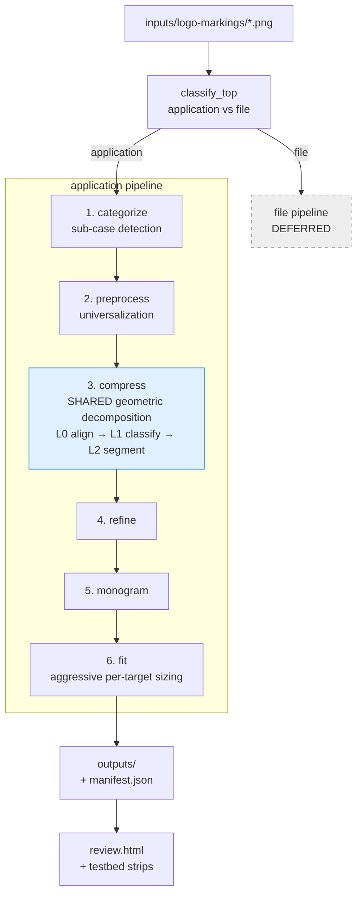

# iconograph-algorithm

A pipeline that decomposes application logos into a pixelated "abstract" +
monogram and ships them as a Fedora hicolor icon set. The architectural
inspiration is MIT Media Lab's algorithmic identity system: per-target
rescaling and recomposition instead of one canonical bitmap squeezed onto
every grid. Built on Python + OpenCV + scikit-image + scikit-learn + Pillow.

## Pipeline at a glance



## Pipeline stages

This README documents each stage's **interface** — input contract, output
contract, decision logic, invocation. Algorithm internals live in
`src/iconograph/**`; downstream stages should plan against this README, not
against upstream source (per CLAUDE.md H6 — "applies to LLM context too").

### Stage 1 — categorize (sub-case detection)

**Status:** complete. 25/25 fixtures match ground truth on
`python -m iconograph testbed categorize`.

**Input contract**

- `path: pathlib.Path` pointing at a PNG (any mode — `_load_rgba` handles
  RGB, RGBA, indexed-with-tRNS uniformly via `Pillow.Image.convert("RGBA")`).

**Output contract**

Returns a frozen `Categorization` dataclass with these fields:

| Field             | Type                              | Meaning                                                                                                |
|-------------------|-----------------------------------|--------------------------------------------------------------------------------------------------------|
| `routing`         | `"standard" \| "inverted" \| "burst"` | Which Stage 2 branch the dispatcher will call.                                                          |
| `color_essential` | `bool`                            | Chrome/Firefox signature — small central element inside multi-hue surround. When `True`, routing is always `"burst"`. |
| `is_compound`     | `bool`                            | Envelope + inner-glyph composition (Telegram disc+plane, Claude square+sunburst).                       |
| `precedence`      | `"outer" \| "inner" \| None`        | For compound logos: which sub-element wins. `None` for non-compound.                                    |
| `envelope_mask`   | `(H, W) bool \| None`              | Outer boundary mask when compound; `None` otherwise.                                                    |
| `inner_mask`      | `(H, W) bool \| None`              | Inner glyph/hole mask when compound; `None` otherwise.                                                  |

**Decision tree (routing)**


The post-strip-recategorize check (`psr` node) re-runs after Stage 2 would
strip the envelope: if the revealed inner is a sunburst (Claude), the final
routing is `burst`, not `inverted`. The check uses polygon-vertex count
≥ 20 *and* radial-profile coefficient-of-variation ≥ 0.20 together — either
signal alone misfires.

**Routing distribution across the 25 fixtures**

```
standard  = 15   discord, gmail, whatsapp, slack, figma, android-head_flat,
                 vscode, mastodon, obsidian, apple-rainbow, docker-mark-black,
                 homebrew, react, microsoft-edge, youtube
inverted  =  7   adobe-illustrator, instagram, linkedin, signal, spotify,
                 telegram, youtube-music
burst     =  3   claude, chrome, firefox
```

**Invocation (Python)**

```python
from pathlib import Path
from iconograph.application.categorize import categorize, load_rgba

cat = categorize(Path("fixtures/claude.png"))
# cat.routing == "burst"
# cat.is_compound == True
# cat.precedence == "inner"

rgba = load_rgba(Path("fixtures/claude.png"))   # canonical RGBA loader
# returns (H, W, 4) uint8 cropped to non-transparent bbox
```

**Invocation (testbed)**

```
python -m iconograph testbed categorize
```

Emits `testbed/categorize/grid.png` (3×3 routing confusion matrix +
per-fixture chips + check/cross). Exit code 0 iff every fixture matches
the ground truth in `fixtures/README.md`.

### Stage 2 — preprocess (universalization)

**Status:** complete. 25/25 fixtures pass the contract check on
`python -m iconograph testbed preprocess`.

Stage 2 takes `(Categorization, RGBA)` and dispatches to one of three
branches: `standard.universalize`, `inverted.universalize`, or the
three-phase `color_essential` pipeline (shade-collapse → frame →
feature-separate → compose). All branches converge at `frame_with_margin`,
producing a `(S, S, 3) uint8` square RGB image on white with a 10% margin
around the content's tight bounding box. Burst logos (Claude) fold into the
standard branch at Stage 2 because the mask-selection primitive is
identical to any inner-precedence compound; the burst identity flows
downstream via `cat.routing` for stages 4 and 5 to re-diverge on.

### Stage 3 — compress (geometric decomposition)

**Status:** L0 align + L1 primitive-classify + L2 feature-segment + L3 shape-fit (beam) complete.
The **active direction** is the **contour-driven decomposer** — D1 `contour_parse` (DONE) + D2/D3
`decompose` (functional v1) — which supersedes L3's whole-shape IoU beam. See *"D1–D3 — contour-driven
decomposer"* below; the full design, counterexample analysis, and tuning roadmap live in
`.claude/plans/review-current-progress-in-steady-goblet.md`.

Stage 3 "compresses" the universalized image into a minimal **geometric**
description — fitted primitives where one suffices, split sub-features where
none does — that the deferred fitting layer turns into the final pixel
abstract. It is a sub-pipeline of three implemented sub-stages, each cached
(H6) with its own testbed grid, plus a deferred fourth:

```
align (L0) → segment_prim_classify (L1) → L2_feature_segment (L2) → ┬ L3_fit (beam — IoU baseline)
                                                                    └ contour_parse (D1) → decompose (D2+D3)  ◀ ACTIVE
```

#### D1–D3 — contour-driven decomposer (the active decomposition paradigm)

The decomposer identifies **the clean primitives whose boundaries trace a shape's contour** —
triangles for straight/angular runs, ellipses for curved runs, combined by union (add) + negation
(subtract) — leaving **curve-junction labels** between primitives and a small **complex residual**.
*Why:* clean primitive identity enables idealized geometric pixel-art (a later render stage can
de-rotate / "linearize" e.g. Android's angled pills to straight rects, and overrepresent the
labelled curves), recovering structure that nearest-neighbour pixelation destroys. It is **not**
area-IoU blob-fitting (L3's muddy whole-shape fits — Docker's 7-part 0.92 whale — are the
anti-pattern). Built layer-by-layer; each layer is its own module + `*_debug.py` testbed.

- **D1 — `contour_parse.py` (`parse_shape`).** A feature mask → `ParsedShape{outer, holes}`. Each
  closed contour (via `approxPolyDP`) is split into maximal **straight** and **arc** runs (by the
  **sagitta ratio**, `STRAIGHT_DEV_FRAC=0.12` — semicircle≈0.50, 45°-arc≈0.10), each run + corner
  tagged **convex/concave** (curvature cross-product on a CW-normalized contour), and **interior
  holes** parsed (`RETR_CCOMP`). Types: `ContourSegment{kind, points, start, end, convex}`,
  `Corner{point, kind, convex}`, `ParsedShape` (in `common.py`). Run: `python -m iconograph.d1_debug`
  → strip: aligned | typed contour (straight=blue, convex arc=red, concave arc=purple, hole=amber,
  peak=green, valley=cyan). **DONE, validated, deterministic.**

- **D2+D3 — `decompose.py` (`decompose_shape(mask, min_feat, hint) → Decomposition`).** Edge-traces
  the boundary: a **convex arc → an ellipse that ADDs**; a **concave arc → an ellipse that
  SUBTRACTs** (so Apple's bite / a ring's inner edge carve generically — *no hint needed*, the
  convexity sign is the linchpin); an added ellipse that **spills** outside the shape is **carved by
  a half-plane** from a straight run (the whale hull's flat top → `ellipse − rect` = half-disc); the
  straight-edged remainder is covered by per-component best-fit primitives; **holes subtract** a
  fitted primitive; a **single-primitive `shape_hint`** is fit directly. Acceptance is **boundary
  alignment** (≥`ALIGN_FRAC` of a run within `ALIGN_TAU` px of the rasterized edge) AND ⊆ S; an
  un-traceable run → a **junction label**; coverage < `ADEQUATE_COV=0.90` leaves a **residual** mask.
  Runs on a padded canvas (spill room). `Decomposition{parts: list[Part], junctions, residual,
  coverage, …}`. Run: `python -m iconograph.d2_debug` → 4-panel: target | D1 contour | D2
  decomposition | old L3 beam. **Functional v1, deterministic.**

**Output contract:** `{ primitives (signed `Part`s — adds OR'd, then subtracts carved), junction
labels (curves the renderer overrepresents), residual mask (low-res render tier) }`.

**Render tiers — stage 6, NOT built:** R1 idealize/linearize primitives → crisp pixel-art; R2
overrepresent junctions; R3 low-res nearest-neighbour the residual, layered last.

**Current results (functional v1):** Apple → `body ellipse − bite − notch + leaf` (cov 0.88); Docker
whale → `hull(ellipse − carve) + fins` (0.86, 1 fin can fall to residual); dome 0.95; chrome sectors
parse convex-outer/concave-inner; youtube-music/discord holes subtract. **Tuning roadmap (pick-up
points):** the spill-carve + arc-ellipse fit are coverage-rough on hull/dome; **polygon recognition**
(try one dominant primitive, else **ear-triangles**) is not yet implemented (the straight remainder
uses per-component gap-fill); the **capsule** isn't reused for `rotated_rect` hints (bare rect).
Counterexample findings CE1–CE6 + NEW-1…7 are in the plan file.

The **L3 beam** (below) stays as a working IoU baseline the decomposer is compared against (`d2_debug`
panel 4) — a candidate to retire once D2's coverage polishes.

#### L0 — align

Axis-aligns dominant straight features so downstream primitive fits aren't
fighting a few degrees of rotation. Input and output are both the
`(S, S, 3) uint8` RGB square (contract-identical to Stage 2's output).
Testbed: `python -m iconograph testbed align`.

#### L1 — segment_prim_classify (primitive classification)

Binarizes, labels 8-connected components, and fits each region to the best
single primitive — **Circle / Rectangle / Triangle / Ellipse** — when one
clears the IoU gate; a region no primitive fits becomes an `L1Miss` carrying
its cropped mask forward.

**Output:** `SegmentClassification{image_shape, binarized, labels,
segments: list[Classified | L1Miss]}`, where
`Classified{primitive, bbox, color_rgb, area_px, iou}` and
`L1Miss{bbox, color_rgb, area_px, mask, best_attempt}`. The shared primitive
fitters and `iou_analytical` live in `compress/common.py` (reused by L2).
Testbed: `python -m iconograph testbed segment_prim_classify`.

#### L2 — L2_feature_segment (feature segmentation)

Splits each `L1Miss` — it does **not** fit it (fitting is L3's job). Per miss:

- **global structure kept whole** — `holed` (interior counterform),
  `sunburst` (radial spikes), or `ring` (a thin band around an empty centre);
- **a detected ring is polar-resolved** — `cv2.warpPolar` unrolls it about
  its centre, connected components in polar space split it into its
  sub-features (Chrome's 3 sectors, Edge's band, Signal's open arc), each
  inverse-warped back to cartesian and tagged `annular_band` /
  `annular_sector`. A seam stitch across θ=0/2π keeps a sector that crosses
  the +x axis as one feature;
- **otherwise body + appendages** — morphological opening peels thin
  protrusions (the body is kept exact as `mask − appendages`); each part is
  identified by its best-fitting primitive, with a `half_circle` fallback,
  else `defer`.

A cross-miss pre-pass groups shared-centre misses that tile one ring
(Chrome's sectors arrive as three separate `L1Miss`es) before resolving.

**Output:** `FeatureSegmentation{image_shape, segments: list[Classified |
Feature]}`, where `Feature{mask, bbox, kind, color_rgb, best_fit_iou,
shape_hint}`, `kind ∈ {local, global, defer}`, and `shape_hint` (e.g.
`circle`, `rotated_rect`, `half_circle`, `annular_sector`, `holed`) routes
the deferred fitter. Testbed: `python -m iconograph testbed L2_feature_segment`
— a 3-panel strip per fixture (aligned | L1 primitives | L2 features) plus
`grid.png`.

#### L3 — L3_fit (geometric shape fitting)

L3 turns every miss-derived `Feature` into a *construction* — signed primitives
(rotated rectangles / ellipses / triangles, circles) combined by union (add) and
negation (subtract), overlap allowed — that reconstructs the shape. Two passes per
feature: a bounded **beam search** (greedy with back-stepping) adds a primitive over the
uncovered residual or subtracts one over the spilled residual, scoring the *whole*
construction's IoU so overshoot is safe (a later subtract carves it); then a **cleanup**
pass drops redundant parts (backward elimination — the "several rectangles on one spot"
case) and gap-fills any remaining hole (the no-disjoint / arc-coverage guarantee). The
fit runs on a padded canvas so an enclosing primitive can overshoot into background and
be carved rather than silently clipped. The L2 `shape_hint` seeds the search
(single-primitive → 1-part fit; `half_circle` → enclosing circle); composite hints
(`holed` / `ring` / `sunburst` / `annular_*`) cold-start in v1 — dedicated templates are
a later pass.

**Deferral is a fit-adequacy decision:** a feature whose cleaned construction stays below
`ADEQUATE_IOU` becomes a `Deferral` (carrying its mask forward) rather than a forced
low-quality shape. This supersedes L2's `kind="defer"` tag, which now only signals "no
hint → cold start."

**Output:** `FittedDecomposition{image_shape, shapes: list[Classified | FittedShape |
Deferral]}`, where `FittedShape{bbox, color_rgb, parts, iou, shape_hint}` and
`Part{primitive, op ∈ {add, subtract}}` (rotated primitives + the construction algebra
live in `compress/common.py`). Determinism (H8): fixed-order candidates + total
`_part_key` tie-breaks, no RNG. Validated by the direct-run harness `python -m
iconograph.l3_debug` (default fixtures: android-head_flat, gmail, obsidian), which writes
a 4-panel strip per fixture (aligned | L2 features | L3 pass-1 | L3 pass-2) to
`testbed/L3_fit/`; full-testbed wiring is deferred.

### Stage 4 — refine

**Status:** not yet implemented.

Post-quantization cleanup: stray-pixel snapping, isolated-pixel artifact
removal, minimum-feature-size enforcement per hicolor target, edge-aware
corrections. Mostly shared logic in `refine/common.py`; class-specific
passes (e.g. radial-symmetry preservation for burst) only where shared
logic visibly fails on a sub-case.

### Stage 5 — monogram (selection + generation)

**Status:** not yet implemented.

Pick the monogram glyph (extracted letter, embedded mark, or
filename-derived fallback) and render it at canonical working resolution.
Per-class: `inverted` uses a different luminance threshold for letter
extraction; `monogram-only` logos forward their own glyph unchanged;
`standard` logos go through connected-component / OCR letter extraction.

### Stage 6 — fit (aggressive per-target sizing)

**Status:** not yet implemented.

For each Fedora hicolor size (16, 22, 24, 32, 48, 64, 128, 256), search
over `(scale, x-offset, y-offset)` to maximize the proportion of the N×N
canvas occupied by ink, subject to: tight bounding-box preservation,
minimum legible monogram glyph height per target, and a per-size padding
floor. Per-target rasterization happens here. Writes the Fedora hicolor
tree + updates `manifest.json`.

## File-icon pipeline

**Deferred** until the application pipeline ships. `src/iconograph/file/`
is a stub directory; `src/iconograph/classify_top.py` routes every
current fixture to `"application"` and raises `NotImplementedError` for
`"file"` so the unimplemented boundary surfaces in stack traces rather
than being silently absorbed.

## CLI

```
python -m iconograph build                  # batch over inputs/logo-markings/, skip unchanged
python -m iconograph build --force          # reprocess everything
python -m iconograph build --only "<glob>"  # reprocess matching inputs
python -m iconograph review                 # regenerate review.html
python -m iconograph testbed <stage>        # in-development stage runner
python -m iconograph bench [<stage>] [--serial]   # time the implemented stages (H1 baseline)
```

Currently wired testbed stages: `categorize`, `preprocess`, `align`,
`segment_prim_classify`, `L2_feature_segment`. Others return
`not implemented` until their stage lands. The single-process
`l2seg_debug` module (`python -m iconograph.l2seg_debug [stem ...]`) is a
fast numeric L2 report + `--dump <stem>` overlay for tight iteration
without forking a worker pool.

## Repository layout

```
src/iconograph/
    __main__.py            CLI entrypoint
    pipeline.py            top-level dispatch (application vs file)
    classify_top.py        icon-class detector
    manifest.py            hash + skip-don't-rebuild (per H8)
    review.py              review.html generator
    testbed.py             cached-stage runner + comparison-strip emitter
    application/
        pipeline.py        stage 1 → 6 orchestrator
        categorize.py      Stage 1
        preprocess/        Stage 2 — standard.py, inverted.py, color_essential.py, common.py
        compress/          Stage 3 — align.py (L0), segment_prim_classify.py (L1),
                                     L2_feature_segment.py (L2), common.py (shared fitters)
        refine/            Stage 4 — common.py, burst.py
        monogram/          Stage 5 — standard.py, inverted.py, common.py
        fit/               Stage 6 — search.py, compose.py, common.py
    file/                  DEFERRED
fixtures/                  ≥20 reference logos spanning sub-cases (per H9)
inputs/logo-markings/      user-provided, gitignored
outputs/                   generated, gitignored
.cache/stages/             per-fixture intermediate outputs (per H6), gitignored
testbed/                   in-development comparison strips (per H7), gitignored
```
