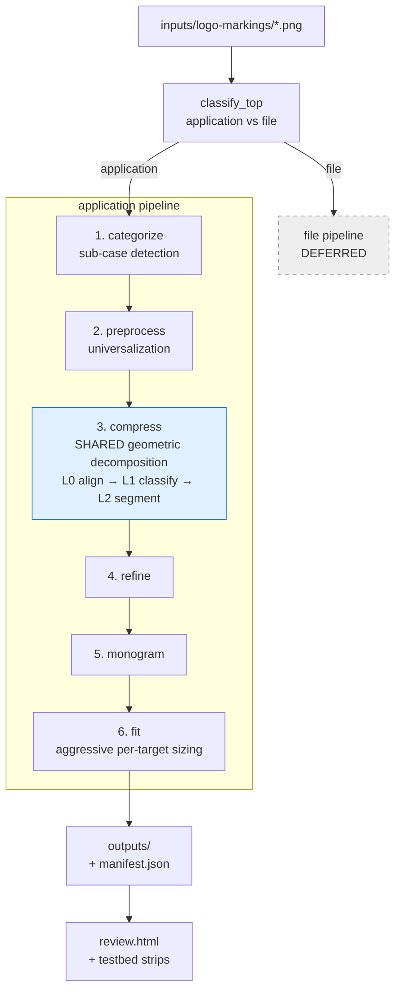

# iconograph-algorithm

A pipeline that decomposes application logos into a pixelated "abstract" +
monogram and ships them as a Fedora hicolor icon set. The architectural
inspiration is MIT Media Lab's algorithmic identity system: per-target
rescaling and recomposition instead of one canonical bitmap squeezed onto
every grid. Built on Python + OpenCV + scikit-image + scikit-learn + Pillow.

## Pipeline at a glance



## Pipeline stages

This README documents each stage's **interface** — input contract, output
contract, decision logic, invocation. Algorithm internals live in
`src/iconograph/**`; downstream stages should plan against this README, not
against upstream source (per CLAUDE.md H6 — "applies to LLM context too").

### Stage 1 — categorize (sub-case detection)

**Status:** complete — 25/25 original fixtures match ground truth on
`python -m iconograph testbed categorize`. The 5 later additions (mathematica, electron,
medium-m, vue, reddit-snoo) route with documented caveats (see `fixtures/README.md`):
electron + vue currently yield 0 L2 Features downstream (an open stage-1/2 routing item,
parked), and the new rows' flag columns are estimates.

**Input contract**

- `path: pathlib.Path` pointing at a PNG (any mode — `_load_rgba` handles
  RGB, RGBA, indexed-with-tRNS uniformly via `Pillow.Image.convert("RGBA")`).

**Output contract**

Returns a frozen `Categorization` dataclass with these fields:

| Field             | Type                              | Meaning                                                                                                |
|-------------------|-----------------------------------|--------------------------------------------------------------------------------------------------------|
| `routing`         | `"standard" \| "inverted" \| "burst"` | Which Stage 2 branch the dispatcher will call.                                                          |
| `color_essential` | `bool`                            | Chrome/Firefox signature — small central element inside multi-hue surround. When `True`, routing is always `"burst"`. |
| `is_compound`     | `bool`                            | Envelope + inner-glyph composition (Telegram disc+plane, Claude square+sunburst).                       |
| `precedence`      | `"outer" \| "inner" \| None`        | For compound logos: which sub-element wins. `None` for non-compound.                                    |
| `envelope_mask`   | `(H, W) bool \| None`              | Outer boundary mask when compound; `None` otherwise.                                                    |
| `inner_mask`      | `(H, W) bool \| None`              | Inner glyph/hole mask when compound; `None` otherwise.                                                  |

**Decision tree (routing)**


The post-strip-recategorize check (`psr` node) re-runs after Stage 2 would
strip the envelope: if the revealed inner is a sunburst (Claude), the final
routing is `burst`, not `inverted`. The check uses polygon-vertex count
≥ 20 *and* radial-profile coefficient-of-variation ≥ 0.20 together — either
signal alone misfires.

**Routing distribution across the original 25 fixtures** (the 5 later additions are
documented per-row in `fixtures/README.md`; current totals there: standard 19 / inverted 8 / burst 3)

```
standard  = 15   discord, gmail, whatsapp, slack, figma, android-head_flat,
                 vscode, mastodon, obsidian, apple-rainbow, docker-mark-black,
                 homebrew, react, microsoft-edge, youtube
inverted  =  7   adobe-illustrator, instagram, linkedin, signal, spotify,
                 telegram, youtube-music
burst     =  3   claude, chrome, firefox
```

**Invocation (Python)**

```python
from pathlib import Path
from iconograph.application.categorize import categorize, load_rgba

cat = categorize(Path("fixtures/claude.png"))
# cat.routing == "burst"
# cat.is_compound == True
# cat.precedence == "inner"

rgba = load_rgba(Path("fixtures/claude.png"))   # canonical RGBA loader
# returns (H, W, 4) uint8 cropped to non-transparent bbox
```

**Invocation (testbed)**

```
python -m iconograph testbed categorize
```

Emits `testbed/categorize/grid.png` (3×3 routing confusion matrix +
per-fixture chips + check/cross). Exit code 0 iff every fixture matches
the ground truth in `fixtures/README.md`.

### Stage 2 — preprocess (universalization)

**Status:** complete — 25/25 original fixtures pass the contract check on
`python -m iconograph testbed preprocess` (same later-additions caveat as Stage 1:
electron/vue universalize but their thin strokes defer at L2).

Stage 2 takes `(Categorization, RGBA)` and dispatches to one of three
branches: `standard.universalize`, `inverted.universalize`, or the
three-phase `color_essential` pipeline (shade-collapse → frame →
feature-separate → compose). All branches converge at `frame_with_margin`,
producing a `(S, S, 3) uint8` square RGB image on white with a 10% margin
around the content's tight bounding box. Burst logos (Claude) fold into the
standard branch at Stage 2 because the mask-selection primitive is
identical to any inner-precedence compound; the burst identity flows
downstream via `cat.routing` for stages 4 and 5 to re-diverge on.

### Stage 3 — compress (geometric decomposition)

**Status:** L0 align + L1 primitive-classify + L2 feature-segment complete. The **contour-driven
decomposer** — D1 `contour_parse` (DONE) + D2/D3 `decompose` — is the **mature primary path**: most
fixtures decompose to **≥0.85 IoU as clean, contiguous constructions** (**circle-first** arc-trace +
spill-carve + notch-subtract + **recursive hole decomposition** (multi-primitive counter carves, incl.
**negative CSG groups** for arch-bearing counters) + annular ring/sector + **rrect annulus** + holed
fill-fit + **primitive-union / skeleton / block-carve / local-feature discovery** + iterative
contour-refinement + a **structure-first `_post_prune`**, all chosen through one **boundary-aware**
`min(area, boundary)` arbitration with a structured-annulus + **parsimony** preference). Sub-adequate
features additionally fire the **`diff_fit` refiner** — test-time differentiable CSG optimization
(torch CPU, NO training; lazy optional import) that jointly polishes the top deterministic candidates
and competes through the same arbitration. **Woven multi-ring** shapes (react) use **per-group CSG**
(`Part.group`); a **Wedge** (pie-sector) primitive is in the vocabulary. The **L3 beam**
(`L3_fit`) is kept *only* as the `testbed decompose --panels` panel-4
baseline — whole-shape IoU **blob-fitting**, **never reused by D2** (it breaks contiguity). See
*"D1–D3 — contour-driven decomposer"* below for the full design, per-fixture results, and the
**Next (future sessions)** roadmap.

Stage 3 "compresses" the universalized image into a minimal **geometric**
description — fitted primitives where one suffices, split sub-features where
none does — that the deferred fitting layer turns into the final pixel
abstract. It is a sub-pipeline of three implemented sub-stages, each cached
(H6) with its own testbed grid, plus a deferred fourth:

```
align (L0) → segment_prim_classify (L1) → L2_feature_segment (L2) → ┬ L3_fit (beam — baseline ONLY, `--panels`)
                                                                    └ contour_parse (D1) → decompose (D2+D3)  ◀ ACTIVE
                                                                        └ diff_fit (gated test-time refiner)
```

#### D1–D3 — contour-driven decomposer (the active decomposition paradigm)

The decomposer identifies **the clean primitives whose boundaries trace a shape's contour** —
triangles for straight/angular runs, ellipses for curved runs, combined by union (add) + negation
(subtract) — leaving **curve-junction labels** between primitives and a small **complex residual**.
*Why:* clean primitive identity enables idealized geometric pixel-art (a later render stage can
de-rotate / "linearize" e.g. Android's angled pills to straight rects, and overrepresent the
labelled curves), recovering structure that nearest-neighbour pixelation destroys. It is **not**
area-IoU blob-fitting (L3's muddy whole-shape fits — Docker's 7-part 0.92 whale — are the
anti-pattern). Built layer-by-layer; each layer is its own module + `*_debug.py` testbed.

- **D1 — `contour_parse.py` (`parse_shape`).** A feature mask → `ParsedShape{outer, holes}`. Each
  closed contour (via `approxPolyDP`) is split into maximal **straight** and **arc** runs (by the
  **sagitta ratio**, `STRAIGHT_DEV_FRAC=0.12` — semicircle≈0.50, 45°-arc≈0.10), each run + corner
  tagged **convex/concave** (curvature cross-product on a CW-normalized contour), and **interior
  holes** parsed (`RETR_CCOMP`). Types: `ContourSegment{kind, points, start, end, convex}`,
  `Corner{point, kind, convex}`, `ParsedShape` (in `common.py`). Run: `python -m iconograph.d1_debug`
  → strip: aligned | typed contour (straight=blue, convex arc=red, concave arc=purple, hole=amber,
  peak=green, valley=cyan). **DONE, validated, deterministic.**

- **D2+D3 — `decompose.py` (`decompose_shape(mask, min_feat, hint, ring, bbox_xy) → Decomposition`).** Edge-traces
  the boundary: a **convex arc → a primitive that ADDs**; a **concave arc → a primitive that
  SUBTRACTs** (so Apple's bite / a ring's inner edge / a letterform counter carve generically — *no
  hint needed*, the convexity sign is the linchpin). The arc model is **circle-FIRST** (`_fit_arc_prim`):
  a **Kasa least-squares circle** (`_fit_arc_circle`, `np.linalg.lstsq` — cv2 has no LSQ circle fit)
  when the run is genuinely circular (`rmse ≤ max(ARC_CIRCLE_RMSE_PX, ARC_CIRCLE_RMSE_FRAC·r)`), else
  the bbox-constrained ellipse — because `cv2.fitEllipse` is **ill-conditioned on partial arcs** (a
  half-circle arch run balloons into an eccentric runaway that the spill gate then rejects, collapsing
  the trace; the 3-dof circle is well-conditioned on the same points, and a contour-anchored circle is
  what the render tier idealizes best). Arc admission is a **relative AND absolute floor**
  (`MIN_ARC_FRAC=0.02` of perimeter, run length ≥ `ARC_MIN_RUN_MULT·min_feat`) — the old 0.05 cliff
  silently deleted counter arcs and crown scallops. An added arc primitive that **spills** outside the
  shape is **carved by a half-plane** from a straight run (the whale hull's flat top → `ellipse − rect`
  = half-disc) and remaining **interior** spill (an arch circle's lower half dipping into a concave leg
  gap no half-plane can reach) by **eats-guarded primitive subtracts** — both BEFORE the group spill
  verdict, so a carvable construction isn't thrown away; the
  straight-edged remainder is covered by per-component best-fit primitives; a **concave straight
  notch** (an over-covered spill component) is carved by an `approxPolyDP` **triangle SUBTRACT** —
  inscribed, eats-guarded (the Gmail M's V); **holes subtract** a fitted primitive, or — when one
  primitive can't match (`_fit_hole_parts`) — a **depth-1 recursive `decompose_shape` on the hole
  crop**: an all-add counter construction flips flat by De Morgan (each add → a parent-group subtract);
  one that needs its own subtracts (a letterform arch = ring − inner) lands VERBATIM in a **negative
  CSG group** that `_compound_mask` carves from the positive groups' union (mastodon's m = rect block +
  arch circles − counter circles − gap rect, exactly the hand-annotated construction); a
  **parallel-run stroke candidate** (`_fit_stroke_rects`) pairs near-parallel straight D1 runs (outer
  AND hole contours) at consistent width into **bars whose long edges coincide with the runs** — a
  `RotatedRectangle`, or a `RoundedRectangle` capsule when rounded end-caps fit better — then finishes
  with the shared fill/hole-carve/spill machinery (vscode's X strokes + bracket bar → refined to
  0.98/0.90, winning over the 0.85 triangle-carve with the semantically right identity); a
  **single-primitive `shape_hint`** is fit directly (`rotated_rect` probes rounded, sharp, AND a
  forced full capsule — `corner_radius = min(w, h)/2` on the sharp fit's geometry, since the rounded
  fitter's own corner estimate under-rounds true capsules: android's antennae 0.34 vs 0.65 boundary) —
  and an adequate single (min ≥ `DIFF_FIRE_THRESH`) returns early, while a SUB-adequate single falls
  through into the full candidate flow (trace + discovery + refiner) with the single kept in the pool
  — the old unconditional early-exit bypassed the fire gate on exactly the features that needed it
  (android's round-capped antennae at 0.47 → 0.78); a **`holed` / annular `shape_hint`** builds a
  **fill-fit ring** (`_fit_holed`: best primitive over the hole-FILLED body ADD − each detected hole
  SUBTRACT) and, when `RingGeom` is threaded, an **annular** construction (`Circle(outer) ADD −
  Circle(inner) SUBTRACT [− two radial half-plane SUBTRACTs]`, `_fit_annular`) — **both compete** with
  the edge-trace (so a ragged ring geometry can't beat a clean fill-fit; youtube-music's ring → 0.95). A
  **rounded-rect annulus** (`RoundedRect(outer) − RoundedRect(inner)`, `_fit_rr_annular`, near-square
  admitted via `min_aspect=1.0`) competes for annular hints too — instagram's squircle ring → **0.95
  (red→green)**, while a true circular ring keeps its `Circle` annulus (corner-radius / no-hole /
  solidity gates make it a no-op). For **hint=`None`** shapes a set of **discovery** candidates competes
  by the same `min`-key: a **primitive-union** (DT-peak circles + enclosing rect/tri/ellipse, area-greedy
  ⊕ boundary-aware better-of-both — slack's corner → circle+rect 0.60→0.95), a **skeleton-stroke** union
  (figma's pill), a **block-carve** (`block − exact D1 notch triangles` — gmail's M), and a
  **local-feature** union (filled body − fitted holes — react/slack/signal dots); a **parsimony**
  preference (fewest parts ≥2 within `PARSIMONY_TOL=0.03` of the best `min`) then favours the cleaner
  construction. **Woven multi-ring** shapes carve each other under one global subtract, so each ring is
  scoped to its own **CSG group** (`Part.group`): `_compound_mask` evaluates `(∪add − ∪sub)` per group
  then unions the groups (default group 0 = the flat `(∪add)−(∪sub)`, **byte-identical**), and a
  **symmetry-replicated rotated-ellipse orbit** detector (`_fit_rot_orbits`: `minEnclosingCircle` centre
  → `warpPolar` outer-radius profile → `numpy.fft.rfft` order-pick → envelope ellipse fit, one annulus
  per orbit in its own group) reaches **0.94** on react under grouped eval vs 0.49 flat, and a sibling
  **radial-spur** detector (`_fit_rot_spurs`: same `warpPolar` profile → `scipy.signal.find_peaks`
  peak-count order → one `RoundedRectangle` capsule blade per spike + a hub circle, gated on spike-spacing
  uniformity) turns claude's 12-spike **sunburst** into a clean 13-part burst (0.50→**0.78**). A
  **structured-construction preference** then selects the clean few-part annulus over a higher-fidelity
  many-part trace when it covers ≥ `STRUCT_MIN_AREA` and is within `STRUCT_TOL` of the best score
  (chrome's global ring `outer − inner − cuts` beats its 19-part local-ellipse trace). Each arc-ellipse fit is
  **bbox-constrained** (axis ≤ `AXIS_BBOX_FRAC` × the feature box, + a centre-escape reject) so a
  partial, ill-conditioned arc can't balloon. Acceptance is **global containment**: the convex-arc
  ellipses are carved (deterministic order), then kept as a group iff the carved construction's spill
  (`|outside S| / |construction|`) ≤ `ACCEPT_SPILL`; an un-traceable / un-carvable run → a **junction
  label**; coverage < `ADEQUATE_COV=0.90` leaves a **residual** mask. **The construction is then
  REFINED** while sub-adequate: the trace loops its own contour-fit passes over the shrinking residual
  (under-coverage → a best-fit ADD; over-coverage → a generalized eats-guarded SUBTRACT,
  `_best_overcover_prim`; both net-positive-guarded, bounded by `REFINE_MAX_ITERS`/`MIN_REFINE_GAIN`) —
  filling under-carved counters and missing negates while staying **one contiguous, contour-aligned
  piece** (deliberately *not* the L3 IoU-beam, which scatters non-contiguous blobs). A trace that piles
  past `TRACE_PRUNE_PARTS` gets the **structure-first `_post_prune`** (common.py, H5-shared): a free
  pass drops parts costing < `PRUNE_TOL` of the min-IoU, then a budget pass removes the cheapest parts
  toward the cap while each step costs ≤ `STRUCT_PRUNE_STEP` — clean few-part structure is worth
  bounded fidelity (the chrome-annulus doctrine). The full **arbitration pool** per feature: the traced
  construction; the sub-adequate single-hint candidates (kept in the pool — no early exit below the fire
  gate); a straight-only trace and a whole-shape single primitive when sub-adequate; the discovery
  candidates (primitive-union / skeleton / block-carve / local-feature / **parallel-run strokes** /
  rot-orbits / rot-spurs / the annular family); and — below
  `DIFF_FIRE_THRESH=0.88` — the **`diff_fit` refined candidates**: test-time differentiable CSG
  optimization (`diff_fit.py`, torch CPU, NO training, lazily imported only when firing) that encodes
  the top-3 deterministic candidates as gated soft-SDF constructions (smooth per-group CSG matching
  `_compound_mask` incl. negative groups), descends a boundary-band-weighted soft-IoU with Adam on a
  bbox-cropped ≤160px grid, alternates deterministic residual **spawning** (no RNG — components +
  distance-transform argmax), optionally ties parameters across a detected **mirror axis**, decodes
  back to exact Parts (angle-snap to axis-aligned types; circle-snap), and re-scores HARD — refined
  candidates only append to the pool and win or lose through the same arbitration (H8: bitwise-identical
  reruns, verified). **Arbitration is
  contour-aware**: candidates rank by **`min(area IoU, boundary IoU)`** — Boundary IoU (Cheng 2021) is
  IoU restricted to a `d`-px boundary rim (`d = 0.02 × bbox diagonal`), so a high-area but boundary-wrong
  construction (a curved ellipse shaving a flat edge — Adobe's 'A' top; a local ellipse over a global
  ring) loses to the boundary-aligned one. The same `min` keys the spill-subtractor pick
  (`_best_overcover_prim`), flipping Adobe's flat top from a negated ellipse to a straight subtract.
  `coverage` (area IoU) still drives the residual/adequacy gates; `boundary_cov` rides along for display.
  Runs on a padded canvas (spill room). `Decomposition{parts: list[Part], junctions, residual,
  coverage (area IoU), boundary_cov, …}`. Run: **`python -m iconograph testbed decompose`** (cache-only;
  per-fixture `target | D2 overlay` + **split chips** top=area / bottom=boundary IoU, so a high-area /
  low-boundary false positive reads green-over-red) or **`python -m iconograph testbed decompose --panels`**
  (4-panel: target | D1 contour | D2 | old L3 beam). **Mature, deterministic.**

**Output contract:** `{ primitives (signed `Part`s with a CSG `group` — within each group adds OR'd then
subtracts carved; POSITIVE groups then unioned and NEGATIVE groups carved from that union (a counter
whose own construction needs subtracts); default group 0 = flat `(∪add)−(∪sub)`), junction labels (curves
the renderer overrepresents), residual mask (low-res render tier) }`. Vocabulary includes **Wedge**
(filled pie sector, `cv2.ellipse` partial-angle raster; `a1 > a0`, may exceed 360°).

**Render tiers — stage 6, NOT built:** R1 idealize/linearize primitives → crisp pixel-art; R2
overrepresent junctions; R3 low-res nearest-neighbour the residual, layered last.

**Pre-pivot results (historical record — the 25-fixture / 55-feature era):** Apple → `body ellipse − bite + leaf` (0.93; leaf 0.95); Docker
whale → `hull half-disc (ellipse − waterline carve) + remainder`, the old balloon eliminated (0.79;
tail is honest residual); android dome → half-disc via flat carve (0.95). The **iterative contour-refinement** then carves the
remaining negates/constructions — Adobe's "A" → `triangle − counter − leg-gap` (0.80→**0.97**, zero
residual) — and lifts nearly the whole sub-adequate set with **zero regressions**: telegram 0.78→0.95,
linkedin 0.69→0.91, obsidian 0.86→0.92, discord 0.80→0.92, chrome sectors 0.76→0.90, docker 0.79→0.89,
spotify ~0.66→0.88, vscode 0.75→0.87, gmail 0.74→0.86, figma 0.72→0.84, whatsapp-sector 0.56→0.82 — all
staying one contiguous piece. The
**balloon overshoot is fixed** (bbox-constrained fit + global-spill acceptance),
`ALIGN_TAU`/`ALIGN_FRAC`/`SPILL_FRAC` are retired into one spill gate. Of that era's tuning roadmap,
only **polygon recognition** (one dominant primitive, else **ear-triangles**) was never built as such —
and is now largely obviated by the block-carve, parallel-run stroke, and circle-first trace candidates
(gmail's M-valley, vscode, signal, obsidian all resolve through them); the **ring/annular fitter**
(`Circle(outer) − Circle(inner) [− radial cuts]` from L2's threaded `RingGeom`) plus the **`_fit_holed`
fill-fit**, both competing under the boundary-aware arbitration with a structured-annulus preference,
now render **chrome as a clean 3-sector global annulus** (selected over its 19-part trace, area 0.91→0.76
— a deliberate parsimony tradeoff), fix **youtube-music** (0.00→0.95) and the **whatsapp** band
(0.00→0.86), turn **instagram**'s squircle ring into a clean `RoundedRect − RoundedRect` annulus
(0.67→**0.95**, red→green), and hold microsoft-edge (0.87). **react**'s 3 woven orbit rings are now
**solved**: **per-group CSG** (`Part.group`, byte-identical) + the symmetry-replicated `_fit_rot_orbits`
detector turn the 16-part `holed` blob into 3 clean orbit annuli (0.56→**0.94**, 16→6 parts, red→green).
**claude**'s 12-spike **sunburst** is likewise decomposed by the sibling `_fit_rot_spurs` (peak-count
order → capsule-blade-per-spike + hub) — a 13-part radial burst (0.50→**0.78**, red→amber, boundary
0.14→0.57); **firefox**'s non-uniform burst is held byte-identical by the spacing-uniformity gate (it
stays the open sunburst case). The boundary-aware **primitive-union** also lifted a broad set (slack
corner 0.60→0.95, obsidian/docker/telegram/signal +0.1–0.2). That era closed at dataset mean area-IoU
**0.862→0.93** (46/55 green, n=25), clean fixtures zero-regression — superseded by the pivot numbers below.

**Generic-first hybrid + contour anchoring (the four-round 2026-06 pivot — CURRENT STATE):** the **`diff_fit` refiner**
(test-time differentiable CSG, torch CPU, no training — gated `< DIFF_FIRE_THRESH=0.88`, competing
through the unchanged arbitration) plus **recursive hole decomposition** (negative CSG groups) and the
**circle-first contour-anchored trace** (Kasa LSQ arc circles, the `MIN_ARC_FRAC` 0.05→0.02 cliff fix,
pre-gate interior-spill carving, the structure-first `_post_prune` budget pass) lifted the dataset from
mean area **0.923 → 0.963** (n=30 fixtures / 60 features, mean `min(area, boundary)` 0.804), with 41
features up in round 1, bounded trades in round 2, 5 up / 0 down in round 3 (the stroke candidate
also lifted adobe-illustrator 0.81→0.88, firefox, linkedin, medium-m — not a single-fixture win),
and 8 up / 0 down in round 4 (the capsule-single + no-early-exit fix: android antennae 0.47/0.45 →
0.78/0.75, slack's four pills, apple's leaf, reddit-snoo). The headline structural wins, all in
the user's hand-annotated construction class: **mastodon** 0.667/0.34 → **0.92/0.65** (the white m
finally resolved: rect block + 2 arch circles − counter circles − gap rect, carved as a recursive hole
construction); **homebrew** 0.855/0.48 → **0.97/0.77** (circle-per-crown-scallop + ear circles + handle,
13 parts); **vscode** 0.948/0.70 → **0.98/0.90** (the X strokes + bracket bar as parallel-run capsule bars, the
hand-annotated identity, beating the 0.85 triangle-carve honestly);
**medium-m** (new letterform-counter fixture) 0.94/0.78 → 0.96/0.83; plus broad boundary lifts
(apple 0.47→0.80, obsidian 0.64→0.80, reddit-snoo 0.48→0.83, firefox 0.48→0.77, claude 0.57→0.82,
mathematica 0.44/0.57→0.84/0.78). Known accepted variance: refined-candidate scores drift within a
small band when deterministic seeds shift (obsidian 0.896→0.802, mathematica#1 0.902→0.781 between
rounds — both still far above their 0.64/0.57 baselines); the arbitration floor is the deterministic
pool, which only improved.

**Next (future sessions):**
- **Upstream routing gaps (stage 1/2, NOT decompose):** electron (dark disc not stripped → thin orbit
  strokes deferred, no Feature reaches the orbit detector), vue (V-strokes deferred → 0 L2 Features —
  the stroke-glyph H9 exercise is pending), mathematica (inverted routing → annular_band features, no
  sunburst hint). These gate the H9 second positives for `_fit_rot_orbits` / stroke coordination.
- **Perf:** the README's compute-`recon`-once TODO got more load-bearing — `_post_prune`'s budget pass
  is O(n²) compound evals and the depth-1 hole recursion fires the diff refiner (mastodon ≈ 2–3 min
  cold; memoized per process). An incremental compound mask + a downsampled prune scorer are the two
  obvious wins before stage-6's 8-size loop.
- **`diff_fit` C5 (evidence-gated):** encode subtract-Circles as non-elongatable `kind="circle"` if the
  refiner is ever observed mangling shave-off circles (not seen so far — contour-anchored traces mostly
  clear the fire gate).
- **Wedge producer:** the Wedge primitive (+ SDF/encode/decode/reflect plumbing) is in the vocabulary
  but no deterministic candidate constructs one yet — the natural producer is the annular-sector path
  (`Circle − two half-planes ≡ Wedge`, a 1-part idealization the render tier prefers). Wire it when a
  sector fixture motivates it; until then the plumbing is dormant by design.
- **Sunburst follow-ups** (the spur detector itself is SHIPPED — see the historical record above):
  **firefox** (a non-uniform burst — the spacing-CV gate holds it byte-identical, so it needs its own
  variable-length / mixed-spike handling) and ≥1 more *uniform*-burst fixture (H9) so the spur
  methodology isn't a single-fixture win; likewise ≥1 more orbit/atom fixture for `_fit_rot_orbits`
  (both gated on the upstream routing fixes above — electron was meant to be the orbit second positive).
- **Decompose polish, still open:** compute `recon` once per call (incremental compound mask — matters
  for stage-6's 8 hicolor sizes); the optional annular → `compress/annular.py` split. **Reverted once,
  re-land separately if wanted:** deriving `AXIS_BBOX_FRAC` from the arc sagitta (measured mean-neutral;
  a deliberate area↔boundary/parsimony tradeoff, not a free cleanup).
- **Deferred pipeline stages**: 4 refine · 5 monogram · **6 aggressive-fit — the rendering phase**
  (per-target rasterization onto each hicolor grid + the two-tier render: idealized primitives + low-res
  residual). Then the **file-icon pipeline** (deferred until the application path ships clean outputs).

#### L0 — align

Axis-aligns dominant straight features so downstream primitive fits aren't
fighting a few degrees of rotation. Input and output are both the
`(S, S, 3) uint8` RGB square (contract-identical to Stage 2's output).
Testbed: `python -m iconograph testbed align`.

#### L1 — segment_prim_classify (primitive classification)

Binarizes, labels 8-connected components, and fits each region to the best
single primitive — **Circle / Rectangle / Triangle / Ellipse** — when one
clears the IoU gate; a region no primitive fits becomes an `L1Miss` carrying
its cropped mask forward.

**Output:** `SegmentClassification{image_shape, binarized, labels,
segments: list[Classified | L1Miss]}`, where
`Classified{primitive, bbox, color_rgb, area_px, iou}` and
`L1Miss{bbox, color_rgb, area_px, mask, best_attempt}`. The shared primitive
fitters and `iou_analytical` live in `compress/common.py` (reused by L2).
Testbed: `python -m iconograph testbed segment_prim_classify`.

#### L2 — L2_feature_segment (feature segmentation)

Splits each `L1Miss` — it does **not** fit it (fitting is L3's job). Per miss:

- **global structure kept whole** — `holed` (interior counterform),
  `sunburst` (radial spikes), or `ring` (a thin band around an empty centre);
- **a detected ring is polar-resolved** — `cv2.warpPolar` unrolls it about
  its centre, connected components in polar space split it into its
  sub-features (Chrome's 3 sectors, Edge's band, Signal's open arc), each
  inverse-warped back to cartesian and tagged `annular_band` /
  `annular_sector`. A seam stitch across θ=0/2π keeps a sector that crosses
  the +x axis as one feature;
- **otherwise body + appendages** — morphological opening peels thin
  protrusions (the body is kept exact as `mask − appendages`); each part is
  identified by its best-fitting primitive, with a `half_circle` fallback,
  else `defer`.

A cross-miss pre-pass groups shared-centre misses that tile one ring
(Chrome's sectors arrive as three separate `L1Miss`es) before resolving.

**Output:** `FeatureSegmentation{image_shape, segments: list[Classified |
Feature]}`, where `Feature{mask, bbox, kind, color_rgb, best_fit_iou,
shape_hint}`, `kind ∈ {local, global, defer}`, and `shape_hint` (e.g.
`circle`, `rotated_rect`, `half_circle`, `annular_sector`, `holed`) routes
the deferred fitter. Testbed: `python -m iconograph testbed L2_feature_segment`
— a 3-panel strip per fixture (aligned | L1 primitives | L2 features) plus
`grid.png`.

#### L3 — L3_fit (geometric shape fitting)

L3 turns every miss-derived `Feature` into a *construction* — signed primitives
(rotated rectangles / ellipses / triangles, circles) combined by union (add) and
negation (subtract), overlap allowed — that reconstructs the shape. Two passes per
feature: a bounded **beam search** (greedy with back-stepping) adds a primitive over the
uncovered residual or subtracts one over the spilled residual, scoring the *whole*
construction's IoU so overshoot is safe (a later subtract carves it); then a **cleanup**
pass drops redundant parts (backward elimination — the "several rectangles on one spot"
case) and gap-fills any remaining hole (the no-disjoint / arc-coverage guarantee). The
fit runs on a padded canvas so an enclosing primitive can overshoot into background and
be carved rather than silently clipped. The L2 `shape_hint` seeds the search
(single-primitive → 1-part fit; `half_circle` → enclosing circle); composite hints
(`holed` / `ring` / `sunburst` / `annular_*`) cold-start in v1 — dedicated templates are
a later pass.

**Deferral is a fit-adequacy decision:** a feature whose cleaned construction stays below
`ADEQUATE_IOU` becomes a `Deferral` (carrying its mask forward) rather than a forced
low-quality shape. This supersedes L2's `kind="defer"` tag, which now only signals "no
hint → cold start."

**Output:** `FittedDecomposition{image_shape, shapes: list[Classified | FittedShape |
Deferral]}`, where `FittedShape{bbox, color_rgb, parts, iou, shape_hint}` and
`Part{primitive, op ∈ {add, subtract}}` (rotated primitives + the construction algebra
live in `compress/common.py`). Determinism (H8): fixed-order candidates + total
`_part_key` tie-breaks, no RNG. Validated by the direct-run harness `python -m
iconograph.l3_debug` (default fixtures: android-head_flat, gmail, obsidian), which writes
a 4-panel strip per fixture (aligned | L2 features | L3 pass-1 | L3 pass-2) to
`testbed/L3_fit/`; full-testbed wiring is deferred.

### Stage 4 — refine

**Status:** not yet implemented.

Post-quantization cleanup: stray-pixel snapping, isolated-pixel artifact
removal, minimum-feature-size enforcement per hicolor target, edge-aware
corrections. Mostly shared logic in `refine/common.py`; class-specific
passes (e.g. radial-symmetry preservation for burst) only where shared
logic visibly fails on a sub-case.

### Stage 5 — monogram (selection + generation)

**Status:** not yet implemented.

Pick the monogram glyph (extracted letter, embedded mark, or
filename-derived fallback) and render it at canonical working resolution.
Per-class: `inverted` uses a different luminance threshold for letter
extraction; `monogram-only` logos forward their own glyph unchanged;
`standard` logos go through connected-component / OCR letter extraction.

### Stage 6 — fit (aggressive per-target sizing)

**Status:** not yet implemented.

For each Fedora hicolor size (16, 22, 24, 32, 48, 64, 128, 256), search
over `(scale, x-offset, y-offset)` to maximize the proportion of the N×N
canvas occupied by ink, subject to: tight bounding-box preservation,
minimum legible monogram glyph height per target, and a per-size padding
floor. Per-target rasterization happens here. Writes the Fedora hicolor
tree + updates `manifest.json`.

## File-icon pipeline

**Deferred** until the application pipeline ships. `src/iconograph/file/`
is a stub directory; `src/iconograph/classify_top.py` routes every
current fixture to `"application"` and raises `NotImplementedError` for
`"file"` so the unimplemented boundary surfaces in stack traces rather
than being silently absorbed.

## CLI

```
python -m iconograph build                  # batch over inputs/logo-markings/, skip unchanged
python -m iconograph build --force          # reprocess everything
python -m iconograph build --only "<glob>"  # reprocess matching inputs
python -m iconograph review                 # regenerate review.html
python -m iconograph testbed <stage>        # in-development stage runner
python -m iconograph bench [<stage>] [--serial]   # time the implemented stages (H1 baseline)
```

Currently wired testbed stages: `categorize`, `preprocess`, `align`,
`segment_prim_classify`, `L2_feature_segment`, `decompose` (+ `decompose --panels`
for the 4-panel D1/D2/L3 view). Others return `not implemented` until their stage
lands. Single-process debug modules give tight iteration without forking a worker
pool: `python -m iconograph.l2seg_debug [stem ...]` (fast numeric L2 report +
`--dump <stem>` overlay), `python -m iconograph.d1_debug` (D1 typed-contour strips),
`python -m iconograph.l3_debug` (legacy L3-beam baseline), and
`python -m iconograph.diff_debug [stem ...] [--twice]` (the diff_fit refiner harness;
`--twice` runs the refiner twice and asserts byte-identical decodes — the H8 check).
The refiner's torch dependency is an optional extra: `pip install -e .[diff]` —
lazily imported only when a feature actually fires the refiner, so the core
pipeline runs without it.

## Repository layout

```
src/iconograph/
    __main__.py            CLI entrypoint
    pipeline.py            top-level dispatch (application vs file)
    classify_top.py        icon-class detector
    manifest.py            hash + skip-don't-rebuild (per H8)
    review.py              review.html generator
    testbed.py             cached-stage runner + comparison-strip emitter
    l2seg_debug.py         single-process L2 debug report
    d1_debug.py            D1 typed-contour debug strips
    l3_debug.py            legacy L3-beam debug harness (baseline only)
    diff_debug.py          diff_fit refiner harness (--twice = H8 determinism check)
    application/
        pipeline.py        stage 1 → 6 orchestrator
        categorize.py      Stage 1
        preprocess/        Stage 2 — standard.py, inverted.py, color_essential.py, common.py
        compress/          Stage 3 — align.py (L0), segment_prim_classify.py (L1),
                                     L2_feature_segment.py (L2), L3_fit.py (beam — baseline only),
                                     contour_parse.py (D1), decompose.py (D2+D3 — ACTIVE),
                                     diff_fit.py (test-time differentiable refiner — optional torch,
                                     lazy import), common.py (primitives incl. Wedge, negative CSG
                                     groups, _post_prune, _fit_arc_circle; shared fitters, H5)
        refine/            Stage 4 — common.py, burst.py
        monogram/          Stage 5 — standard.py, inverted.py, common.py
        fit/               Stage 6 — search.py, compose.py, common.py
    file/                  DEFERRED
fixtures/                  ≥20 reference logos spanning sub-cases (per H9)
inputs/logo-markings/      user-provided, gitignored
outputs/                   generated, gitignored
.cache/stages/             per-fixture intermediate outputs (per H6), gitignored
testbed/                   in-development comparison strips (per H7), gitignored
```
